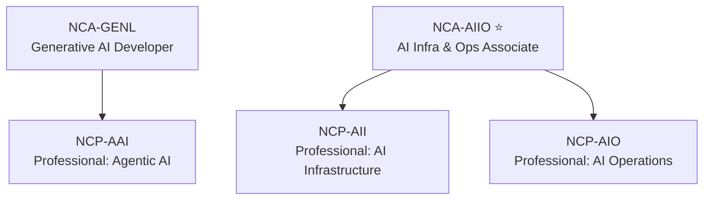
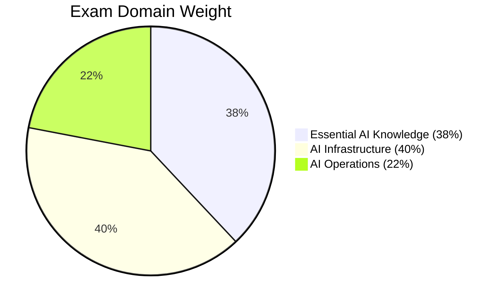
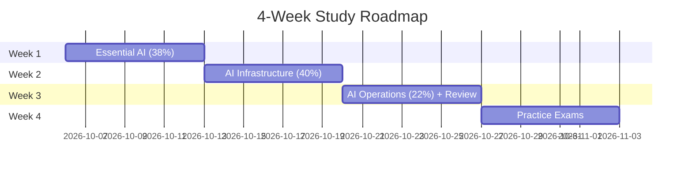

# Module 00 — Exam Overview & Study Setup (ပြည့်စုံသော ရှင်းလင်းချက်)

> ဤ module ၏ ရည်ရွယ်ချက် — စာမေးပွဲ မည်သို့ ဖွဲ့စည်းထားသည်၊ ဘာကို မျှော်လင့်ရမည်၊ မည်သို့ ပြင်ဆင်ရမည် ဆိုသည်ကို အပြည့်အစုံ နားလည်စေရန် ဖြစ်ပါသည်။

---

## 1. ပြဿနာ — ဘာကြောင့် ဤ module ကို အရင် လေ့လာရသလဲ

NCA-AIIO စာမေးပွဲသည် စာကျက်ပြီး ဖြေရုံမျှ မဟုတ်ပါ — scenario အခြေပြု မေးခွန်းများကို 60 မိနစ်အတွင်း 50 ခု ဖြေဆိုရပြီး တစ်မေးခွန်းလျှင် ပျမ်းမျှ ~72 စက္ကန့်သာ ရှိပါသည်။ စာမေးပွဲ ဖွဲ့စည်းပုံ၊ domain အလေးချိန်၊ မေးခွန်း ပုံစံကို ကြိုတင် မသိပါက —

- အလေးချိန် 40% ရှိသော Infrastructure domain အစား ကိုယ်နှစ်သက်ရာ domain တွင်သာ အချိန် ကုန်တတ်ပါသည်
- အချိန် စီမံခန့်ခွဲမှု မှား၍ နောက်ဆုံး မေးခွန်းများ မဖြေလိုက်ရခြင်း ဖြစ်တတ်ပါသည်
- NVLink/InfiniBand ကဲ့သို့ ဆင်တူသော သတ်မှတ်ချက် အတွဲများတွင် ရှုပ်၍ အမှား ရွေးတတ်ပါသည်

ထို့ကြောင့် ဤ module သည် လေ့လာရေး အချိန်ကို အကျိုးရှိစွာ ခွဲဝေပေးမည့် မြေပုံ ဖြစ်ပါသည်။

---

## 2. NCA-AIIO ဆိုတာ ဘာလဲ (အဓိက သဘောတရား)

**NCA-AIIO (NVIDIA-Certified Associate: AI Infrastructure and Operations)** သည် NVIDIA ၏ entry-level certification ဖြစ်ပြီး၊ AI ကို run ရန် လိုအပ်သော hardware, network, data center, software operation အကြောင်းကို နားလည်ကြောင်း အတည်ပြုသည့် အောင်လက်မှတ် ဖြစ်ပါသည်။

ဤ certification သည် model တည်ဆောက်သူများ (data scientist) အတွက် မဟုတ်ဘဲ — AI model များကို ထိရောက်စွာ run နိုင်ရန် infrastructure ကို ဆောက်လုပ်၊ စီမံခန့်ခွဲ၊ စောင့်ကြည့်ရသော IT professional များအတွက် ဖြစ်ပါသည်။

**ဘာကြောင့် လိုအပ်ရသလဲ** — AI ခေတ်တွင် data center တစ်ခု၏ ပုံစံ ပြောင်းလဲသွားပါသည်။ GPU rack တစ်ခုသည် ရုံးအဆောက်အဦ တစ်ခုလောက် ပါဝါ စားသုံးနိုင်ပြီး၊ training cluster အတွက် InfiniBand ဘာကြောင့် လိုအပ်ရပြီး inference fleet အတွက် မလိုအပ်ရသည်၊ GPU utilization ဘာကြောင့် ကျဆင်းသည် စသည်တို့ကို ရှင်းပြနိုင်သော ပညာရှင် လိုအပ်လာပါသည်။

---

## 3. NVIDIA Certification မိသားစု — မည်သည့်နေရာတွင် ရှိသလဲ



| Certification | ပန်းတိုင် ပရိသတ် | အဓိက အကြောင်းအရာ |
|---|---|---|
| NCA-GENL | Generative AI developer | LLM တည်ဆောက်ခြင်း |
| **NCA-AIIO** | **IT / infrastructure / ops** | **hardware, network, DC, operations** |
| NCP-AAI | Agentic AI engineer | agent system တည်ဆောက်ခြင်း |
| NCP-AII | Professional — AI Infrastructure | cluster deploy/configure |
| NCP-AIO | Professional — AI Operations | monitoring/troubleshooting/operations |

NCA-AIIO ပြီးပါက NCP-AII (deploy ဘက်) သို့မဟုတ် NCP-AIO (operation ဘက်) သို့ ဆက်လက် တက်ရောက်နိုင်ပါသည်။ ပရော်ဖက်ရှင်နယ် အဆင့်သို့ မတက်မီ အခြေခံ ခိုင်မာအောင် စစ်ဆေးခြင်းသည် စီးပွားရေးအရ အကျိုးရှိပါသည် (Professional စာမေးပွဲ များသည် ပိုမို စျေးကြီးပြီး ခက်ခဲပါသည်)။

---

## 4. Exam Logistics — အသေးစိတ်

| အချက် | တန်ဖိုး |
|---|---|
| မေးခွန်း အရေအတွက် | 50 |
| အချိန် | 60 မိနစ် (~72 စက္ကန့်/မေးခွန်း) |
| Format | Multiple choice (single response + multiple response ရောနှော) |
| Delivery | Online, remote-proctored (Certiverse platform) |
| ကုန်ကျစရိတ် | $125 (official course bundle နှင့် ဆို $150) |
| Pass mark | NVIDIA က မထုတ်ပြန် — practice တွင် 70-72%+ အမြဲ ရအောင် လေ့ကျင့် |
| ရလဒ် | Pass / Fail (score breakdown မပြ) |
| သက်တမ်း | 2 နှစ် (retake ဖြင့်သာ ပြန်လည်) |
| ဘာသာစကား | English |
| Prerequisite | တရားဝင် prerequisite မသတ်မှတ်ထားပါ — သို့သော် data center infrastructure အခြေခံ (server, network, storage, power, cooling) ကို ကြိုတင် နားလည်ထားရန် အကြံပြုပါသည် |

### မှတ်ပုံတင်ခြင်း Workflow

```
① certiverse.nvidia.com တွင် account ဖွင့်
② voucher ဝယ်ယူ (NVIDIA training site မှ)
③ ရက်/အချိန် ရွေးချယ် မှတ်ပုံတင်
④ proctored environment ကြိုတင် စစ်ဆေး (24 နာရီ ကြို)
⑤ စာမေးပွဲ ဖြေဆို
⑥ Pass/Fail ရလဒ် ချက်ချင်း သိရှိ
```

- reschedule ကို 24 နာရီ ကြိုတင်ပါက အခမဲ့ ပြုလုပ်နိုင်ပါသည်
- မအောင်ပါက waiting period ရှိပြီး နောက် $125 ထပ်ကျပါသည်

### Proctor စည်းကမ်းများ
- webcam ဖြင့် စောင့်ကြည့်ခြင်း
- government-issued ID ပြရခြင်း
- တိတ်ဆိတ်သော အခန်း၊ ရှင်းလင်းသော စားပွဲ (စာရွက်/ဖုန်း/နားကြပ် မပါရ)

---

## 5. Exam Blueprint — ရည်မှန်းချက် အပြည့်အစုံ



### Domain 1: Essential AI Knowledge — 38% (≈19 မေးခွန်း)
- 1.1 NVIDIA software stack ကို AI environment တွင် ရှင်းပြနိုင်ခြင်း
- 1.2 Training နှင့် inference architecture requirement များကို နှိုင်းယှဉ်နိုင်ခြင်း
- 1.3 AI, machine learning, deep learning သဘောတရားများ ခွဲခြားနိုင်ခြင်း
- 1.4 AI လျင်မြန်စွာ တိုးတက်/လက်ခံလာရခြင်း အကြောင်းရင်းများ
- 1.5 AI use case နှင့် industry အဓိကများ
- 1.6 NVIDIA solution အမျိုးမျိုး၏ ရည်ရွယ်ချက်နှင့် အသုံးပြုမှု
- 1.7 AI development/deployment life cycle ၏ software component များ
- 1.8 GPU နှင့် CPU architecture ကို နှိုင်းယှဉ်ခြင်း

### Domain 2: AI Infrastructure — 40% (≈20 မေးခွန်း) ⭐ အလေးချိန် အများဆုံး
- 2.1 AI training task use case အလိုက် hardware requirement ခွဲခြားခြင်း
- 2.2 Use case အလိုက် GPU infrastructure ချဲ့ထွင်ခြင်း
- 2.3 Data center power နှင့် cooling requirement
- 2.4 On-prem vs cloud ၏ အားသာချက်/စိန်ခေါ်မှု/စဉ်းစားရမည့်အချက်
- 2.5 Accelerated infrastructure cluster ၏ component နှင့် စဉ်းစားရမည့်အချက်များ
- 2.6 Facility requirement များ
- 2.7 AI workload အတွက် networking requirement
- 2.8 DC networking protocol နှင့် key concept များ
- 2.9 High-speed DC network option များနှင့် အသုံးပြုမှု
- 2.10 DPU ၏ ရည်ရွယ်ချက်နှင့် အကျိုးကျေးဇူး

### Domain 3: AI Operations — 22% (≈11 မေးခွန်း)
- 3.1 AI data center management နှင့် monitoring အခြေခံ
- 3.2 AI cluster orchestration နှင့် job scheduling အခြေခံ
- 3.3 GPU monitoring ၏ key measure နှင့် criteria
- 3.4 Accelerated infrastructure virtualization စဉ်းစားရမည့်အချက်များ

**Domain အလိုက် ပြင်ဆင်မှု နည်းလမ်း** — Domain 2 သည် မေးခွန်း အများဆုံး ဖြစ်သော်လည်း Domain 1 နှင့် 3 ပေါင်းလျှင် 60% ရှိသောကြောင့် တစ်ခုတည်းကိုသာ အာရုံစိုက်ခြင်း မပြုပါနှင့်။ ကိုယ် အားနည်းသော domain ကို practice test ရလဒ်ဖြင့် ရှာဖွေပြီး ဦးစားပေး ပြန်ဖတ်ပါ။

---

## 6. မေးခွန်း ပုံစံနှင့် ဖြေဆို နည်းဗျူဟာ

မေးခွန်းများသည် တိုတောင်းပြီး scenario အခြေပြု များပါသည် — "training cluster အတွက် ဘယ် fabric ရွေးမလဲ"၊ "GPU temperature 83°C ရောက်နေပြီး SM clock ကျနေ — အရင် ဘာ စစ်မလဲ" စသည်ဖြင့် ဖြစ်ပါသည်။

### ဖြေဆို Workflow

```
မေးခွန်း ဖတ်
  ↓
"ဒါက training လား inference လား" ဆုံးဖြတ်
  ↓
keyword များ ရှာ — (fabric / power / MIG / DCGM / scale)
  ↓
option များ တစ်ခုချင်း ဖယ်ရှား
  ↓
သေချာပါက အဖြေ ရွေး / မသေချာပါက flag ပြီး ရှေ့ဆက်
```

### ရှုပ်ထွေးလေ့ရှိသော အတွဲများ (နှိုင်းယှဉ် ဇယား)

| ရှုပ်လေ့ရှိသော အတွဲ | ခွဲခြားချက် |
|---|---|
| NVLink vs InfiniBand | node အတွင်း (scale-up) vs node ကြား (scale-out) |
| MIG vs vGPU | hardware partition vs mediated time-share |
| BasePOD vs SuperPOD | validated pod vs multi-rack supercomputer |
| TensorRT vs Triton vs NIM | optimize engine vs serving server vs packaged microservice |
| Base Command Manager vs Platform | on-prem cluster OS vs cloud-managed service |
| DGX vs HGX | ပြီးပြည့်စုံ system vs OEM baseboard |

### အချိန် စီမံခန့်ခွဲမှု
- တစ်မေးခွန်းလျှင် ~72 စက္ကန့်
- ပထမ အကြိမ် ဖြတ်သန်းမှုတွင် လွယ်ကူသော မေးခွန်းများကို အရင် ဖြေ
- 30 မိနစ် ကျန်ချိန်တွင် flag ပြုလုပ်ထားသော မေးခွန်းများ ပြန်ဖြေ
- 5 မိနစ် ကျန်ချိန်တွင် မဖြေရသေးသော မေးခွန်းများ — guess မလုပ်ဘဲ မကျန်စေပါနှင့်

---

## 7. လက်တွေ့ ပြင်ဆင်မှု — 4-Week လေ့လာရေး အစီအစဉ် (စုစုပေါင်း ~40-50 နာရီ)

ဤစာမေးပွဲအတွက် စက်ပစ္စည်း ပြင်ဆင်ရန် မလိုအပ်ပါ — ပြင်ဆင်မှု ဆိုလိုသည်မှာ အချိန် စီမံခန့်ခွဲမှုနှင့် လေ့လာရေး material စီစဉ်မှု ဖြစ်ပါသည်။ အောက်ပါ gantt သည် 4 ပတ် အစီအစဉ် နမူနာ ဖြစ်ပြီး ကိုယ်ပိုင် အချိန်ဇယားနှင့် လိုက်လျောညီထွေ ပြောင်းလဲ အသုံးပြုနိုင်ပါသည်။



- **Week 1** — AI/ML/DL အခြေခံ၊ GPU vs CPU၊ NVIDIA software stack၊ training vs inference။ NVIDIA ၏ အခမဲ့ course "AI Infrastructure and Operations Fundamentals" (~7 နာရီ) ကို ပြီးအောင် ဖတ်ပါ — blueprint နှင့် တိုက်ရိုက် ကိုက်ညီပါသည်
- **Week 2** — platform မျိုးဆက်နှင့် scaling၊ power/cooling/facility၊ networking၊ DPU၊ on-prem vs cloud — အလေးချိန် အများဆုံး domain ဖြစ်၍ တစ်ရက်ချင်း နက်ရှိုင်းစွာ
- **Week 3** — monitoring/orchestration/virtualization — ပြီးလျှင် review
- **Week 4** — Practice exam 3 စုံ (timing ဖြင့်) — 70% အောက် ကျပါက weak domain ပြန်ဖတ်

### ပင်မ လေ့လာစရာ resource များ (အစဉ်လိုက်)

1. **NVIDIA AI Infrastructure and Operations Fundamentals** (အခမဲ့, ~7 နာရီ) — https://www.nvidia.com/en-us/training/ တွင် ရှာပါ
2. **NVIDIA Exam Study Guide PDF** (တရားဝင်, အခမဲ့) — https://www.nvidia.com/en-us/learning/certifications/associate-ai-inf-ops/
3. **Certiverse** (စာမေးပွဲ platform) — https://certiverse.nvidia.com
4. Suggested readings — DCGM documentation, Base Command docs, Kubernetes docs, Slurm docs, Docker "What Is a Container", NVIDIA MIG User Guide, Run:ai "6 Reasons for Low GPU Utilization"

---

## 8. လုပ်ငန်း လည်ပတ်မှု သတိပေးချက်များနှင့် အမှား ကြီးကြီးမားမား ရှောင်ရှားနည်း

1. **Practice မဖြေဘဲ ဖြေခြင်း** — 70%+ မရမချင်း practice test ဖြေပါ
2. **Hardware spec ကို စာကျက်ခြင်း** — ဂဏန်း အနည်းငယ်သာ လိုပါသည် (DGX B200 power, instance 7 ခု, bandwidth အဆင့်) — သို့သော် ဂဏန်းအမှန်များသည် model/version ပေါ် မူတည်၍ ပြောင်းလဲနိုင်သောကြောင့် official page တွင် အမြဲ ပြန်စစ်ပါ
3. **Domain တစ်ခုတည်းတွင် အချိန် ကုန်ခြင်း** — 40% ကို ဦးစားပေးရမည် မှန်သော်လည်း 38% နှင့် 22% ကို မလျစ်လျူရှုပါနှင့်
4. **Official course ကို မဖတ်ခြင်း** — NVIDIA-specific vocabulary လွဲနိုင်ပါသည်
5. **စာမေးပွဲ နေ့မှ ပထမဆုံး စစ်ဆေးခြင်း** — proctored environment ကို ကြိုတင် တစ်ရက်အလိုတွင် စမ်းသပ်ပြီး ID အသင့် ပြင်ထားပါ
6. **Scenario မေးခွန်းတွင် စကားလုံး လွဲဖတ်ခြင်း** — "NOT"၊ "BEST"၊ "FIRST" ကဲ့သို့ keyword များကို လျစ်လျူမရှုပါနှင့်

⚠️ **Exam trap** — စာမေးပွဲတွင် ပြဿနာ ဖြေရှင်းသည့် အဆင့်အလိုက် "ပထမ ဘာလုပ်မလဲ (FIRST)" နှင့် "အကောင်းဆုံး ဖြေရှင်းနည်း (BEST)" ကို ရောနှော ဖြေတတ်ပါသည် — မေးခွန်း စကားလုံးကို နှစ်ကြိမ် ဖတ်ပါ။

---

## 9. Self-Check (မိမိကိုယ်ကို စစ်ဆေးရန်)

1. NCA-AIIO စာမေးပွဲတွင် မေးခွန်း အရေအတွက်နှင့် အချိန် မည်မျှရှိပြီး တစ်မေးခွန်းလျှင် ပျမ်းမျှ အချိန် မည်မျှ ရှိသနည်း။
2. Exam domain သုံးခု၏ အလေးချိန် မည်မျှစီ ရှိပြီး မည်သည့် domain က အလေးချိန် အများဆုံးလဲ။
3. NVLink နှင့် InfiniBand ကို စာမေးပွဲတွင် မည်သို့ ခွဲခြား မေးလေ့ရှိသနည်း။
4. မေးခွန်း တစ်ခုကို 60 စက္ကန့် ကျော် စဉ်းစားနေပါက ဘာလုပ်သင့်သနည်း။
5. Pass mark ကို NVIDIA က ထုတ်ပြန်ခြင်း မရှိပါက မိမိ အဆင်သင့်ဖြစ်မှုကို မည်သို့ တိုင်းတာသနည်း။

**အဖြေများ**

1. 50 မေးခွန်း / 60 မိနစ် — တစ်မေးခွန်းလျှင် ပျမ်းမျှ ~72 စက္ကန့်
2. Essential AI Knowledge 38%၊ AI Infrastructure 40% (အများဆုံး)၊ AI Operations 22%
3. NVLink = node အတွင်း scale-up interconnect၊ InfiniBand = node ကြား scale-out fabric
4. flag ပြုလုပ်ပြီး နောက်မေးခွန်းသို့ ဆက်သွားပြီး ကျန်ချိန်တွင် ပြန်ဖြေပါ
5. timed practice exam များတွင် 70-72% အမြဲ ရနေမှ စာမေးပွဲ ရက် ချိန်ပါ (NVIDIA သည် တိကျသော passing score ကို မထုတ်ပြန်ပါ)

---

## 10. Official References

- NVIDIA Certification — https://www.nvidia.com/en-us/learning/certifications/
- NCA-AIIO exam page — https://www.nvidia.com/en-us/learning/certifications/associate-ai-inf-ops/
- Certiverse — https://certiverse.nvidia.com
- NVIDIA Training — https://www.nvidia.com/en-us/training/

---

## Technical review notes

- ပြင်ဆင်မှု — "Prerequisite: data center infrastructure အခြေခံ" ကို တရားဝင် prerequisite အဖြစ် မသတ်မှတ်ထားကြောင်း ရှင်းလင်းပြင်ဆင်ထားသည် (NVIDIA သည် တရားဝင် prerequisite မထားရှိဘဲ အကြံပြု အသိပညာအဖြစ်သာ ဖော်ပြသည်)။
- ပြင်ဆင်မှု — NCP-AII အတွက် ဖော်ပြထားသော ဈေးနှုန်း/မေးခွန်းအရေအတွက်/အချိန် အသေးစိတ်ကို ဖယ်ရှားလိုက်သည် — ထိုဂဏန်းများ ပြောင်းလဲနိုင်ခြင်းကြောင့် ဖြစ်သည် (needs verification)။
- Exam logistics (50Q/60min/$125/$150 bundle/Certiverse/2 နှစ် သက်တမ်း/pass mark မထုတ်ပြန်) ကို အပြင်လက်ချက် ရင်းမြစ်များဖြင့် စစ်ဆေးပြီး ဖြစ်သည် — သို့သော် စျေးနှုန်းနှင့် policy များ ပြောင်းလဲနိုင်သောကြောင့် စာမေးပွဲ မှတ်ပုံတင်မီ official exam page တွင် ပြန်လည် စစ်ဆေးပါ (needs verification)။
- ယခု module တွင် command ဥပမာ မထည့်သွင်းပါ — စာမေးပွဲ ပြင်ဆင်မှု အကြောင်းအရာ ဖြစ်၍ configuration လိုအပ်ချက် မရှိပါ။
