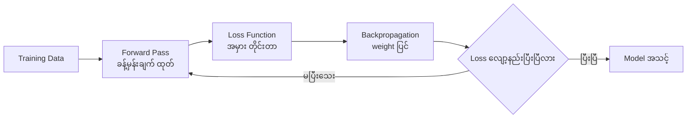
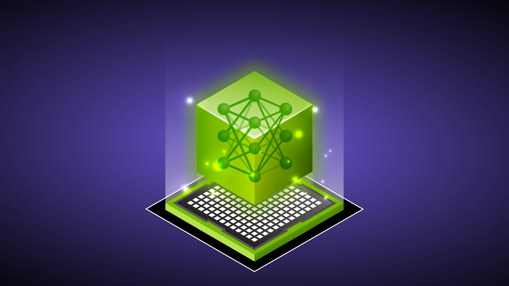
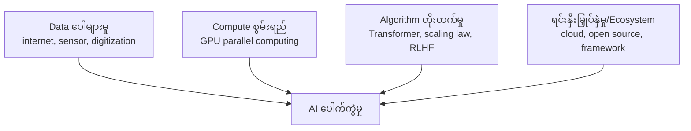
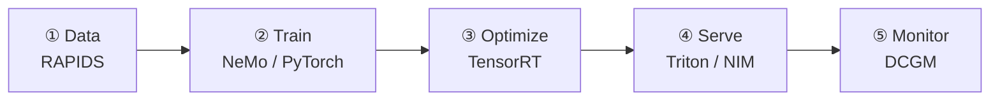

# Module 01 — AI / ML / DL အခြေခံ + AI Adoption (ပြည့်စုံသော ရှင်းလင်းချက်)

> ဤ module ၏ ရည်ရွယ်ချက် — AI, machine learning, deep learning ၏ ဆက်နွယ်မှု၊ သင်ကြားနည်း အမျိုးအစားများ၊ neural network အလုပ်လုပ်ပုံ၊ AI ဘာကြောင့် ယခုခေတ် ပေါက်ကွဲရသလဲ ဆိုသည်ကို အမြစ်မှ နားလည်စေရန် ဖြစ်ပါသည်။

---

## 1. ပြဿနာ — Infrastructure ပညာရှင်တစ်ယောက် AI အခြေခံ ဘာကြောင့် လိုအပ်သလဲ

AI infrastructure ကို စီမံခန့်ခွဲရာတွင် workload ၏ သဘောသဘာဝကို နားမလည်ပါက မှားယွင်းသော ဆုံးဖြတ်ချက်များ ချမှတ်မိပါသည် — ဥပမာ training အတွက် ရေရှည် compute စွမ်းအား လိုအပ်ပြီး inference အတွက် တုံ့ပြန်မှု အချိန် လိုအပ်သည်ကို မသိပါက တူညီသော hardware ကို နှစ်မျိုးလုံးအတွက် ရွေးချယ်မိတတ်ပါသည်။ ထို့ပြင် "AI သည် ML ၏ subset လား" ကဲ့သို့ အခြေခံ သဘောတရား ရှုပ်ထွေးမှုများသည် စာမေးပွဲတွင် တိုက်ရိုက် မေးခွန်းထုတ်လေ့ရှိပါသည်။

ဤ module သည် နောက်ပိုင်း module အားလုံး (GPU လိုအပ်ခြင်း၊ software stack၊ training vs inference architecture) ၏ အခြေခံ ဖြစ်ပါသည်။

---

## 2. အဓိက သဘောတရား — AI, ML, DL ၏ ဆက်နွယ်မှု

```
┌───────────────────────────────────────────────┐
│  AI (Artificial Intelligence)                 │
│   ┌───────────────────────────────────────┐   │
│   │  ML (Machine Learning)                │   │
│   │   ┌───────────────────────────────┐   │   │
│   │   │  DL (Deep Learning)           │   │   │
│   │   │  neural network အလွှာများ   │   │   │
│   │   └───────────────────────────────┘   │   │
│   └───────────────────────────────────────┘   │
└───────────────────────────────────────────────┘
```

**AI (Artificial Intelligence)** — လူ့ဉာဏ်ရည် လိုအပ်သော အလုပ်များ (တွေးခေါ်ခြင်း၊ မှတ်မိခြင်း၊ ဆုံးဖြတ်ခြင်း၊ ဘာသာပြန်ခြင်း၊ ပုံ အသိအမှတ်ပြုခြင်း) ကို စက်က ဆောင်ရွက်နိုင်ခြင်း ဖြစ်ပါသည်။ လူက ရေးသားထားသော rule များဖြင့် အလုပ်လုပ်သော chess program၊ rule-based chatbot များပါ AI အတွင်း ပါဝင်ပါသည်။

**ML (Machine Learning)** — program ကို rule များဖြင့် တိုက်ရိုက် မရေးသားဘဲ data မှ pattern ကို ကိုယ်တိုင် လေ့လာစေခြင်း ဖြစ်ပါသည်။

> **ဥပမာ** — spam email filter: "စာတွင် ငွေ/link ပါလျှင် spam" ဟု ရေးသားမနေဘဲ spam နှင့် မဟုတ်သော email သန်းပေါင်းများစွာ ပြသပြီး ကွဲပြားပုံကို ကိုယ်တိုင် ရှာဖွေစေပါသည်။

**DL (Deep Learning)** — ML ၏ အမျိုးအစားခွဲ တစ်ခုဖြစ်ပြီး neural network အလွှာ များများ (deep) ကို အသုံးပြုခြင်း ဖြစ်ပါသည်။ ပုံတစ်ပုံအတွင်း ခွေးကို မှတ်မိစေရန် feature ကို လူက ကိုယ်တိုင် ထုတ်ပေးစရာ မလိုဘဲ network က အလွှာအလိုက် feature များကို ကိုယ်တိုင် ဖန်တီးလေ့လာပါသည်။

⚠️ **Exam trap** — "AI သည် ML ၏ subset လား" → မဟုတ်ပါ။ **ML သည် AI ၏ subset** ဖြစ်ပြီး DL သည် ML ၏ subset ဖြစ်ပါသည်။

---

## 3. Machine Learning အမျိုးအစား ၄ မျိုး (နှိုင်းယှဉ် ဇယား)

| အမျိုးအစား | သင်ကြားပုံ | ဥပမာ |
|---|---|---|
| **Supervised** | label ပါသော data | spam detection (classification)၊ အိမ်ဈေး ခန့်မှန်းခြင်း (regression) |
| **Unsupervised** | label မပါသော data | customer segmentation (clustering)၊ anomaly detection |
| **Reinforcement** | reward/penalty ဖြင့် စမ်းသပ် | robot ထိန်းချုပ်ခြင်း၊ game AI၊ RLHF |
| **Self-supervised** | data အတွင်းမှ label ကိုယ်တိုင် ဖန်တီး | LLM (next-token prediction) |

Supervised learning ကို ထပ်ခွဲပါက **classification** (အမျိုးအစား ခွဲခြား) နှင့် **regression** (ကိန်းဂဏန်း ခန့်မှန်း) ဟူ၍ ၂ မျိုး ရှိပါသည်။

ခေတ်သစ် Generative AI ၏ သော့ချက်မှာ **self-supervised learning** ဖြစ်ပါသည် — ကမ္ဘာ့ စာသားအားလုံးကို label ပြုလုပ်စရာ မလိုဘဲ "နောက်တစ်လုံး ဘာလဲ" ခန့်မှန်းရုံဖြင့် သင်ကြားနိုင်သောကြောင့် ဖြစ်ပါသည်။ ထို့နောက် reinforcement learning (RLHF) ဖြင့် လူ့နှစ်သက်မှုနှင့် ကိုက်ညီအောင် ညှိပေးပါသည်။

**ဘယ်အခါ ဘာသုံးမလဲ** — label ပါ data ရှိ → supervised၊ data ကို အုပ်စုခွဲ/ပုံမှန်မဟုတ်သည် ရှာ → unsupervised၊ ဆုံးဖြတ်ချက် အဆင့်ဆင့်နှင့် reward ရှိ → reinforcement၊ စာသား/media အမြောက်အများ → self-supervised။

---

## 4. Neural Network နှင့် Deep Learning အလုပ်လုပ်ပုံ (အဓိက သဘောတရား)

**Neuron တစ်ခု** — input များကို weight များဖြင့် မြှောက် ပေါင်းပြီး bias ထည့်ကာ activation function ဖြတ်သန်းစေခြင်း ဖြစ်ပါသည်။

```
input₁ ×w₁ ─┐
input₂ ×w₂ ─┼→ Σ + bias → activation → output
input₃ ×w₃ ─┘
```

**Layer** — input layer → hidden layers → output layer။ hidden layer အလွှာ များလေ "deep" ဖြစ်လေ ဖြစ်ပါသည်။

### Architecture မျိုးဆက်များ

1. **CNN (Convolutional Neural Network)** — ပုံ/video အတွက် (medical imaging, quality inspection)
2. **RNN/LSTM** — sequence ဒေတာ (ဘာသာစကား၊ အချိန်စီးရီး) — ယခုအခါ အသုံးနည်းလာ
3. **Transformer (2017, "Attention Is All You Need")** — attention mechanism ဖြင့် sequence တစ်ခုလုံးကို တစ်ပြိုင်နက် မြင်နိုင်ခြင်းကြောင့် BERT, GPT, LLM အားလုံး၏ အခြေခံ ဖြစ်လာပါသည်

### Training Process — Workflow



1. data ကို ထည့် → ခန့်မှန်း (forward pass)
2. အမှား တိုင်းတာ (loss)
3. gradient တွက်ပြီး weight ပြင် (backpropagation + optimizer)
4. ထိုအဆင့်ကို epoch ပေါင်းများစွာ ပြန်လုပ် → ခန့်မှန်းချက် မှန်ကန်လာ

ဤ ကွင်းဆက်တွင် matrix operation အများအပြား ပါဝင်သောကြောင့် GPU လိုအပ်ခြင်း ဖြစ်ပါသည် (Module 02 နှင့် ဆက်စပ်ပါသည်)။

---

## 5. Training vs Inference (နှိုင်းယှဉ် ဇယား)

| အချက် | Training | Inference |
|---|---|---|
| ရည်ရွယ်ချက် | data မှ weight တွက်ထုတ်ခြင်း | weight သုံး၍ အဖြေ ထုတ်ပေးခြင်း |
| Compute | အလွန်ကြီး | နည်း |
| အချိန် | ရက်/ပတ် ကြာ | ms-level response |

architecture requirement ကွာခြားချက်ကို Module 04 တွင် အပြည့်အစုံ လေ့လာပါမည်။


*ပုံ — LLM inference ၏ အဆင့်များ (ရင်းမြစ်: NVIDIA Developer Blog)*

---

## 6. AI ဘာကြောင့် ယခုခေတ် ပေါက်ကွဲရသလဲ (Objective 1.4)

ဤမေးခွန်းသည် "အားလုံးပါဝင်" (all of the above) ပုံစံဖြင့် အမြဲ ထွက်လေ့ရှိပါသည် — factor ၄ ခု ပေါင်းစပ်မှု ဖြစ်ပါသည်။



1. **Data ပေါများမှု** — internet, smartphone, sensor ကြောင့် သင်ကြားစရာ ဒေတာ သန်းပေါင်းများစွာ
2. **Compute စွမ်းရည်** — GPU ၏ parallel computing ကြောင့် နှစ်ပေါင်းများစွာ တွက်ရမည့် အလုပ် ရက်ပိုင်းဖြင့် ပြီးစီး
3. **Algorithm တိုးတက်မှု** — Transformer, attention, scaling law, pretraining + fine-tuning, RLHF — model ကြီးလေ စွမ်းရည် မြင့်လေ
4. **ရင်းနှီးမြှုပ်နှံမှုနှင့် ecosystem** — cloud GPU ငှားနိုင်ခြင်း၊ PyTorch/HuggingFace ကဲ့သို့ open source၊ framework များကြောင့် entry barrier ကျခြင်း

**သမိုင်းဝင် အချိန်ကိုက်** — 2012 AlexNet က GPU ၂ လုံးဖြင့် ImageNet တွင် ယခင်နည်းပညာကို အဆများစွာ ကျော်လွန်အောင်မြင်ခဲ့ပြီး deep learning လက်ခံမှု ခုန်တက်စေခဲ့ပါသည်။ 2017 Transformer ပေါ်လာပြီးနောက် LLM မျိုးဆက် ဖြစ်ပေါ်လာပါသည်။

---

## 7. Generative AI / LLM အကြောင်း အကျဉ်း

- **LLM (Large Language Model)** — စာသား သန်းပေါင်းများစွာဖြင့် သင်ကြားထားသော Transformer model ကြီး
- **Generative AI** — စာသား၊ ပုံ၊ code၊ အသံ အသစ်များ ဖန်တီးပေးနိုင်သော AI
- **Multimodal** — စာသား + ပုံ + အသံ ပေါင်းစပ် နားလည်ခြင်း
- **RAG (Retrieval-Augmented Generation)** — model ကို ပြင်ပ ဒေတာ ရှာဖွေစေပြီး အဖြေ တိကျစေခြင်း
- **Agent** — tool သုံးကာ အဆင့်ဆင့် အလုပ် လုပ်ဆောင်နိုင်သော AI

---

## 8. Use Case နှင့် Industry များ (Objective 1.5)

| Industry | အဓိက use case |
|---|---|
| Healthcare | X-ray/MRI ရောဂါ ရှာဖွေခြင်း၊ ဆေးဝါး တွေ့ရှိမှု အရှိန်မြှင့်ခြင်း၊ genomics |
| Finance | fraud detection၊ algorithmic trading၊ risk analysis |
| Manufacturing | predictive maintenance၊ quality inspection (computer vision) |
| Retail | recommendation system၊ demand forecast |
| Automotive | autonomous driving perception၊ driver assistance |
| Telecom / Energy | network optimization၊ smart grid |
| အလုံးစုံ GenAI | chatbot/copilot၊ code generation၊ summarize၊ translation |

⚠️ ဤ objective သည် infra exam တွင် ဘာကြောင့် ပါရသလဲ — **use case → workload type → hardware requirement** ကွင်းဆက်ကို နားလည်မှ မှန်ကန်သော infrastructure ရွေးချယ်နိုင်သောကြောင့် ဖြစ်ပါသည်။

---

## 9. AI Development Life Cycle (Objective 1.7)


*ပုံ — LLM optimize/deploy lifecycle (ရင်းမြစ်: NVIDIA Developer Blog)*



1. **Data preparation** — ဒေတာ စုဆောင်း/သန့်ရှင်း/ပြင်ဆင် (RAPIDS)
2. **Training** — model သင်ကြား/fine-tune (NeMo, PyTorch)
3. **Optimization** — production အတွက် မြန်အောင်/သေးအောင် ပြင် (TensorRT)
4. **Deployment/Serving** — service အဖြစ် တင်သုံး (Triton, NIM)
5. **Monitoring** — စွမ်းဆောင်ရည်/အရည်အသွေး စောင့်ကြည့် (DCGM)

ဘယ် NVIDIA tool က ဘယ်အဆင့်မှာ ရှိသလဲ ဆိုတာကို Module 03 တွင် အပြည့်အစုံ လေ့လာပါမည်။

---

## 10. လက်တွေ့ ပြင်ဆင်မှု — AI environment အခြေခံ စစ်ဆေးခြင်း (illustrative)

ယေဘုယျ AI workstation တစ်ခုတွင် Python + PyTorch အသုံးပြု၍ CUDA ရရှိနိုင်မှုကို စစ်ဆေ်သည့် နမူနာ command များ ဖြစ်ပါသည် — ဤ command များသည် ဥပမာ သက်သက် ဖြစ်ပြီး စာမေးပွဲတွင် command ရိုက်ရန် မဟုတ်ပါ။

```bash
# GPU ရှိ/မရှိ နှင့် driver အခြေအနေ ကြည့်ခြင်း
nvidia-smi

# PyTorch မှ CUDA ကို အသုံးပြုနိုင်/မနိုင် စစ်ဆေးခြင်း
python -c "import torch; print(torch.cuda.is_available())"
```

- `nvidia-smi` — NVIDIA driver နှင့် GPU အခြေအနေ (memory, utilization, temperature) ကို ပြသပါသည်
- `python -c "import torch; print(torch.cuda.is_available())"` — PyTorch အနေဖြင့် GPU ကို တွေ့ရှိ/အသုံးပြုနိုင်ကြောင်း True/False ပြန်ပေးပါသည်

⚠️ ထွက်လာသော အဖြေနှင့် အသေးစိတ်သည် GPU model, driver version, PyTorch version ပေါ် မူတည်၍ ကွဲပြားနိုင်ပါသည်။

---

## 11. လုပ်ငန်း လည်ပတ်မှု သတိပေးချက်များ — အဓိက မှားယွင်းနိုင်သော အချက်များ (Exam traps)

1. DL ⊃ ML ⊃ AI ဟု ယူဆခြင်း — မှားပါသည် (AI ⊃ ML ⊃ DL)
2. LLM ကို supervised learning ဟု ထင်ခြင်း — self-supervised ဖြစ်ပါသည်
3. AI ပေါက်ကွဲရခြင်းကို အကြောင်းရင်း တစ်ခုတည်း ပြောခြင်း — ၄ ခု ပေါင်းစပ်မှု ဖြစ်ပါသည်
4. Inference သည် training ၏ အပိုင်းငယ်သာ ဟု ထင်ခြင်း — requirement များ သီးခြား ဖြစ်ပါသည်
5. Transformer ကို "ပိုကြီးသော RNN" ဟု ထင်ခြင်း — attention mechanism ဖြင့် အလုပ်လုပ်ပုံ မတူညီပါ
6. Rule-based system ကို ML ဟု ခေါ်ခြင်း — ML သည် data မှ သင်ယူခြင်း ဖြစ်ရမည်

---

## 12. Self-Check (မိမိကိုယ်ကို စစ်ဆေးရန်)

1. AI, ML, DL subset အစဉ် မှန်ကန်သောအချက်ကို ရွေးပါ။
2. LLM ၏ next-token prediction သည် ML အမျိုးအစား ၄ ခုအနက် မည်သည့်အမျိုးအစားနှင့် အနီးစပ်ဆုံးလဲ။
3. AI ခုန်တက်စေသော factor ၄ ခုကို ဖော်ပြပါ။
4. Transformer architecture ၏ အဓိက ဆန်းသစ်မှုက ဘာလဲ။
5. Training နှင့် inference ကို requirement အလိုက် မည်သို့ ခွဲခြားမလဲ။

**အဖြေများ**

1. AI ⊃ ML ⊃ DL
2. Self-supervised (label ကို data အတွင်းမှ ကိုယ်တိုင် ဖန်တီးခြင်း)
3. data ပေါများမှု၊ GPU compute၊ algorithm တိုးတက်မှု၊ ရင်းနှီးမြှုပ်နှံမှု/ecosystem
4. attention mechanism (sequence တစ်ခုလုံး တစ်ပြိုင်နက် မြင်နိုင်ခြင်း)
5. Training = ကြီးမားသော compute၊ ရက်/ပတ် ကြာချိန်၊ data အကြီးစား — Inference = နည်းပါးသော compute၊ ms-level latency၊ တည်ငြိမ်သော တုံ့ပြန်မှု

---

## 13. Official References

- NVIDIA — What Is Deep Learning: https://www.nvidia.com/en-us/glossary/deep-learning/
- NVIDIA — What Is Machine Learning: https://www.nvidia.com/en-us/glossary/machine-learning/
- NVIDIA — What Is Generative AI: https://www.nvidia.com/en-us/glossary/generative-ai/
- "Attention Is All You Need" (2017): https://arxiv.org/abs/1706.03762
- NVIDIA AI Life Cycle overview: https://www.nvidia.com/en-us/solutions/ai-workflow-and-mlops/

---

## Technical review notes

- ပြင်ဆင်မှု — Mini-Quiz ကို ဖြေမပါသော ပုံစံမှ မေးခွန်း + အဖြေ ခွဲထားသော self-check ပုံစံသို့ ပြောင်းလဲပြီး မေးခွန်း ၅ ခု တိုးချဲ့ထားသည်။
- ပြင်ဆင်မှု — လက်တွေ့ configuration အဖြစ် `nvidia-smi` နှင့် PyTorch CUDA စစ်ဆေးမှု command များကို illustrative အဖြစ် ထည့်သွင်းထားသည် — ထွက်လဒ်သည် tool version ပေါ် မူတည်၍ ကွဲပြားနိုင်သည် (needs verification)။
- မူလ အကြောင်းအရာ အားလုံး (diagram များ၊ image embed များ၊ reference link များ၊ နည်းပညာ အချက်အလက်များ) ကို ထိန်းသိမ်းထားပြီး ဖြစ်သည် — နည်းပညာအရ ပြင်ဆင်ရန် လိုအပ်သော အချက် မတွေ့ရှိပါ။
