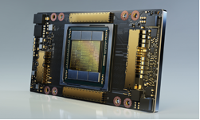
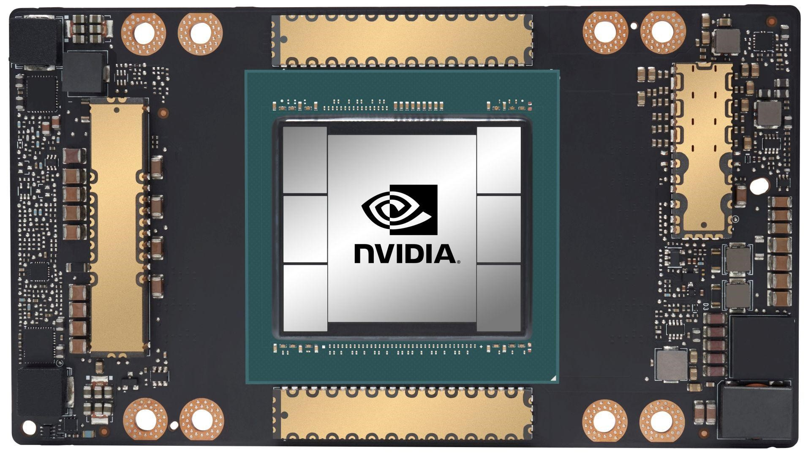
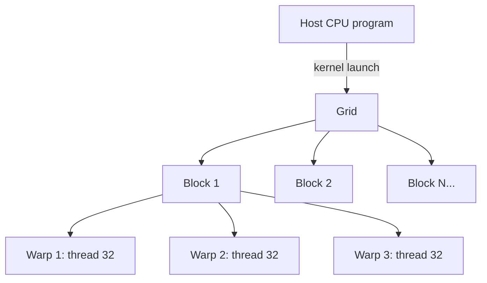
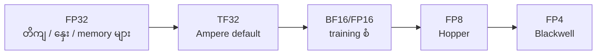
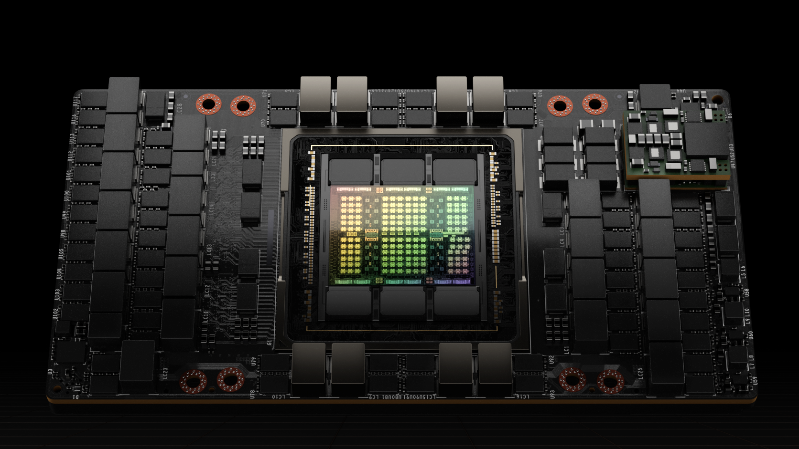
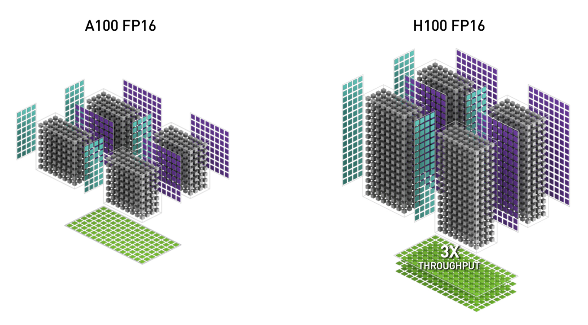

# Module 02 — GPU vs CPU Architecture (ပြည့်စုံသော ရှင်းလင်းချက်)

> ဤ module ၏ ရည်ရွယ်ချက် — CPU နှင့် GPU ဒီဇိုင်း မည်သို့ ကွာခြားသည်၊ GPU အတွင်းပိုင်း မည်သို့ အလုပ်လုပ်သည်၊ AI အတွက် GPU ဘာကြောင့် မဖြစ်မနေ လိုအပ်ရသည် ဆိုသည်ကို အမြစ်မှ နားလည်စေရန် ဖြစ်ပါသည်။

---

## 1. CPU နှင့် GPU — ဒီဇိုင်း ရည်ရွယ်ချက် မတူညီပုံ

| အချက် | CPU | GPU |
|---|---|---|
| Core အရေအတွက် | အနည်းငယ် (16-128) | ထောင်/သောင်းချီ (CUDA cores) |
| Core တစ်ခုချင်း | ရှုပ်ထွေး (branch prediction, out-of-order) | ရိုးရှင်း |
| Clock speed | မြင့် (3-5 GHz) | နိမ့် (1-2 GHz) |
| ပန်းတိုင် | single-task latency နိမ့် | data throughput မြင့် |
| Cache | ကြီး (hundreds of MB) | သေး (L1/L2 shared) |
| သင့်တော်သော အလုပ် | OS, database, sequential logic | matrix math, massive parallel |

### လူဥပမာ ဖြင့် ရှင်းလင်းချက်

ပေါင်းချက် ၁ သန်း လုပ်ဆောင်ရမည် ဆိုပါစို့ —
- **CPU** = မှတ်ဉာဏ် ကောင်းမွန်သော ပညာရှင် ၁၆ ယောက် စေလွှတ်ခြင်း — တစ်ခုချင်း စဉ်းစားဆုံးဖြတ်ပြီး လုပ်ဆောင်သည်
- **GPU** = ရိုးရှင်းသော ပေါင်းချက်သာ တတ်မြောက်သော ကျောင်းသား ၁ သောင်း စေလွှတ်ခြင်း — အားလုံး တစ်ပြိုင်နက် လုပ်ဆောင်သည်

```
CPU:  [task1]→[task2]→[task3]→[task4]  (တစ်လုံးချင်း မြန်မြန်)
GPU:  [task1..task10000] တစ်ပြိုင်နက်     (အများကြီး တစ်ခါတည်း)
```

⚠️ **Exam trap** — "GPU သည် CPU ထက် မြန်သည်" ဆိုသော စကားသည် မှားယွင်းပါသည်။ မှန်ကန်သော ပြောဆိုမှုမှာ **"parallel arithmetic workload တွင် GPU သည် အဆများစွာ ပိုမြန်သည်"** ဖြစ်ပါသည်။ Sequential/branch-heavy အလုပ်တွင် CPU သည် ဆက်လက်၍ မြန်ဆဲ ဖြစ်ပါသည်။

---

## 2. GPU အတွင်းပိုင်း ဖွဲ့စည်းပုံ


*ပုံ — A100 GPU ၏ အဓိက feature များ (ရင်းမြစ်: NVIDIA Developer Blog, Ampere Architecture In-Depth)*


*ပုံ — A100 GPU (SXM4 module) (ရင်းမြစ်: NVIDIA Developer Blog)*

### Component များ

- **SM (Streaming Multiprocessor)** — GPU ၏ အခြေခံ scheduling နှင့် execution unit — A100 တွင် SM 108 ခု ပါရှိပြီး တစ်ခုချင်းစီသည် thread ထောင်ချီကို စီမံခန့်ခွဲပါသည်
- **CUDA Core** — ပေါင်း/မြှောက် (FMA) လုပ်ဆောင်သော general computing unit
- **Tensor Core** — matrix multiply-accumulate အတွက် သီးသန့် hardware circuit — Transformer ၏ အလုပ် အများစုသည် matrix multiplication ဖြစ်သောကြောင့် ဤ unit သည် AI ၏ နှလုံးသား ဖြစ်ပါသည်

**Tensor Core မျိုးဆက်များ** — Ampere = 3rd gen (TF32)၊ Hopper = 4th gen (Transformer Engine, FP8)၊ Blackwell = 5th gen (FP4)

### CUDA Programming Model


*ပုံ — CUDA programming model: host (CPU) မှ device (GPU) သို့ kernel လွှဲပြောင်းခြင်း (ရင်းမြစ်: NVIDIA Developer Blog)*



### Warp နှင့် SIMT

- **Warp** — thread 32 ခု ပါဝင်သော အုပ်စု — SIMT (Single Instruction, Multiple Threads) execution
- **Warp divergence** — warp အတွင်း thread များ if/else branch ကြောင့် လမ်း ၂ ခု ကွဲပါက လမ်း ၂ ခုကို တစ်ခုပြီးတစ်ခု run ရပြီး အမြန်နှုန်း တစ်ဝက်နီးပါး ကျနိုင်ပါသည်

```
မကောင်း:                    ကောင်း:
thread 0-15: if path A        အားလုံး: if path A
thread 16-31: else path B     (branch မကွဲ)
→ 2 ကြိမ် run ရ                 → 1 ကြိမ် run ရ
```

- **SIMT vs SIMD** — SIMT သည် thread တစ်ခုချင်း ကိုယ်ပိုင် register နှင့် branch ပြုလုပ်နိုင်ပြီး၊ SIMD (CPU AVX) သည် vector lane အားလုံး ညီညီတူတူသာ လုပ်ဆောင်နိုင်ပါသည်

---

## 3. Memory Hierarchy နှင့် Bandwidth — LLM အတွက် အရေးကြီးဆုံး

```
Register (SM အတွင်း)        ~20 cycles     ← အမြန်ဆုံး
Shared memory / L1           ~20-30 cycles
L2 cache                     ~200 cycles
Global memory / HBM          ~200-300+ cycles ← အနှေးဆုံး
```

SM နှင့် နီးကပ်လေ memory သည် မြန်ဆန်လေ ဖြစ်ပါသည်။ register မှ ဖတ်ခြင်းနှင့် HBM မှ ဖတ်ခြင်း ကြားတွင် ကွာခြားချက် ဆယ်ဆကျော် ရှိပါသည်။ ထို့ကြောင့် kernel ရေးသားရာတွင် လိုအပ်သော data ကို shared memory အတွင်း အရင် သိမ်းဆည်းပြီးမှ thread အားလုံး ဖတ်ရှုစေခြင်းသည် အကောင်းဆုံး ဖြစ်ပါသည်။

### HBM vs GDDR

| GPU | Memory | Bandwidth |
|---|---|---|
| A100 | 80GB HBM2e | 2 TB/s |
| H100 | 80GB HBM3 | 3.35 TB/s |
| H200 | 141GB HBM3e | 4.8 TB/s |
| B200 | 180GB HBM3e | ~8 TB/s |

**HBM (High Bandwidth Memory)** — chip အလွှာ ထပ်ပြီး wide bus ဖြင့် ချိတ်ဆက်ထားခြင်း — data center GPU များတွင် အသုံးပြုပါသည်။ Consumer GPU များမှာ GDDR ကို အသုံးပြုပါသည်။

**ဘာကြောင့် bandwidth အရေးကြီးသလဲ** — LLM inference ၏ decode အဆင့်သည် memory-bound ဖြစ်ပြီး token တစ်လုံး ထုတ်တိုင်း model weight နှင့် KV cache အားလုံးကို memory မှ ဖတ်ရပါသည်။

---

## 4. Precision Format များ

| Format | Bits | အသုံးပြုမှု |
|---|---|---|
| FP32 | 32 | အခြေခံ computation |
| TF32 | 19 | Ampere matmul default |
| FP16 | 16 (range ကျဉ်း) | training/inference |
| **BF16** | 16 (range ကျယ်) | **modern training default** |
| **FP8** | 8 | Hopper Transformer Engine |
| INT8 | 8 | inference quantization |
| **FP4** | 4 | Blackwell |



- **BF16 vs FP16** — FP16 သည် precision ပိုကောင်းသော်လည်း range ကျဉ်းသောကြောင့် large model training တွင် overflow ဖြစ်လွယ်ပါသည်။ BF16 သည် FP32 range ပါဝင်သောကြောင့် training တွင် စံအဖြစ် အသုံးပြုပါသည်
- **Mixed precision training** — BF16 ဖြင့် တွက်ချက်ပြီး FP32 master weight ဖြင့် သိမ်းဆည်းပါသည်
- **Quantization** — inference တွင် FP8/INT8/INT4 ဖြင့် model ကို သေးငယ်စေ မြန်ဆန်စေပါသည်

---

## 5. GPU မျိုးဆက်များ — Ampere → Ada → Hopper → Blackwell


*ပုံ — Hopper (H100) SXM5 module (ရင်းမြစ်: NVIDIA Developer Blog, Hopper Architecture In-Depth)*


*ပုံ — A100 နှင့် H100 FP16 performance နှိုင်းယှဉ်ချက် (ရင်းမြစ်: NVIDIA Developer Blog)*

| မျိုးဆက် | ကိုယ်စားပြု model | Memory | Bandwidth | NVLink | အဓိက feature |
|---|---|---|---|---|---|
| Ampere (2020) | A100 | 80GB HBM2e | 2TB/s | 600GB/s | MIG ပေါ်လာခြင်း၊ TF32 |
| Ada (2022) | L40S / L4 | 48GB GDDR6 | 864GB/s | — | inference/graphics၊ power သက်သာ |
| Hopper (2022) | H100 | 80GB HBM3 | 3.35TB/s | 900GB/s | Transformer Engine (FP8) |
| Hopper (2024) | H200 | 141GB HBM3e | 4.8TB/s | 900GB/s | memory ၂ ဆ တိုးခြင်း |
| Blackwell (2024-25) | B200 / GB200 | 180GB HBM3e | ~8TB/s | 1.8TB/s | dual-die၊ FP4၊ NVLink 5 |

မျိုးဆက် တစ်ခုပြီးတစ်ခု တိုးလာသည်နှင့်အမျှ memory capacity, bandwidth, precision efficiency, interconnect speed အားလုံး တိုးတက်လာပါသည်။

**System form factor** — **DGX** = 8-GPU ပါ ပြီးပြည့်စုံ system၊ **HGX** = OEM များ ကိုယ်ပိုင် server ဆောက်ရန် baseboard၊ **MGX** = modular reference design၊ **IGX** = edge/industrial

---

## 6. Consumer GPU vs Data Center GPU

| အချက် | Consumer (GeForce RTX) | Data Center (A100/H100/B200) |
|---|---|---|
| Memory | 16-24GB GDDR | 80-180GB HBM |
| ECC | မပါဝင် | ပါဝင် |
| MIG / vGPU | မရရှိ | ရရှိ |
| NVLink | မရရှိ (PCIe သာ) | ရရှိ |
| အသုံးပြုမှု | workstation၊ development | cluster၊ 24/7 production |

ထို့အပြင် consumer GPU ၏ die design သည် data center GPU နှင့် မတူညီသောကြောင့် data center GPU အတွက် ရေးသားထားသော kernel များသည် consumer GPU တွင် အလုပ်မလုပ်နိုင်ခြင်း ဖြစ်တတ်ပါသည်။

---

## 7. စာမေးပွဲတွင် အများဆုံး ကျဆုံးလေ့ရှိသော အချက်များ

1. "GPU သည် CPU ထက် မြန်သည်" — workload ပေါ် မူတည်ကြောင်း framing ပြောင်းပေးပါ
2. Tensor Core နှင့် CUDA Core ကွဲခြားပါ (matrix engine vs general unit)
3. HBM = data center၊ GDDR = consumer
4. BF16 (range) vs FP16 (precision) — training default က BF16
5. MIG သည် Ampere မှ စတင်ပြီး hardware partition feature ဖြစ်ပါသည်
6. NVLink သည် node အတွင်း interconnect (inter-node မဟုတ်)

---

## 8. Mini-Quiz

1. CPU နှင့် GPU ဒီဇိုင်း ရည်ရွယ်ချက် ခွဲခြားပါ။ "GPU သည် ပိုမြန်သည်" ဆိုသော စကား ဘာကြောင့် မမှန်ကန်ရသလဲ။
2. Tensor Core ၏ အခန်းကဏ္ဍကို ရှင်းပြပါ။
3. HBM နှင့် GDDR ကွာခြားချက်ကို ဖော်ပြပါ။ decode အမြန်နှုန်းနှင့် bandwidth ဆက်စပ်ပုံကို ရှင်းပြပါ။
4. BF16 ကို training တွင် အသုံးများရခြင်း အကြောင်းရင်း ဘာလဲ။

**အဖြေများ** — 1) CPU = latency နိမ့်၊ GPU = throughput မြင့် — parallel workload တွင်သာ GPU ပိုမြန် · 2) matrix multiply-accumulate သီးသန့် hardware · 3) HBM = stacked/wide bus (TB/s)၊ GDDR = narrow bus — decode သည် memory-bound ဖြစ်၍ bandwidth က အမြန်နှုန်း သတ်မှတ် · 4) FP32 range ပါဝင်၍ overflow နည်းခြင်း

---

## 9. Official References

- NVIDIA Ampere Architecture In-Depth: https://developer.nvidia.com/blog/nvidia-ampere-architecture-in-depth/
- NVIDIA Hopper Architecture In-Depth: https://developer.nvidia.com/blog/nvidia-hopper-architecture-in-depth/
- NVIDIA H100 Tensor Core GPU: https://www.nvidia.com/en-us/data-center/h100/
- CUDA C++ Programming Guide: https://docs.nvidia.com/cuda/cuda-c-programming-guide/
