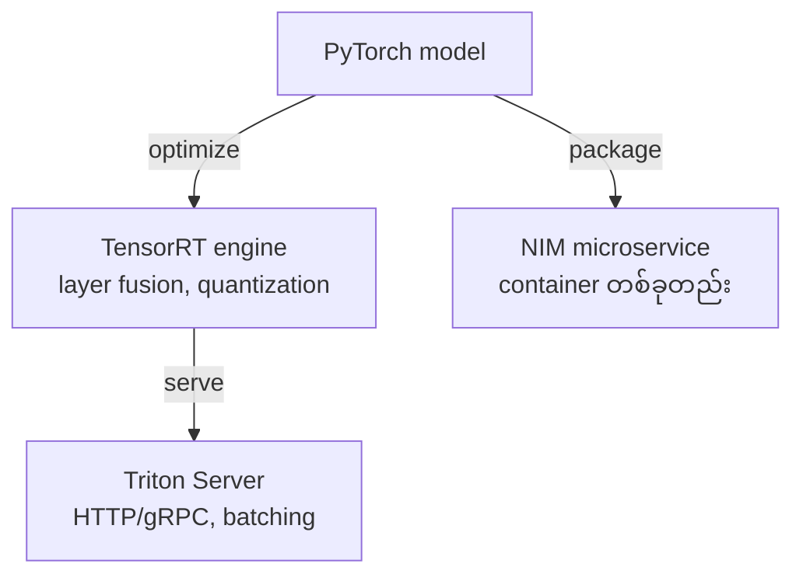
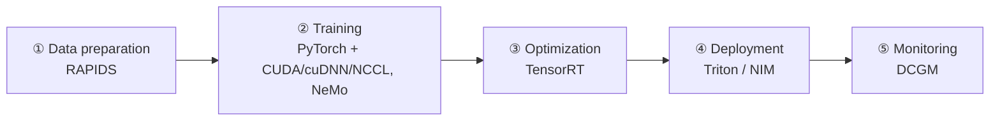

# Module 03 — NVIDIA Software Stack & Solutions (ပြည့်စုံသော ရှင်းလင်းချက်)

> ဤ module ၏ ရည်ရွယ်ချက် — NVIDIA software အများအပြားကို layer အလိုက် ခွဲခြမ်း နားလည်ပြီး tool တစ်ခုချင်း၏ အခန်းကဏ္ဍကို တစ်ကြောင်းတည်းဖြင့် ရှင်းပြနိုင်စေရန် ဖြစ်ပါသည်။

---

## 1. Stack ကို Layer အလိုက် နားလည်ခြင်း

```
┌───────────────────────────────────────────────────┐
│ Application / Framework    PyTorch, TensorFlow,   │  ← model ရေးသား/သင်ကြား
│                            NeMo                    │
├───────────────────────────────────────────────────┤
│ Inference                  TensorRT, Triton,      │  ← optimize နှင့် serve
│                            NIM                     │
├───────────────────────────────────────────────────┤
│ Acceleration Libraries     cuDNN, cuBLAS, NCCL,   │  ← ready-made engine
│                            RAPIDS                  │
├───────────────────────────────────────────────────┤
│ Platform                   CUDA                    │  ← အခြေခံ (မပါက ဘာမှ မရ)
├───────────────────────────────────────────────────┤
│ Hardware                   GPU                     │
└───────────────────────────────────────────────────┘
```


*ပုံ — CUDA programming model (ရင်းမြစ်: NVIDIA Developer Blog)*

---

## 2. Platform အဆင့် — CUDA

**CUDA (Compute Unified Device Architecture)** — GPU ကို general-purpose parallel computing အတွက် အသုံးပြုနိုင်စေသော platform, API, compiler toolchain ဖြစ်ပါသည်။ C/C++/Python မှ တစ်ဆင့် GPU code ရေးသား လုပ်ဆောင်နိုင်ပါသည်။

CUDA မပါဝင်ပါက ကျန် software အားလုံး အလုပ်မလုပ်နိုင်ပါ — ၎င်းသည် NVIDIA ၏ အဓိက ecosystem အားသာချက် ဖြစ်ပြီး ပြိုင်ဘက် GPU များတွင် ကိုက်ညီသော အစားထိုးမှု မရှိပါ။

---

## 3. Acceleration Libraries အဆင့်

| Library | အလုပ် | တစ်ကြောင်းတည်း ရှင်းလင်းချက် |
|---|---|---|
| **cuDNN** | DNN primitive (convolution, pooling, normalization, attention) | deep learning ၏ အခြေခံ တွက်ချက်မှု engine |
| **cuBLAS** | BLAS matrix multiply (GEMM) | linear algebra accelerator |
| **NCCL** | multi-GPU/multi-node collective communication | distributed training ၏ ဆက်သွယ်ရေး သွေးကြော |
| **RAPIDS** | GPU data science (cuDF, cuML) | data preprocessing ကို GPU ပေါ်တွင် မြန်ဆန်စေခြင်း |

⚠️ **ရှုပ်လေ့ရှိပုံ** — cuDNN vs cuBLAS vs NCCL။ မှတ်ရနည်း — cuDNN = neural network ၏ အလုပ်၊ cuBLAS = သင်္ချာ matrix၊ NCCL = GPU ချင်း ဆက်သွယ်ခြင်း။

---

## 4. Training အဆင့် — Framework များ

- **PyTorch / TensorFlow** — training framework များ — CUDA ပေါ်တွင် run
- **NeMo** — NVIDIA ၏ generative AI / LLM framework — pretrain, fine-tune, alignment (RLHF), multimodal
- **TAO Toolkit** — vision/speech အတွက် transfer learning — code အနည်းငယ်ဖြင့် pretrained model ပြင်ဆင်နိုင်

**မှတ်ရနည်း** — LLM သင်ကြား/fine-tune → NeMo၊ ပုံ/အသံ model ကို data အနည်းငယ်ဖြင့် ပြင်ဆင် → TAO။

---

## 5. Inference အဆင့် — TensorRT vs Triton vs NIM ⭐



| အချက် | **TensorRT** | **Triton** | **NIM** |
|---|---|---|---|
| ဘာလဲ | inference **optimizer + runtime** | inference **server** | packaged **microservice** (container) |
| လုပ်ဆောင်ချက် | layer fusion, FP8/INT8, compile | serving, dynamic batching, multi-model | pre-optimized model + runtime |
| နှိုင်းယှဉ်ပုံ | ကား engine ပြင်ဆင်ခြင်း | ကားဂိုဒေါင် စီမံခြင်း | အငှားကား app — ဖွင့်ပြီး ချက်ချင်း သုံးခြင်း |

**မေးခွန်းပုံစံ နှင့် အဖြေ** —
- "model ကို GPU အတွက် optimize လုပ်ချင်" → **TensorRT**
- "production တွင် model အမျိုးမျိုးကို batching ဖြင့် serve ချင်" → **Triton**
- "enterprise support ဖြင့် ပြီးပြည့်စုံသော inference service ကို မြန်မြန် တင်သုံးချင်" → **NIM**

📌 Triton အတွင်းတွင် TensorRT backend ထည့်သွင်းနိုင်ခြင်းကြောင့် ဤ ၃ ခု ဆက်စပ်နေပါသည်။

---

## 6. Platform / Ecosystem (Objective 1.6)

| Solution | ရှင်းလင်းချက် |
|---|---|
| **NGC** | GPU-optimized container, model, notebook **catalog/registry** — tool မဟုတ် |
| **NVIDIA AI Enterprise** | production suite — support, SLA, security; NIM ပါဝင် |
| **Base Command Manager** | on-prem DGX cluster OS |
| **Base Command Platform** | cloud-managed AI platform service (⚠️ Manager နှင့် မတူ) |
| **LaunchPad** | hands-on test-drive environment |
| **DOCA** | DPU software platform |

⚠️ **Base Command Manager vs Platform** — Manager = on-prem software၊ Platform = cloud service — စာမေးပွဲတွင် အမြဲ ရှုပ်အောင် မေးလေ့ရှိပါသည်။

---

## 7. AI Development Life Cycle mapping (Objective 1.7)



မေးခွန်းပုံစံ — "optimization အဆင့်တွင် မည်သည့် tool" → TensorRT။ "data preprocessing ကို GPU ပေါ် တင်ချင်" → RAPIDS။ "serving အဆင့်" → Triton/NIM။

---

## 8. အဓိက မှားယွင်းနိုင်သော အချက်များ

1. TensorRT vs Triton vs NIM — optimize engine vs serving server vs packaged microservice
2. Base Command Manager vs Platform — on-prem OS vs cloud service
3. NGC = catalog/registry — execution tool မဟုတ်
4. NeMo (GenAI/LLM) vs TAO (transfer learning, vision/speech)
5. NCCL = communication၊ cuDNN = NN primitives၊ cuBLAS = matmul
6. CUDA = platform layer — library တစ်ခု မဟုတ်

---

## 9. Mini-Quiz

1. CUDA, cuDNN, cuBLAS, NCCL ကို တစ်ခုချင်း တစ်ကြောင်းတည်းဖြင့် ရှင်းပြပါ။
2. "model ကို production တွင် serve ချင်ပြီး dynamic batching လိုချင်" — မည်သည့် tool ရွေးမလဲ။
3. NIM သည် Triton နှင့် မည်သို့ ကွာခြားသလဲ။

**အဖြေများ** — 1) CUDA = GPU platform/API၊ cuDNN = DNN primitives၊ cuBLAS = matmul၊ NCCL = collective communication · 2) **Triton** · 3) NIM = pre-optimized packaged container microservice (enterprise-ready)

---

## 10. Official References

- CUDA Zone: https://developer.nvidia.com/cuda-zone
- cuDNN: https://developer.nvidia.com/cudnn
- NCCL: https://developer.nvidia.com/nccl
- RAPIDS: https://rapids.ai
- TensorRT: https://developer.nvidia.com/tensorrt
- Triton Inference Server: https://developer.nvidia.com/triton-inference-server
- NIM: https://www.nvidia.com/en-us/ai/
- NGC: https://catalog.ngc.nvidia.com
- NeMo: https://developer.nvidia.com/nemo
