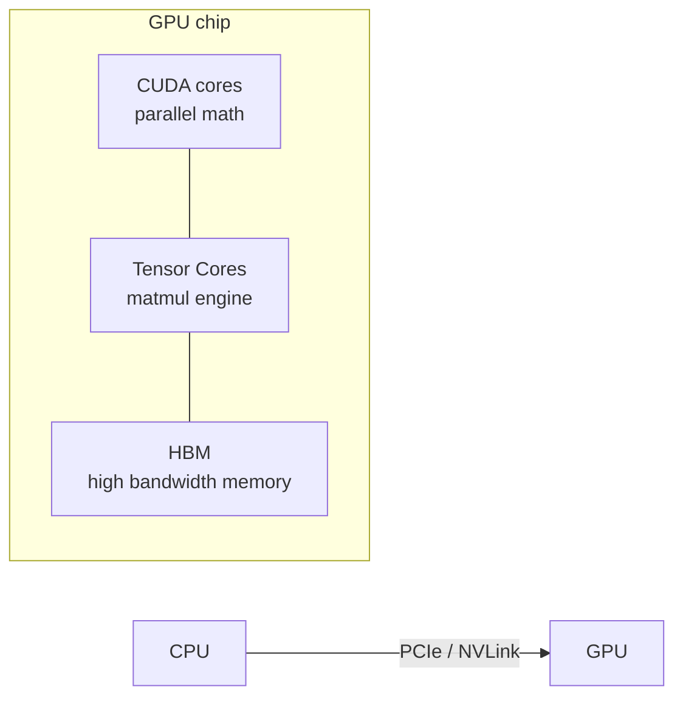
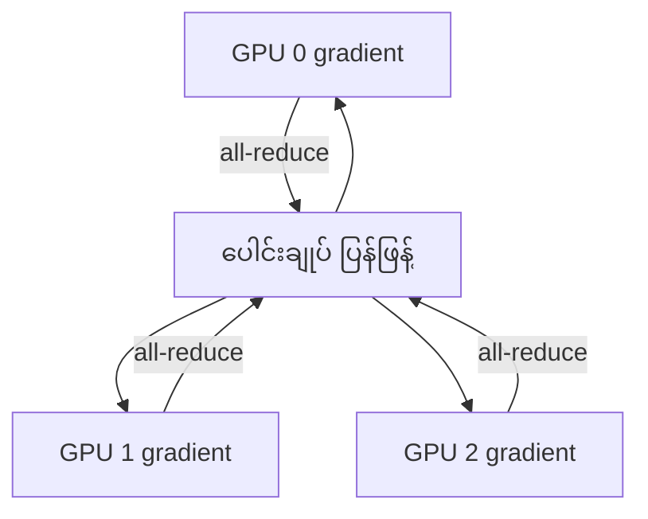
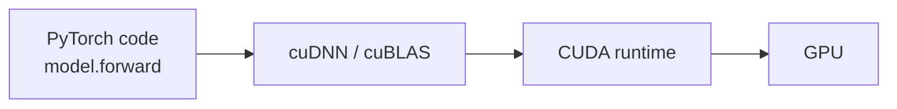
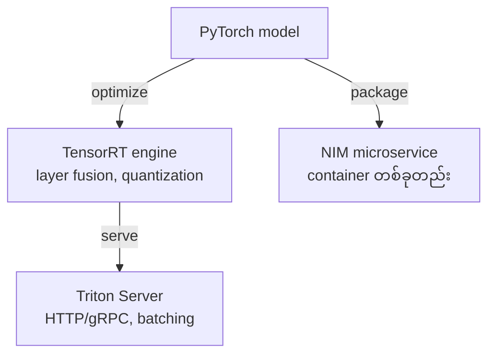
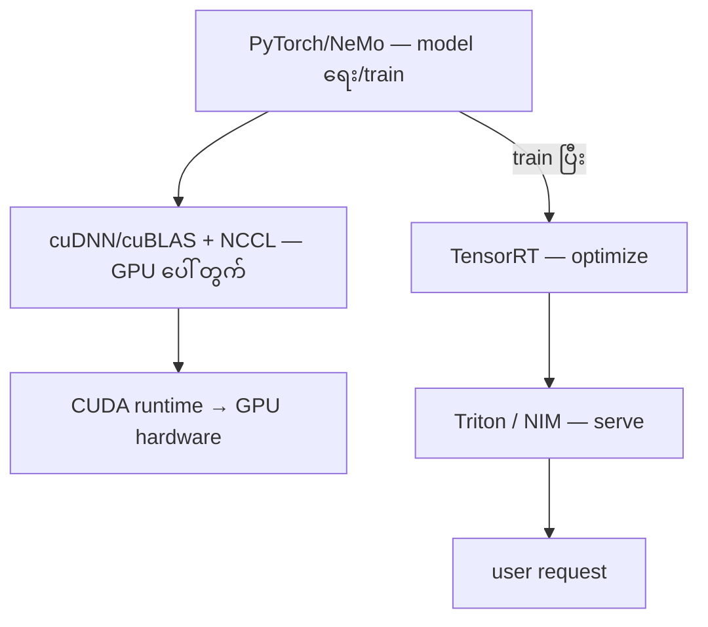
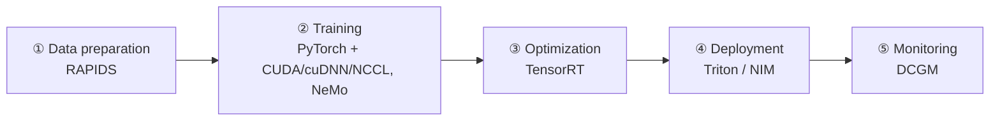

# Module 03 — NVIDIA Software Stack & Solutions (ပြည့်စုံသော ရှင်းလင်းချက်)

> ဤ module ၏ ရည်ရွယ်ချက် — NVIDIA software အများအပြားကို layer အလိုက် ခွဲခြမ်း နားလည်ပြီး tool တစ်ခုချင်း၏ အခန်းကဏ္ဍကို တစ်ကြောင်းတည်းဖြင့် ရှင်းပြနိုင်စေရန် ဖြစ်ပါသည်။

---

## 1. ပြဿနာ — NVIDIA software အမည်များ ဘာကြောင့် ရှုပ်ရသလဲ

NVIDIA ၏ software စာရင်းတွင် CUDA, cuDNN, NCCL, TensorRT, Triton, NIM, NeMo, RAPIDS, NGC, Base Command စသည်ဖြင့် အမည် ဆင်တူသော tool များ များပြားပါသည်။ တစ်ခုနှင့်တစ်ခု ရောထွေးပါက —

- မေးခွန်းတွင် "model ကို optimize လုပ်ချင်" နှင့် "model ကို serve လုပ်ချင်" ကို မခွဲခြားနိုင်ဘဲ အဖြေ မှားတတ်ပါသည်
- infrastructure စီမံကိန်းတွင် ဘယ် layer အတွက် ဘယ် tool ဝယ်/တပ်ဆင်ရမည်ကို မဆုံးဖြတ်နိုင်ပါ

ဤ module သည် stack တစ်ခုလုံးကို layer အလိုက် စဉ်းစားတတ်စေရန် ရည်ရွယ်ပါသည် — အောက်ခြေ hardware မှ အပေါ်ဆုံး application အထိ တစ်ဆင့်ချင်း တက်ကြည့်ပါမည်။

---

## 2. အဓိက သဘောတရား — Stack ကို Layer အလိုက် နားလည်ခြင်း

```
┌───────────────────────────────────────────────────┐
│ Application / Framework    PyTorch, TensorFlow,   │  ← model ရေးသား/သင်ကြား
│                            NeMo                    │
├───────────────────────────────────────────────────┤
│ Inference                  TensorRT, Triton,      │  ← optimize နှင့် serve
│                            NIM                     │
├───────────────────────────────────────────────────┤
│ Acceleration Libraries     cuDNN, cuBLAS, NCCL,   │  ← ready-made engine
│                            RAPIDS                  │
├───────────────────────────────────────────────────┤
│ Platform                   CUDA                    │  ← အခြေခံ (မပါက ဘာမှ မရ)
├───────────────────────────────────────────────────┤
│ Hardware                   GPU                     │
└───────────────────────────────────────────────────┘
```


*ပုံ — CUDA programming model (ရင်းမြစ်: NVIDIA Developer Blog)*

အပေါ်ဆုံး layer မှ စတင် မရှင်းပြပါနှင့် — အောက်ခြေ **CUDA** မပါဝင်ပါက အပေါ်က tool အားလုံး အလုပ်မလုပ်ပါ။ ထို့ကြောင့် stack ကို အောက်မှ အပေါ်သို့ ဖတ်ခြင်းက အလွယ်ဆုံး ဖြစ်ပါသည် — အောက်တွင် component တစ်ခုချင်းကို ဤအစဉ်အတိုင်း အသေးစိတ် ရှင်းပြပါမည်။

---

## 3. Hardware အဆင့် — GPU

stack ရဲ့ အောက်ဆုံး အလွှာ — CUDA cores (parallel math), Tensor Cores (matrix
multiply-accumulate), HBM (memory bandwidth မြင့်) ပါဝင်သော chip ဖြစ်ပါသည်။



- အပေါ်က software အားလုံးသည် ဤ hardware ကို အလုပ်ခိုင်းခြင်း ဖြစ်ပြီး GPU generation ပြောင်းလျှင် core/memory spec များ ပြောင်းလဲပါသည် — တိကျသော ဂဏန်းများကို သက်ဆိုင်ရာ GPU datasheet မှ အတည်ပြုပါ (needs verification per model)။

---

## 4. Platform အဆင့် — CUDA ⭐ (stack ရဲ့ အသက်)

**CUDA (Compute Unified Device Architecture)** — GPU ကို general-purpose parallel computing အတွက် အသုံးပြုနိုင်စေသော platform, API, compiler toolchain ဖြစ်ပါသည်။ C/C++/Python မှ တစ်ဆင့် GPU code ရေးသား လုပ်ဆောင်နိုင်ပါသည်။

### ဘာတွေ ပါဝင်သလဲ

| Component | ဘာလုပ် |
|---|---|
| Programming model | CPU code ထဲကနေ GPU kernel ခေါ်သုံးခွင့် ပေး |
| `nvcc` compiler | GPU code ကို machine code အဖြစ် ဘာသာပြန် |
| Runtime / Driver API | GPU hardware ကို တကယ် ထိန်းချုပ်ဆက်သွယ် |
| Debugger / Profiler | kernel debug နှင့် performance တိုင်းတာ |

### ဘယ်လို အလုပ်လုပ်သလဲ (call flow)

```
CPU (host) code                    GPU (device)
─────────────────                  ──────────────────
input ပြင်ဆင် →  memory copy ──→  GPU memory
kernel ခေါ်    ────────────────→  kernel ရာပေါင်းများ parallel run
ရလဒ် ပြန်ယူ  ←────────────────  memory copy ပြန်
```

- CUDA က kernel (GPU ပေါ် လုပ်ဆောင်မည့် function) ကို သောင်းချီ တပြိုင်နက် run ခွင့် ပေးခြင်းဖြင့် parallelism ဖြစ်လာပါသည်
- အပေါ်က PyTorch/cuDNN အားလုံးသည် အောက်ဆုံးတွင် CUDA runtime မှ တစ်ဆင့်သာ GPU ကို ခိုင်းပါသည်

CUDA မပါဝင်ပါက ကျန် software အားလုံး အလုပ်မလုပ်နိုင်ပါ — ၎င်းသည် NVIDIA ၏ အဓိက ecosystem အားသာချက် ဖြစ်ပြီး ပြိုင်ဘက် GPU များတွင် ကိုက်ညီသော အစားထိုးမှု မရှိပါ။

⚠️ CUDA သည် library တစ်ခု မဟုတ်ပါ — platform/toolchain ဖြစ်ပါသည်။ ဤခွဲခြားချက်ကို စာမေးပွဲတွင် တိုက်ရိုက် မေးလေ့ရှိပါသည်။

---

## 5. Acceleration Libraries အဆင့် — ready-made engine များ (အသေးစိတ်)

ကိုယ်တိုင် GPU kernel ရေးစရာ မလိုဘဲ အဆင်သင့် အသုံးပြုနိုင်သော optimized library များ — framework များက အောက်တွင် အလိုအလျောက် ခေါ်သုံးပါသည်။

| Library | အလုပ် | တစ်ကြောင်းတည်း ရှင်းလင်းချက် |
|---|---|---|
| **cuDNN** | DNN primitive (convolution, pooling, normalization, attention) | deep learning ၏ အခြေခံ တွက်ချက်မှု engine |
| **cuBLAS** | BLAS matrix multiply (GEMM) | linear algebra accelerator |
| **NCCL** | multi-GPU/multi-node collective communication | distributed training ၏ ဆက်သွယ်ရေး သွေးကြော |
| **RAPIDS** | GPU data science (cuDF, cuML, cuGraph) | data preprocessing ကို GPU ပေါ်တွင် မြန်ဆန်စေခြင်း |

### 5.1 cuDNN — deep learning primitive engine

convolution, pooling, batchnorm, LSTM, attention ကဲ့သို့ layer အဆင့် operation များ၏
အမြန်ဆုံး GPU implementation များ ပါဝင်ပါသည်။

```
PyTorch layer (Conv2d)  →  cuDNN kernel  →  GPU
```

- ဘာကြောင့် လိုသလဲ — layer တစ်ခုချင်းအတွက် algorithm အမျိုးမျိုး ရှိပြီး cuDNN က
  ပေးသော GPU generation အတွက် အကောင်းဆုံးကို ရွေးပေးပါသည်
- framework version နှင့် cuDNN version ကိုက်ညီမှု လိုအပ်ပါသည်

### 5.2 cuBLAS — matrix math accelerator

neural network ရဲ့ အဓိက အလုပ်က matrix multiply (GEMM) ဖြစ်ပါသည် —
dense layer တိုင်းသည် GEMM ဖြစ်ပြီး cuBLAS က ထို GEMM ကို Tensor Core များဖြင့်
အမြန်ဆုံး တွက်ပေးပါသည်။

```
y = W x   (dense layer)  =  GEMM  →  cuBLAS  →  GPU
```

⚠️ **ရှုပ်လေ့ရှိပုံ** — cuDNN vs cuBLAS vs NCCL။ မှတ်ရနည်း — cuDNN = neural network ၏ အလုပ်၊ cuBLAS = သင်္ချာ matrix၊ NCCL = GPU ချင်း ဆက်သွယ်ခြင်း။

### 5.3 NCCL — distributed training ဆက်သွယ်ရေး

GPU အများ/node အများ ပေါင်းလေ့ကျင့်ပါက gradient များ ညှိပေးရပါသည် —
NCCL (NVIDIA Collective Communications Library) က ဤ collective operation များ
(all-reduce, broadcast, all-gather) ကို NVLink/InfiniBand ပေါ်တွင် အမြန်ဆုံး လုပ်ပေးပါသည်။



- multi-GPU training နှေး/ရပ်ပါက ပထမဆုံး စစ်ဆေးရန် — NCCL version, topology,
  fabric link အခြေအနေ
- NCCL က topology-aware ဖြစ်ပြီး NVLink/PCIe/IB လမ်းကြောင်း ရွေးချယ်ပေးပါသည်

### 5.4 RAPIDS — GPU data science

data preprocessing/ETL bottleneck ကို GPU ပေါ် ရွှေ့ချင်ပါက သုံးပါသည် —

| RAPIDS component | အစားထိုးရာ |
|---|---|
| **cuDF** | pandas (DataFrame) |
| **cuML** | scikit-learn (ML algorithm) |
| **cuGraph** | graph analytics |

**ဘယ်အခါ ဘာသုံးမလဲ** — framework တစ်ခုက အလိုအလျောက် အသုံးပြုနေသောကြောင့် လက်တွေ့တွင် တိုက်ရိုက် ရေးသားစရာ နည်းပါးပါသည် — သို့သော် multi-GPU training တွင် ဆက်သွယ်ရေး ပြဿနာ ဖြစ်ပါက NCCL ဘက်ကို စစ်ဆေးရပြီး inference နှေးပါက cuDNN/cuBLAS version ကို စစ်ဆေးရပါသည်။

---

## 6. Training အဆင့် — Framework များ (အသေးစိတ်)

| Framework | ဘာအတွက် ပိုသင့်သလဲ |
|---|---|
| **PyTorch** | research/dynamic graph — ယခု LLM လောက၏ ပင်မ framework |
| **TensorFlow** | production/edge (TFLite) — ecosystem ကြီး၊ tooling ပြည့်စုံ |
| **NeMo** | NVIDIA ၏ generative AI / LLM framework — pretrain, fine-tune, alignment (RLHF), multimodal |
| **TAO Toolkit** | vision/speech အတွက် transfer learning — code အနည်းငယ်ဖြင့် pretrained model ပြင်ဆင် |

### 6.1 PyTorch

- **dynamic graph** — computation graph ကို run နေစဉ် တည်ဆောက် — debugging လွယ်
- `model.forward()` ရိုက်တိုင်း → အောက်က cuDNN/cuBLAS က GPU ပေါ် တကယ် တွက်ပေးခြင်း ဖြစ်ပါသည်
- distributed training အတွက် NCCL ကို အောက်ခံ အဖြစ် သုံးပါသည်



### 6.2 TensorFlow

- graph ကို compile ပြီး run — production serving/edge (TFLite) အတွက် tooling ပြည့်စုံ
- Keras API ဖြင့် model ရေးသားရ လွယ်ကူ
- SavedModel format ဖြင့် deployment ဆင့်သို့ လွှဲပြောင်း

### 6.3 NeMo

LLM အတွက် အထူး ပြင်ဆင်ပြီးသား framework — dataset preparation, distributed
training configuration, checkpoint စီမံမှုများကို ကိုယ်တိုင် ပြန်မရေးရအောင်
recipe များဖြင့် ပေးပါသည်။

- pretrain → fine-tune → PEFT (LoRA ကဲ့သို့) → alignment (RLHF) အဆင့်များ ပံ့ပိုး
- speech/multimodal model များလည်း ပါဝင်

**မှတ်ရနည်း** — LLM သင်ကြား/fine-tune → NeMo၊ ပုံ/အသံ model ကို data အနည်းငယ်ဖြင့် ပြင်ဆင် → TAO။

---

## 7. Inference အဆင့် — TensorRT vs Triton vs NIM ⭐ (အသေးစိတ်)



| အချက် | **TensorRT** | **Triton** | **NIM** |
|---|---|---|---|
| ဘာလဲ | inference **optimizer + runtime** | inference **server** | packaged **microservice** (container) |
| လုပ်ဆောင်ချက် | layer fusion, FP8/INT8, compile | serving, dynamic batching, multi-model | pre-optimized model + runtime |
| နှိုင်းယှဉ်ပုံ | ကား engine ပြင်ဆင်ခြင်း | ကားဂိုဒေါင် စီမံခြင်း | အငှားကား app — ဖွင့်ပြီး ချက်ချင်း သုံးခြင်း |

### 7.1 TensorRT — model ကို မြန်အောင် ပြင်ပေးသူ

trained model ကို GPU inference အတွက် optimize engine အဖြစ် ပြောင်းပေးပါသည် —

- **Layer fusion** — operation များ ပေါင်း၍ kernel အရေအတွက် လျှော့
- **Precision calibration** — FP32 → FP16/INT8/FP8 ပြောင်း (accuracy ထိန်းရင်း မြန်)
- **Kernel auto-tuning** — target GPU generation အလိုက် kernel ရွေးပေး

```
PyTorch model → ONNX export → TensorRT engine (optimize) → inference
```

⚠️ optimize ပြီးတိုင်း accuracy ကို validation set ဖြင့် ပြန်စစ်ပါ — quantization က accuracy ကျစေနိုင်ပါသည်။

### 7.2 Triton Inference Server — service အဖြစ် တင်ပေးသူ

model မျိုးစုံကို production service အဖြစ် စီမံ ဝန်ဆောင်ပေးပါသည် —

```
client (HTTP/gRPC) → ┌──────── Triton ─────────┐
                     │ model repository         │
                     │ backend (TRT/PT/ONNX)    │
                     │ scheduler (dynamic batch)│
                     │ ensemble (pipeline)      │
                     └──────────────────────────┘
```

- **model repository** — model/version များ သိမ်းရာ
- **backend မျိုးစုံ** — TensorRT, PyTorch, ONNX Runtime ကို တစ်ပြိုင်နက် serve
- **dynamic batching** — request သေးသေးများ စုပြီး GPU ပြည့်ပြည့် သုံးခြင်း
- **ensemble** — preprocess → model → postprocess ကို pipeline ချိတ်

### 7.3 NIM — အဆင်သင့် ဖြစ်နေသော packaged service

**NIM (NVIDIA Inference Microservice)** က optimized model + inference runtime +
API server ကို container တစ်ခုအဖြစ် ပက်ကေ့ချ် လုပ်ပေးထားခြင်း ဖြစ်ပါသည်။

- OpenAI-compatible API ပါဝင် — client code ပြောင်းစရာ မလို
- လူကြိုက်များ LLM/embedding model များကို ပြင်ဆင်ပြီး ဖြန့်ဝေပေး
- enterprise support (NVIDIA AI Enterprise) ဖြင့် ရနိုင်

**မေးခွန်းပုံစံ နှင့် အဖြေ** —
- "model ကို GPU အတွက် optimize လုပ်ချင်" → **TensorRT**
- "production တွင် model အမျိုးမျိုးကို batching ဖြင့် serve ချင်" → **Triton**
- "enterprise support ဖြင့် ပြီးပြည့်စုံသော inference service ကို မြန်မြန် တင်သုံးချင်" → **NIM**

📌 Triton အတွင်းတွင် TensorRT backend ထည့်သွင်းနိုင်ခြင်းကြောင့် ဤ ၃ ခု ဆက်စပ်နေပါသည် — Triton သည် engine ကို ဖန်တီးခြင်း မဟုတ်ဘဲ ထို engine များကို စီမံခန့်ခွဲ ဝန်ဆောင်မှု ပေးခြင်း ဖြစ်ပါသည်။

---

## 8. End-to-end — request တစ်ခု ဘယ်လို ဖြတ်သွားသလဲ



ဤ flow ကို မှတ်ထားပါက component ဘယ်အဆင့်မှာ ရှိသလဲ ဆိုတာ ချက်ချင်း ခွဲခြားနိုင်ပါမည်။

---

## 9. Platform / Ecosystem (Objective 1.6)

| Solution | ရှင်းလင်းချက် |
|---|---|
| **NGC** | GPU-optimized container, model, notebook **catalog/registry** — tool မဟုတ် |
| **NVIDIA AI Enterprise** | production suite — support, SLA, security; NIM ပါဝင် |
| **Base Command Manager** | on-prem DGX cluster OS |
| **Base Command Platform** | cloud-managed AI platform service (⚠️ Manager နှင့် မတူ) |
| **LaunchPad** | hands-on test-drive environment |
| **DOCA** | DPU software platform |

⚠️ **Base Command Manager vs Platform** — Manager = on-prem software၊ Platform = cloud service — စာမေးပွဲတွင် အမြဲ ရှုပ်အောင် မေးလေ့ရှိပါသည်။

---

## 10. AI Development Life Cycle mapping (Objective 1.7)



မေးခွန်းပုံစံ — "optimization အဆင့်တွင် မည်သည့် tool" → TensorRT။ "data preprocessing ကို GPU ပေါ် တင်ချင်" → RAPIDS။ "serving အဆင့်" → Triton/NIM။ "GPU ကျန်းမာရေး စောင့်ကြည့်" → DCGM။

---

## 11. လက်တွေ့ ပြင်ဆင်မှု — Software environment စစ်ဆေးခြင်း (illustrative)

ယေဘုယျ GPU environment တစ်ခုတွင် CUDA platform အဆင့် ရှိ/မရှိကို အရင် စစ်ဆေးခြင်းသည် အခြေခံ အဆင့် ဖြစ်ပါသည် — ဥပမာ သက်သက် ဖြစ်ပြီး command ရိုက်ရန် စာမေးပွဲ လိုအပ်ချက် မဟုတ်ပါ။

```bash
# Driver နှင့် CUDA runtime version ကြည့်ခြင်း (platform layer စစ်ဆေး)
nvidia-smi

# CUDA compiler toolchain ထည့်သွင်းထား/မထား စစ်ဆေးခြင်း
nvcc --version
```

- `nvidia-smi` — GPU driver အခြေအနေနှင့် ပံ့ပိုးသော CUDA version ကို ပြသပါသည်
- `nvcc --version` — CUDA compiler toolchain (nvcc) ၏ version ကို ပြသပါသည် — မထည့်သွင်းရသေးပါက command မတွေ့ကြောင်း ပြန်ပါမည်

⚠️ version အမှတ်အသားများသည် တပ်ဆင်ထားသော driver/toolkit version ပေါ် မူတည်၍ ကွဲပြားပါမည်။ library တစ်ခုချင်းစီ၏ လက်ရှိ feature များကို NVIDIA documentation တွင် အမြဲ စစ်ဆေးပါ။

---

## 12. လုပ်ငန်း လည်ပတ်မှု သတိပေးချက်များ — အဓိက မှားယွင်းနိုင်သော အချက်များ (Exam traps)

1. TensorRT vs Triton vs NIM — optimize engine vs serving server vs packaged microservice
2. Base Command Manager vs Platform — on-prem OS vs cloud service
3. NGC = catalog/registry — execution tool မဟုတ်
4. NeMo (GenAI/LLM) vs TAO (transfer learning, vision/speech)
5. NCCL = communication၊ cuDNN = NN primitives၊ cuBLAS = matmul
6. CUDA = platform layer — library တစ်ခု မဟုတ်
7. Triton သည် model ကို optimize ပြုလုပ်ပေးသည့် tool မဟုတ် — optimize ကို TensorRT က လုပ်ဆောင်ပါသည်
8. "NIM သည် Triton ကို အစားထိုးသည်" ဟု ယူဆခြင်း — NIM သည် pre-optimized packaged service ဖြစ်ပြီး Triton ကိုယ်တိုင် ပါဝင်နိုင်ပါသည်

---

## 13. Self-Check (မိမိကိုယ်ကို စစ်ဆေးရန်)

1. CUDA, cuDNN, cuBLAS, NCCL ကို တစ်ခုချင်း တစ်ကြောင်းတည်းဖြင့် ရှင်းပြပါ။
2. "model ကို production တွင် serve ချင်ပြီး dynamic batching လိုချင်" — မည်သည့် tool ရွေးမလဲ။
3. NIM သည် Triton နှင့် မည်သို့ ကွာခြားသလဲ။
4. Base Command Manager နှင့် Base Command Platform ၏ ကွာခြားချက်က ဘာလဲ။
5. LLM ကို fine-tune လုပ်ရန်နှင့် vision model ကို transfer learning လုပ်ရန် မည်သည့် tool များ သုံးမလဲ။

**အဖြေများ**

1. CUDA = GPU platform/API၊ cuDNN = DNN primitives၊ cuBLAS = matmul၊ NCCL = collective communication
2. **Triton** (dynamic batching, multi-model serving)
3. NIM = pre-optimized packaged container microservice (enterprise-ready)၊ Triton = ကိုယ်တိုင် model မျိုးစုံ စီမံ serve ရသော inference server
4. Manager = on-prem cluster OS software၊ Platform = cloud-managed service
5. LLM fine-tune → NeMo၊ vision/speech transfer learning → TAO Toolkit

---

## 14. Official References

- CUDA Zone: https://developer.nvidia.com/cuda-zone
- cuDNN: https://developer.nvidia.com/cudnn
- NCCL: https://developer.nvidia.com/nccl
- RAPIDS: https://rapids.ai
- TensorRT: https://developer.nvidia.com/tensorrt
- Triton Inference Server: https://developer.nvidia.com/triton-inference-server
- NIM: https://www.nvidia.com/en-us/ai/
- NGC: https://catalog.ngc.nvidia.com
- NeMo: https://developer.nvidia.com/nemo

---

## Technical review notes

- ပြင်ဆင်မှု — Mini-Quiz ကို မေးခွန်း ၅ ခု + သီးခြား အဖြေများ ပုံစံသို့ တိုးချဲ့ပြောင်းလဲထားသည်။
- ပြင်ဆင်မှု — လက်တွေ့ configuration အဖြစ် `nvidia-smi` နှင့် `nvcc --version` ကို illustrative အဖြစ် ထည့်သွင်းထားပြီး version ပေါ် မူတည် ကွဲပြားနိုင်ကြောင်း ဖော်ပြထားသည်။
- ပြင်ဆင်မှု — component တစ်ခုချင်း (CUDA, cuDNN, cuBLAS, NCCL, RAPIDS, PyTorch, TensorFlow, NeMo, TAO, TensorRT, Triton, NIM) ကို အသေးစိတ် ကဏ္ဍများနှင့် mermaid/ASCII diagram များ ထပ်မံ ဖြည့်စွက်ထားသည်။
- Triton အတွင်း TensorRT backend ထည့်သွင်းနိုင်မှု အပါအဝင် tool feature များသည် version အလိုက် ပြောင်းလဲနိုင်ပြီး လိုအပ်ပါက NVIDIA documentation ဖြင့် ပြန်လည် စစ်ဆေးပါ (needs verification)။
- NIM feature (OpenAI-compatible API စသည်) များသည် product update ပေါ် မူတည်၍ ပြောင်းလဲနိုင်ပါသည် (needs verification)။
- GPU hardware spec (core count, bandwidth) များကို ဂဏန်း မဖော်ပြထားပါ — generation/SKU ပေါ် မူတည်ပါသည်။
