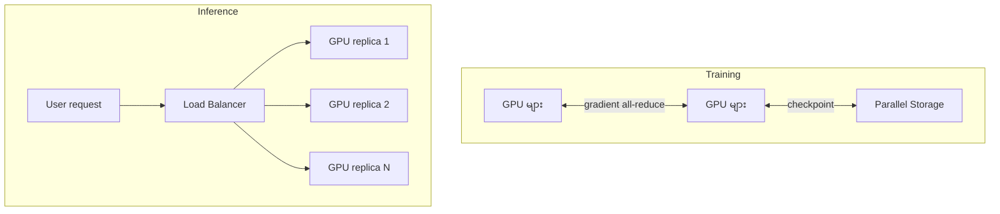
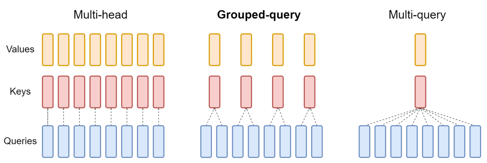
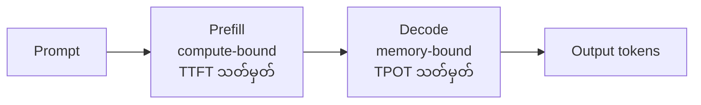
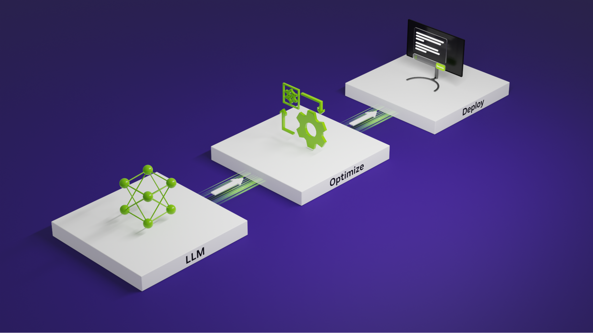

# Module 04 — Training vs Inference (ပြည့်စုံသော ရှင်းလင်းချက်)

> ဤ module ၏ ရည်ရွယ်ချက် — training နှင့် inference သည် မည်သို့ ကွာခြားသည်၊ memory/network/power requirement များ မည်သို့ မတူညီရသည် ဆိုသည်ကို နားလည်ပြီး scenario မေးခွန်းများကို မှန်ကန်စွာ ဖြေဆိုနိုင်စေရန် ဖြစ်ပါသည်။

---

## 1. ပြဿနာ — ဤ ခွဲခြားမှု ဘာကြောင့် အရေးကြီးသလဲ

စာမေးပွဲ၏ scenario မေးခွန်း အများစုသည် "ဤ workload သည် training လား inference လား" ကို ခွဲခြားနိုင်မှ ဖြေဆိုနိုင်ပါသည်။ ၂ ခုလုံးသည် GPU အသုံးပြုသော်လည်း architecture requirement များသည် ဆန့်ကျင်ဘက်အထိ ကွာခြားပါသည်။

- Training သည် GPU အမြောက်အမြားကို တစ်ပြိုင်နက် ချိတ်ဆက်ပြီး ရက်/ပတ် ကြာအောင် run ရပါသည် — network နှေးပါက ရင်းနှီးမြှုပ်နှံမှု တစ်ခုလုံး အချိန်ကုန်ပါသည်။
- Inference သည် အသုံးပြုသူ တုံ့ပြန်ချက် အချိန် (latency) ကို SLA အဖြစ် စောင့်ထိန်းရပြီး 24/7 run နေရပါသည်။
- Memory requirement ခန့်မှန်းရာတွင် training က gradient + optimizer state ပါသော်လည်း inference က weight + KV cache သာ ပါပါသည် — ဤ ခွဲခြားမှုကို မသိပါက GPU sizing မေးခွန်းများ မှားတတ်ပါသည်။

---

## 2. အဓိက သဘောတရား — ပင်မ နှိုင်းယှဉ်ချက်

| အချက် | **Training** | **Inference** |
|---|---|---|
| ရည်ရွယ်ချက် | data မှ weight တွက်ထုတ်ခြင်း | weight သုံး၍ အဖြေ ထုတ်ပေးခြင်း |
| Compute | အလွန်ကြီး (forward + backward) | နည်း (forward only) |
| Memory | weight + gradient + optimizer state | weight + KV cache + activation |
| Network | အလွန်အရေးကြီး (all-reduce) | နည်း (replica/load balance) |
| Latency | ရက်/ပတ် ကြာခွင့်ရ | ms-level SLA (TTFT/TPOT) |
| Precision | mixed (BF16/FP8) | quantization (FP8/INT8/INT4) |
| Failure | checkpoint + ပြန်လည်စတင် | replica restart (သက်သာ) |
| အချိန် သဘော | bursty (project အလိုက်) | 24/7 steady |
| Scaling | data/model/pipeline parallel | replica scale-out |



Training တွင် GPU များသည် step တိုင်း gradient ဖလှယ်ရပြီး checkpoint ကို storage သို့ ပုံမှန် သိမ်းဆည်းရပါသည်။ Inference တွင်မူ request များကို load balancer က replica များသို့ ခွဲဝေပေးပြီး replica တစ်ခုချင်းသည် လွတ်လပ်စွာ run ပါသည်။

---

## 3. Memory Footprint တွက်ချက်နည်း ⭐ (မေးခွန်း အမြဲ ထွက်)

### Training (Adam optimizer)

```
parameter တစ်ခုချင်းအတွက်:
  weight 2 bytes + gradient 2 bytes + optimizer state 8 bytes
  ≈ 12-16 bytes/parameter
```

(အသေးစိတ် — mixed precision တွင် FP16/BF16 weight 2 bytes၊ gradient 2 bytes၊ Adam ၏ first/second moment 2 × 4 bytes = 8 bytes ဖြစ်ပါသည်။ FP32 master weight ထားပါက နောက်ထပ် 4 bytes ပေါင်း၍ 16 bytes/parameter အထိ ရှိနိုင်ပါသည်။ အသုံးပြုသော framework/implementation ပေါ် မူတည်၍ ပမာဏ ကွာခြားနိုင်ပါသည် — needs verification per framework)

> **7B model** → 7B × 12-16 bytes ≈ **84-112GB** (activation အပါ) — GPU တစ်လုံးတည်းတွင် မဝင်နိုင်ပါ — distributed training မဖြစ်မနေ လိုအပ်ပါသည်

### Inference

```
weight (bf16 = 2 bytes/param) + KV cache + activation
```

> **7B model** → ~14GB + KV cache — GPU ၁-၂ လုံးဖြင့် လုံလောက်ပါသည်

⚠️ "inference တွင် memory ဘာကြောင့် ကြီးရသေးသလဲ" → **KV cache** ကြောင့် ဖြစ်ပြီး context ရှည်လေ ကြီးလေ ဖြစ်ပါသည်။ KV cache ကို ခန့်မှန်းလိုပါက —

```
KV cache ≈ 2 (K + V) × layer အရေအတွက် × KV head အရေအတွက်
          × head dimension × bytes/element × batch × sequence length
```

MQA/GQA ကဲ့သို့ KV head နည်းသော architecture တွင် ဤ ပမာဏ သိသိသာသာ လျော့ကျပါသည်။


*ပုံ — attention mechanism နှိုင်းယှဉ်ချက် (ရင်းမြစ်: NVIDIA Developer Blog, Mastering LLM Inference Optimization)*

---

## 4. Compute Profile — Compute-bound vs Memory-bound

- **Training** — compute-bound (GEMM ကြီးများ၊ arithmetic intensity မြင့်) — Tensor Core အပြည့် အသုံးပြုနိုင်
- **Inference** — ၂ ပိုင်း ခွဲ ကြည့်ရမည် —
  - **Prefill** — prompt တစ်ခုလုံး တစ်ပြိုင်နက် လုပ်ဆောင်ခြင်း — compute-bound (GEMM)
  - **Decode** — token တစ်လုံးချင်း ထုတ်ခြင်း — **memory-bound** (GEMV — weight + KV cache ဖြတ်သန်းရ)



"decode ဘာကြောင့် နှေးရသလဲ" → **memory bandwidth** ဖြစ်ပြီး GPU compute မဟုတ်ပါ။ ထို့ကြောင့် decode ပိုင်းတွင် HBM bandwidth မြင့်သော GPU က ပိုမို အကျိုးရှိပါသည်။ TTFT (Time To First Token) သည် prefill ကို တိုင်းတာပြီး TPOT (Time Per Output Token) သည် decode ကို တိုင်းတာပါသည်။

---

## 5. Network နှင့် Scaling နှိုင်းယှဉ်ချက်

### Networking — အကြီးမားဆုံး ကွာခြားချက်

**Training** — synchronous **all-reduce** — GPU အားလုံးကြား gradient များ ပေါင်းချုပ်ရပါသည်။ GPU 32 လုံး ပါသော job တစ်ခုသည် step တိုင်းတွင် gradient GB အဆင့် လှုပ်ရှားပြီး network နှေးပါက GPU အားလုံး စောင့်ဆိုင်းကာ utilization ကျဆင်းပါသည် — ထို့ကြောင့် InfiniBand ကဲ့သို့ fabric မဖြစ်မနေ လိုအပ်ပါသည်။

**Inference** — replica တစ်ခုချင်း လွတ်လပ်စွာ run ပြီး load balancer က ခွဲဝေပေးပါသည် (model ကြီး tensor parallel ဆိုပါက node အတွင်း NVLink လိုအပ်)။

### Scaling Strategy ကွာခြားချက်

| Training | Inference |
|---|---|
| **Data parallel** — data ခွဲပြီး gradient ပေါင်းချုပ် | **Replica** — service အများ တင်ပြီး load balance |
| **Tensor parallel** — layer တစ်ခုချင်း matrix ခွဲ | tensor parallel (ကြီးမား model အတွက်) |
| **Pipeline parallel** — layer အလိုက် GPU ခွဲဝေ | batch tuning (continuous batching) |

### Precision နှင့် Optimization ကွာခြားချက်

- **Training** — mixed precision (BF16 + FP32 master weight)၊ gradient checkpointing၊ FlashAttention
- **Inference** — quantization (FP8/INT8/INT4)၊ distillation၊ caching (KV cache, prefix caching)၊ batching


*ပုံ — LLM optimize/deploy workflow (ရင်းမြစ်: NVIDIA Developer Blog)*

---

## 6. လက်တွေ့ စီစဉ်ခြင်း — Hardware Requirement ခွဲခြားပုံ နှင့် စစ်ဆေးရန် command များ

**Training cluster** — HBM 80GB+ GPU များ၊ NVLink + InfiniBand fabric၊ checkpoint သိမ်းရန် parallel file system၊ power ကြီးမား

**Inference fleet** — latency သေချာမှု ပထမဦးစားပေး၊ power သက်သာ GPU (L4/L40S) မှ H100 အထိ၊ MIG ဖြင့် sharing၊ replica ဖြင့် ချဲ့ထွင်

**GPU memory အခြေအနေ စစ်ဆေးရန်** (ဥပမာ command များ — environment အလိုက် output ကွာခြားနိုင်ပါသည်):

```bash
# GPU တစ်လုံးချင်း၏ memory စုစုပေါင်း/အသုံးပြုပြီး ပမာဏ နှင့် utilization ကို CSV အဖြစ် ပြသည်
nvidia-smi --query-gpu=index,name,memory.total,memory.used,utilization.gpu --format=csv

# run နေသော process များ မည်မျှ GPU memory စားနေသည် ကြည့်ရန်
nvidia-smi --query-compute-apps=pid,process_name,used_memory --format=csv
```

Memory ခန့်မှန်းချက် တွက်ရာတွင် အထက်ပါ ပုံသေနည်းများကို သာမန် ဥပမာ အဖြစ် အသုံးပြုပြီး activation size, batch size, sequence length ကို ထည့်သွင်း တွက်ချက်ပါ — ပုံသေ ဂဏန်းမဟုတ်ပါ။

**Scenario ဖြေဆိုပုံ** — "training job network တွင် ပိတ်နေ" → fabric ပြဿနာ ဦးစားပေး။ "chatbot response နှေး" → TTFT/TPOT, batch size, replica အရေအတွက် စဉ်းစား။

---

## 7. Failure နှင့် Cost Profile နှင့် စစ်ဆေးရန် အချက်များ

- **Training failure** — checkpoint အဆင့်အထိ ပြန်လည် ဆုံးရှုံးပြီး GPU-week တန်ဖိုး ကြီးမား — checkpoint အမြဲ သိမ်းဆည်းရပါသည်
- **Inference failure** — replica ပြန်လည် တင်ရုံ — SLA ပျက်စီးမှု ပမာဏသာ
- **Cost** — training = CapEx/bursty၊ inference = OpEx/steady (24/7)

### အဓိက မှားယွင်းနိုင်သော အချက်များ (Exam traps)

1. "Inference သည် training ၏ အပိုင်းငယ်သာ" — မဟုတ်ပါ — requirement များ သီးခြား
2. Training = network အရေးကြီး၊ Inference = latency အရေးကြီး
3. Memory ခန့်မှန်းပါက gradient + optimizer state မမေ့ပါနှင့်
4. Inference memory = weight + KV cache
5. Batch ကြီးလေ throughput ပိုကောင်းလေ — သို့သော် latency ကျနိုင်

---

## 8. Self-check (Mini-Quiz)

1. Training နှင့် Inference ကို compute, memory, network, latency ၄ ချက်ဖြင့် နှိုင်းယှဉ်ပါ။
2. 7B model အတွက် training memory ခန့်မှန်းချက် မည်မျှရှိသလဲ (Adam)။
3. Training cluster တွင် ဘာကြောင့် InfiniBand လိုအပ်ရသလဲ။
4. Prefill နှင့် Decode အနက် မည်သည့်အဆင့်က memory-bound လဲ။
5. Inference တွင် context ရှည်လာပါက memory မည်သည့်အပိုင်း ကြီးလာသလဲ။

**အဖြေများ** — 1) Training: compute/network ကြီး/ကြာခွင့်ရ၊ Inference: latency SLA/weight+KV · 2) ~84-112GB · 3) all-reduce ကြောင့် GPU အားလုံး စောင့်ဆိုင်းမှု မဖြစ်စေရန် · 4) **Decode** · 5) **KV cache**

---

## 9. Official References

- Mastering LLM Techniques — Inference Optimization: https://developer.nvidia.com/blog/mastering-llm-techniques-inference-optimization/
- NVIDIA Transformer Engine: https://developer.nvidia.com/transformer-engine
- NVIDIA AI Enterprise: https://www.nvidia.com/en-us/data-center/products/ai-enterprise/

---

## Technical review notes

- Training memory ပုံသေနည်းကို 12-16 bytes/parameter အဖြစ် ထိန်းသိမ်းထားပြီး 16 bytes သည် FP32 master weight အပါ mixed-precision Adam အတွက် ဖြစ်ကြောင်း ရှင်းလင်း ထည့်သွင်းထားပါသည် — တိကျသော ပမာဏသည် framework/implementation ပေါ် မူတည်၍ ကွာခြားနိုင်ပါသည် (needs verification per framework)။
- 7B (~84-112GB) နှင့် 7B inference (~14GB) ဂဏန်းများသည် ပုံသေနည်းအရ တွက်ချက်မှု ဖြစ်ပြီး တိုင်းတာထားသော benchmark မဟုတ်ပါ။ activation/batch/sequence length ပေါ် မူတည်၍ တက်လာနိုင်ပါသည်။
- KV cache ပုံသေနည်းသည် standard multi-head attention အတွက် ဖြစ်ပြီး MQA/GQA/MLA ကဲ့သို့ architecture များတွင် ကွာခြားနိုင်ပါသည်။
