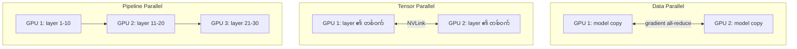

# Module 05 — GPU Platforms & Scaling (ပြည့်စုံသော ရှင်းလင်းချက်)

> ဤ module ၏ ရည်ရွယ်ချက် — DGX/HGX/MGX/IGX platform များ ခွဲခြားနိုင်ခြင်း၊ scale-up vs scale-out ကို မမှားစေခြင်း၊ multi-GPU parallelism နှင့် cluster reference architecture ကို နားလည်စေခြင်း ဖြစ်ပါသည်။

---

## 1. ပြဿနာ — Platform တစ်ခုတည်း မရှိရခြင်း ဘာကြောင့်လဲ

AI system ဆောက်လိုသူတိုင်း ရင်ဆိုင်ရသော ပထမ မေးခွန်းမှာ "မည်သည့် hardware ပုံစံ ဝယ်မလဲ" ဖြစ်ပါသည်။ ပြီးပြည့်စုံသော system လိုသလား၊ OEM ကိုယ်တိုင် ဆောက်လိုသလား၊ edge အတွက်လား ဆိုသည်ကို မခွဲခြားနိုင်ပါက ကုန်ကျစရိတ်နှင့် တည်ဆောက်ချိန် ၂ ခုလုံး လွဲမှားနိုင်ပါသည်။ ထို့အပြင် GPU အရေအတွက် တိုးလာသည်နှင့် အမျှ "node အတွင်း ချိတ်ဆက်မှု" နှင့် "node ကြား ချိတ်ဆက်မှု" ကို မတူညီသော နည်းပညာများဖြင့် ဖြေရှင်းရပါသည် — ဤ ခွဲခြားမှု (scale-up vs scale-out) သည် စာမေးပွဲ၏ exam trap အကြီးဆုံး ဖြစ်ပါသည်။

---

## 2. အဓိက သဘောတရား — NVIDIA Platform မိသားစု

| Platform | ရှင်းလင်းချက် | မည်သူအတွက် |
|---|---|---|
| **DGX** | 8×GPU ပါ ပြီးပြည့်စုံ system (hardware + software stack အပြည့်) | ဝယ်ပြီး ချက်ချင်း run |
| **HGX** | GPU baseboard — OEM များ ကိုယ်ပိုင် server ဆောက်ရန် | Dell, Supermicro, HPE |
| **MGX** | modular reference design (mixed GPU/CPU/DPU) | enterprise/edge စိတ်ကြိုက် |
| **IGX** | edge/industrial platform (medical, robotics) | real-time edge AI |

**မှတ်ရနည်း** — DGX = ကား အပြည့်အစုံ ဝယ်ခြင်း၊ HGX = chassis + engine ဝယ်ပြီး ကိုယ်တိုင် တပ်ဆင်ခြင်း၊ MGX = modular အစိတ်အပိုင်း၊ IGX = စက်ရုံ/edge အတွက်။


*ပုံ — HGX A100 8-way GPU baseboard (ရင်းမြစ်: NVIDIA Developer Blog)*


*ပုံ — HGX-2 platform (ရင်းမြစ်: NVIDIA Developer Blog)*

---

## 3. နှိုင်းယှဉ်ချက် — DGX မျိုးဆက်များ စွမ်းရည် တိုးတက်မှု

| System | GPU | GPU Memory | Performance | Power (max) |
|---|---|---|---|---|
| DGX A100 | 8×A100 | 320GB (640GB ဗားရှင်း ရှိ) | ~5 PFLOPS (FP16/BF16) | 6.5kW |
| DGX H100 | 8×H100 | 640GB HBM3 | 32 PFLOPS (FP8, sparsity အပါ) | 10.2kW |
| DGX H200 | 8×H200 | 1.1TB HBM3e | ~32 PFLOPS (FP8) | 10.2kW |
| **DGX B200** | 8×B200 | **1.4TB** HBM3e | FP8: 72 PFLOPS / FP4: 144 PFLOPS (sparse) | **14.3kW** |
| GB200 NVL72 | 72×B200 (rack) | 13.4TB | exascale class (FP4 ~1.4 EFLOPS sparse) | ~120kW |

⚠️ DGX B200 တစ်လုံး = 14.3kW — ရုံးအဆောက်အဦ တစ်ခုလောက် ပါဝါ စားသုံးပါသည်။ ဤ table သည် rack density မေးခွန်းများ၏ အခြေခံ ဖြစ်ပါသည်။ (Performance ဂဏန်းများသည် GPU generation နှင့် sparse/dense setting ပေါ် မူတည်ပြီး NVIDIA ၏ published figure များ ဖြစ်ပါသည် — model/datasheet အလိုက် ပြန်စစ်ပါ)

**GB200 NVL72** — GPU 72 လုံးကို rack တစ်ခုလုံးအဖြစ် NVLink ဖြင့် ချိတ်ဆက်ပြီး "တစ်ခုတည်းသော ကြီးမား GPU" အဖြစ် မြင်နိုင်အောင် ဆောက်လုပ်ထားခြင်း (rack-scale computing) ဖြစ်ပါသည်။ 13.4TB unified HBM3e နှင့် 130TB/s NVLink domain ဖြင့် parameter ထောင်ချီသော model ကို rack တစ်ခုတည်းတွင် ထားနိုင်ပါသည်။

---

## 4. Scale-up vs Scale-out ⭐ (Exam trap အကြီးဆုံး)

| အချက် | **Scale-up** | **Scale-out** |
|---|---|---|
| အကွာအဝေး | node (သို့ rack) အတွင်း | node များကြား |
| Technology | **NVLink, NVSwitch** | **InfiniBand, Spectrum-X Ethernet** |
| အမြန်နှုန်း | TB/s class (NVLink 5 = 1.8TB/s per GPU) | 400-800Gb/s per port |
| ရည်ရွယ်ချက် | GPU ချင်း ကြား အနီးကပ် (tensor parallel) | cluster ချဲ့ထွင် (data parallel) |

```mermaid
flowchart LR
    subgraph Node အတွင်း Scale-up
    G1[GPU] ---|NVLink TB/s| G2[GPU]
    G2 ---|NVLink| G3[GPU]
    G3 ---|NVLink| G4[GPU]
    end
    subgraph Node ကြား Scale-out
    N1[Node 1] ---|InfiniBand 400G| SW[Fabric Switch]
    SW ---|InfiniBand| N2[Node 2]
    SW ---|InfiniBand| N3[Node N]
    end
```

**မှတ်ရနည်း** — NVLink = အိမ်အတွင်း ဆက်သွယ်ရေး (အလွန်မြန်)၊ InfiniBand = အိမ်ချင်းကြား လမ်းမကြီး။ NVSwitch သည် node အတွင်း NVLink connection များကို စီမံသော switch chip ဖြစ်ပါသည်။

---

## 5. Multi-GPU Parallelism



1. **Data parallel** — GPU တိုင်းက model အပြည့် ပိုင်ဆိုင်ပြီး data ခွဲဝေစားသုံး — step တိုင်း gradient all-reduce (NCCL)
2. **Tensor parallel** — layer တစ်ခုချင်း matrix ကို GPU များကြား ခွဲဝေ (NVLink လိုအပ်)
3. **Pipeline parallel** — layer အလွှာ အလိုက် GPU များ ခွဲဝေ (assembly line ကဲ့သို့)
4. **Expert parallel** — MoE model များတွင် expert အလိုက် ခွဲဝေ

Tensor parallel သည် GPU ကြား အဆက်မပြတ် ဆက်သွယ်ရသဖြင့် NVLink မပါက မထိရောက်ပါ — data parallel မူ node ကြား fabric အပေါ် မူတည်ပါသည်။

---

## 6. Reference Architecture — BasePOD vs SuperPOD

| အဆင့် | ရှင်းလင်းချက် |
|---|---|
| Node | DGX တစ်လုံး (8 GPU) |
| Rack | node 16-64 ပါ (power/cooling ဒီအဆင့်တွင်) |
| **BasePOD** | validated reference pod — compute + fabric + storage + management |
| **SuperPOD** | multi-rack supercomputer — GPU ရာ/ထောင်ချီ |

⚠️ BasePOD vs SuperPOD = pod တစ်ခု vs supercomputer တစ်ခု — စာမေးပွဲတွင် ရှုပ်အောင် မေးလေ့ရှိပါသည်။

---

## 7. Use Case အလိုက် Hardware ရွေးချယ်ခြင်း (Objective 2.1)

| Use case | GPU requirement | Network |
|---|---|---|
| 7B fine-tune | 8×H100 တစ် node (NVLink) | NVLink ဖြင့် လုံလောက် |
| 100B+ pretrain | GPU ရာ/ထောင်၊ multi-node | InfiniBand မဖြစ်မနေ |
| Real-time inference | L40S/H100၊ latency သေချာ | standard (+NVLink TP) |
| Offline batch inference | throughput မြင့် | standard |
| VDI / graphics | L4/L40 | MIG/vGPU sharing |

**ဆုံးဖြတ်ချက် အဆင့်များ** — ① model size × precision → GPU memory → ② training/inference → ③ single/multi node → ④ network fabric → ⑤ storage I/O → ⑥ power/cooling budget

---

## 8. လက်တွေ့ စီစဉ်ခြင်း — Sizing ဥပမာ နှင့် စစ်ဆေးရန် command များ

### လက်တွေ့ မြင်ကွင်း — 70B Model Training စဉ်းစားပုံ (generic ဥပမာ)

**မေးခွန်း** — Llama-70B ကို fine-tune မည်။ GPU အနည်းဆုံး မည်မျှ လိုအပ်သလဲ။

**စဉ်းစားချက်** — 70B × 12-16 bytes ≈ 840GB-1.1TB — H100 80GB တစ်လုံးတွင် မဝင်ဆန့်ပါ — node အနည်းဆုံး ၂-၄ ခု (GPU 16-32 လုံး) လိုအပ်ပြီး: node အတွင်း tensor parallel (NVLink) + node ကြား data parallel (InfiniBand) + parallel file system ။ (ဤ ဂဏန်းများသည် memory ပုံသေနည်းအရ ခန့်မှန်းချက် ဖြစ်ပြီး optimizer/activation setting ပေါ် မူတည်ပါသည်)

### ချိတ်ဆက်မှု topology စစ်ဆေးရန် (ဥပမာ command များ — GPU/driver version ပေါ် မူတည်၍ output ကွာခြားနိုင်)

```bash
# GPU များကြား topology (NVLink/NVSwitch/PCIe မည်သို့ ချိတ်ဆက်ထားသည်) ပြသည်
nvidia-smi topo -m

# NVLink link များ၏ အခြေအနေ ကြည့်ရန် (NVLink ပါသော GPU များတွင်သာ)
nvidia-smi nvlink -s

# InfiniBand port state နှင့် link speed စစ်ဆေးရန်
ibstat
```

`nvidia-smi topo -m` သည် GPU များကြား NVLink (NVL/NV#) လား PCIe လား ဆိုသည်ကို ပြပြီး tensor parallel ထားရန် မည်သည့် GPU အစုကို ရွေးရမည် ဆုံးဖြတ်ရာတွင် အသုံးဝင်ပါသည်။

---

## 9. စစ်ဆေးရန် အချက်များ (Exam traps)

1. NVLink/NVSwitch = scale-up vs InfiniBand/Spectrum-X = scale-out
2. DGX vs HGX — ပြီးပြည့်စုံ system vs baseboard
3. BasePOD vs SuperPOD — pod vs supercomputer
4. Training cluster တွင် network က ဦးစားပေး
5. Power figure များ — rack planning မေးခွန်းနှင့် ချိတ်ဆက်

---

## 10. Self-check (Mini-Quiz)

1. OEM က ကိုယ်ပိုင် server တွင် 8×H100 ချိတ်ဆက် ဆောက်လုပ်လိုပါက မည်သည့် platform လိုအပ်သလဲ။
2. GPU 1000 ပါ training cluster အတွက် fabric ၂ မျိုး ခွဲခြားဖော်ပြပါ။
3. DGX B200 တစ်လုံး ပါဝါ မည်မျှ စားသုံးသလဲ။
4. Tensor parallel အတွက် node အတွင်း မည်သည့် interconnect လိုအပ်သလဲ။

**အဖြေများ** — 1) HGX baseboard · 2) node ကြား = InfiniBand (scale-out)၊ node အတွင်း = NVLink/NVSwitch (scale-up) · 3) 14.3kW (max) · 4) **NVLink/NVSwitch**

---

## 11. Official References

- NVIDIA DGX B200: https://www.nvidia.com/en-us/data-center/dgx-b200/
- NVIDIA HGX: https://www.nvidia.com/en-us/data-center/dgx/
- NVLink and NVSwitch: https://www.nvidia.com/en-us/data-center/nvlink/
- BasePOD / SuperPOD: https://www.nvidia.com/en-us/data-center/data-center-reference-architecture/

---

## Technical review notes

- မူလ table တွင် DGX A100 ၏ performance ကို "FP8" အဖြစ် ဖော်ပြထားခြင်းသည် မမှန်ပါ — A100 တွင် FP8 support မရှိပါ။ "~5 PFLOPS (FP16/BF16)" အဖြစ် ပြင်ဆင်ထားပါသည် (NVIDIA DGX A100 published figure "5 petaFLOPS AI performance")။
- DGX B200 "72 PFLOPS (FP4)" ကို NVIDIA datasheet အတိုင်း FP8: 72 PFLOPS / FP4: 144 PFLOPS (sparse)၊ dense က တစ်ဝက် ဖြစ်ကြောင်း ရှင်းလင်း ပြင်ဆင်ထားပါသည် (verified — NVIDIA DGX B200 datasheet)။
- GB200 NVL72 13.4TB HBM3e နှင့် ~120kW ကို NVIDIA spec page အတိုင်း ထိန်းသိမ်းထားပါသည် (verified)။ သို့သော် vendor system အလိုက် operating power 125-135kW အထိ ရှိနိုင်သဖြင့် "up to ~120kW nominal" အဖြစ်သာ ယူဆပါ (needs verification per vendor)။
- DGX H100 10.2kW၊ DGX A100 6.5kW၊ DGX H200 memory 1.1TB HBM3e များကို NVIDIA published figures အဖြစ် ထားရှိပြီး DGX H200 ၏ "~32 PFLOPS" ကိုမူ တိကျသော ဗားရှင်း datasheet ဖြင့် မစစ်ဆေးရသေးပါ (needs verification)။
