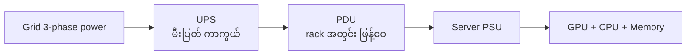
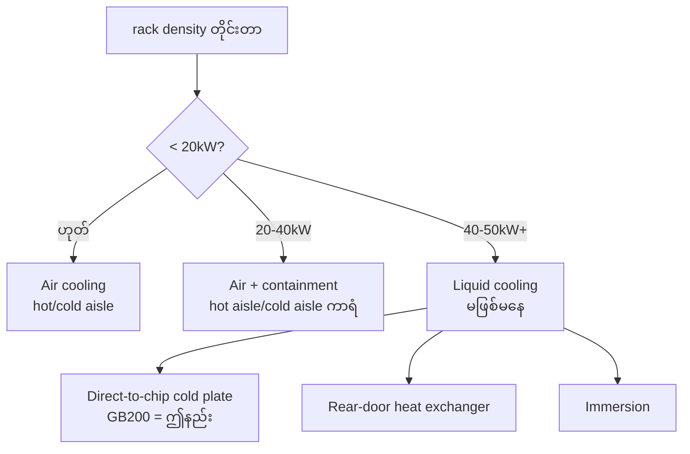

# Module 06 — Power, Cooling & Facility (ပြည့်စုံသော ရှင်းလင်းချက်)

> ဤ module ၏ ရည်ရွယ်ချက် — GPU-dense data center ၏ power/cooling/facility လိုအပ်ချက်များကို နားလည်ပြီး rack density, PUE, redundancy ကဲ့သို့ သော့ချက် ဂဏန်းများဖြင့် တွက်ချက် ဆုံးဖြတ်နိုင်စေရန် ဖြစ်ပါသည်။

---

## 1. ဤ module ဘာကြောင့် အရေးကြီးသလဲ

IT professional အများစုက power/cooling သည် facility team ၏ အလုပ်ဟု ယူဆထားလေ့ရှိသော်လည်း GPU rack တစ်ခုသည် web server rack တစ်ခုထက် ပါဝါ ၁၀-၂၀ ဆ ပိုမို စားသုံးပါသည်။

```
ရိုးရာ web server rack      ~5-10 kW
DGX H100 တစ်လုံး            10.2 kW  (rack တစ်ခုလုံးထက် ကြီး!)
DGX B200 တစ်လုံး            14.3 kW
GB200 NVL72 rack တစ်ခု      ~120 kW
```

ထို့ကြောင့် GPU-dense infrastructure သည် ရိုးရာ data center ဒီဇိုင်းနှင့် မကိုက်ညီဘဲ ပြန်လည် စဉ်းစား ဒီဇိုင်းဆွဲရပါသည်။

---

## 2. Power — အဓိက သဘောတရားများ

### Power Density (kW/rack)
- ရိုးရာ data center — rack တစ်ခု 5-10kW
- GPU-dense — 40-130kW/rack → ရိုးရာ facility တွင် မဝင်နိုင်

### Power Distribution Chain



- **3-phase power** — GPU rack များအတွက် လိုအပ်
- **PDU (Power Distribution Unit)** — rack အတွင်း ပါဝါ ဖြန့်ဝေပေး
- **UPS (Uninterruptible Power Supply)** — မီးပြတ်ကာကွယ်ခြင်း
- **Redundancy** — **N+1** (လိုအပ်သော အရေအတွက် + ၁ လုံး အပို) vs **2N** (ပြည့်စုံသော အရေအတွက် တစ်ဆ ထပ်)

⚠️ N+1 vs 2N ကို စာမေးပွဲတွင် ခွဲခြား မေးလေ့ရှိပါသည် — N+1 = အနည်းဆုံး redundancy၊ 2N = အပြည့်အဝ redundancy (ကုန်ကျ ၂ ဆ)။

### Power Budget တွက်ချက်နည်း

```
စုစုပေါင်း = GPU အရေအတွက် × GPU TDP + server overhead + cooling
```

> **ဥပမာ** — DGX H100 ၄ လုံးပါ rack: 4 × 10.2 ≈ 41kW + cooling overhead → rack အတွက် 50kW+ ပါဝါ လိုအပ်ပါသည်

### PUE (Power Usage Effectiveness) ⭐

```
              facility စုစုပေါင်း ပါဝါ
PUE  =  ─────────────────────────────
              IT equipment ပါဝါ
```

| PUE | အဓိပ္ပာယ် |
|---|---|
| 1.0 | perfect (cooling/lighting ဘာမှ မစား) |
| 1.1-1.2 | ခေတ်မီ / liquid cooling |
| 1.5-2.0 | ရိုးရာ data center |

> **တွက်ချက် ဥပမာ** — IT load 326kW၊ PUE 1.2 → facility 391kW (non-IT 65kW)။ PUE 1.5 → facility 489kW (non-IT 163kW — စုစုပေါင်း၏ 1/3)

---

## 3. Cooling — Air မှ Liquid သို့



### Air Cooling
- ရိုးရာ နည်းလမ်း — ~30-50kW/rack အထိသာ တတ်နိုင်
- **Hot aisle / cold aisle** — အေးသော လေနှင့် ပူသော လေ ခွဲခြားပြီး containment လုပ်ပါက ပိုမို ထိရောက်
- **ASHRAE guideline** — inlet temperature ~18-27°C အတွင်း ထားရှိ

### Liquid Cooling

| နည်းလမ်း | လုပ်ဆောင်ပုံ | အသုံးပြုချိန် |
|---|---|---|
| **Direct-to-chip (cold plate)** | GPU heat sink ပေါ်တွင် ရေ စီးဆင်းစေခြင်း | 50kW+/rack (GB200 = ဤနည်း) |
| **Rear-door heat exchanger** | rack တံခါးတွင် liquid coil | air-cooled room upgrade |
| **Immersion** | စက်တစ်ခုလုံး liquid အတွင်း နှစ်မြှုပ် | extreme density / edge case |

### Thermal Throttling

GPU အပူချိန် မြင့်တက်လာပါက GPU သည် clock speed ကို အလိုအလျောက် လျှော့ချ (throttle) ပြီး performance ကျဆင်းသွားပါသည်။

```
အပူချိန် ↑ → clock ↓ → performance ↓ (တိတ်တဆိတ်!)
```

"အလုပ် နှေးလာ" ဆိုသော scenario များတွင် ပထမဆုံး စစ်ဆေးရမည့် အချက်များအနက် တစ်ခု ဖြစ်ပါသည်။

---

## 4. Facility Requirements (Objective 2.6)

1. **Power availability** — grid မှ ပါဝါ ရရှိနိုင်မှု (GPU pod = MW အဆင့်)၊ redundancy
2. **Cooling capacity** — chiller, cooling tower, water supply၊ PUE ပန်းတိုင်
3. **Floor loading** — GPU rack များ အလေးချိန် 1,500kg+ အထိ — ကြမ်းခင်း ခံနိုင်ရည်
4. **Space & layout** — rack အရေအတွက်၊ expansion လမ်းကြောင်း
5. **Network cabling** — fiber လမ်းကြောင်း၊ cross-connect
6. **Physical security** — access control, CCTV
7. **Fire suppression** — gas-based system (ရေဖြင့် မရ — လျှပ်စစ်ပစ္စည်း)
8. **Out-of-band management** — BMC network
9. **Seismic / weight** — တည်နေရာ ပေါ် မူတည်

---

## 5. လေ့ကျင့်ခန်း — လက်တွေ့ တွက်ချက်ကြည့်ခြင်း

**မေးခွန်း** — DGX H100 ၃၂ လုံး ဝယ်မည်။ rack တစ်ခုတွင် ၄ လုံး ထည့်မည်။

- စုစုပေါင်း power = 32 × 10.2kW ≈ 326kW (cooling ပါ ဆို ~400kW)
- Rack ၈ ခု၊ တစ်ခုချင်း ~41kW → **liquid cooling လိုအပ်**
- PUE 1.2 ဆိုပါက facility ပါဝါ = 326 × 1.2 ≈ 391kW — ငယ်ရွယ်သော စက်ရုံ တစ်ခုလောက် စားသုံးမှု

---

## 6. ထပ်ဆင့် လေ့ကျင့်ခန်း

1. ရိုးရာ rack 8kW ဆိုပါက DGX H100 rack (~41kW) သည် ဆယ်ဆ မည်မျှ ပိုစားသုံးသလဲ — ≈ 5 ဆ
2. IT load 200kW၊ PUE 1.15 → facility = 230kW (cooling/lighting 30kW)
3. GPU အပူချိန် limit 83°C၊ လက်ရှိ 85°C — အရင် စစ်ဆေးရန်: airflow, rack density, ambient, filter

---

## 7. အဓိက မှားယွင်းနိုင်သော အချက်များ

1. kW/rack — 5-10 (ရိုးရာ) vs 40-130 (GPU)
2. N+1 vs 2N redundancy ခွဲခြားပါ
3. PUE ပုံသေနည်း — 1.0 က perfect
4. GPU-dense တွင် air မှ liquid သို့ ပြောင်းရခြင်း
5. Thermal throttling = performance ကျဆင်းခြင်း ၏ အကြောင်းရင်း
6. Floor loading — facility requirement မေးခွန်းများတွင် ပါဝင်

---

## 8. Mini-Quiz

1. GB200 NVL72 rack (~120kW) သည် web server rack (5kW) ထက် ဆယ်ဆ မည်မျှ ပိုစားသုံးသလဲ။
2. PUE 1.5 ဆိုပါက facility ပါဝါ ထဲတွင် cooling/lighting အတွက် မည်မျှ ရာခိုင်နှုန်း ကုန်သလဲ။
3. Rack density မည်မျှ ကျော်လျှင် liquid cooling စဉ်းစားသင့်သလဲ။

**အဖြေများ** — 1) ~24 ဆ · 2) 33% · 3) ~40-50kW/rack

---

## 9. Official References

- NVIDIA DGX B200 Datasheet: https://www.nvidia.com/en-us/data-center/dgx-b200/
- NVIDIA GB200 NVL72: https://www.nvidia.com/en-us/data-center/gb200-nvl72/
- ASHRAE Data Center Guidelines: https://www.ashrae.org/technical-resources/bookstore/datacom-equipment-book-series
- NVIDIA Liquid Cooling: https://www.nvidia.com/en-us/data-center/liquid-cooling/
