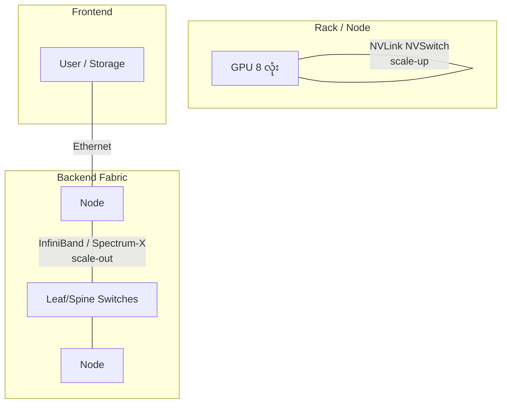

# Module 07 — Networking for AI (ပြည့်စုံသော ရှင်းလင်းချက်)

> ဤ module ၏ ရည်ရွယ်ချက် — AI cluster network သည် ရိုးရာ network နှင့် မည်သို့ ကွာခြားသည်၊ RDMA/InfiniBand/SHARP ကဲ့သို့ နည်းပညာများ ဘာကြောင့် လိုအပ်ရသည် ဆိုသည်ကို နားလည်စေရန် ဖြစ်ပါသည်။

---

## 1. AI Network သည် ရိုးရာ network နှင့် မည်သို့ ကွာခြားသလဲ

ရိုးရာ data center တွင် traffic သည် client → server (north-south) ဖြစ်ပြီး AI cluster တွင်မူ **server ချင်းကြား (east-west)** traffic က 90% ကျော် ဖြစ်ပါသည်။

```
ရိုးရာ DC:   User → Server → User        (north-south များ)
AI cluster:  GPU ↔ GPU ↔ GPU ↔ GPU        (east-west 90%+)
```

Training job တစ်ခု run နေစဉ် GPU ရာချီက တစ်ပြိုင်နက် gradient GB အဆင့် အချင်းချင်း လဲလှယ်နေပါသည် — network တစ်ခုတည်း နှေးပါက GPU အားလုံး စောင့်ဆိုင်းပြီး utilization ကျဆင်းပါသည်။

ထို့ကြောင့် AI network တွင် **bandwidth, latency, congestion control** သုံးခုလုံး အရေးကြီးပါသည်။

---

## 2. Network အမျိုးအစား ၃ မျိုး

| Network | အသုံးပြုရာ | Technology |
|---|---|---|
| **Scale-up** | GPU/node အတွင်း | NVLink, NVSwitch |
| **Scale-out (backend fabric)** | node ကြား — training/inference traffic | InfiniBand, Spectrum-X |
| **Frontend / management** | user access, storage, BMC | standard Ethernet |



⚠️ "backend fabric" နှင့် "frontend network" ကို ခွဲခြားမေးလေ့ရှိပါသည် — AI job traffic သည် backend တွင် သီးသန့် စီးဆင်းရပါမည်။

---

## 3. TCP vs RDMA ⭐ (Objective 2.8)

### TCP/IP (ရိုးရာ)

```
App → Kernel buffer → NIC → ကွန်ရက် → NIC → Kernel buffer → App
         (CPU က တစ်ဆင့်ချင်း ကူးပေးရ → latency ကြီး, CPU စား)
```

### RDMA (Remote Direct Memory Access)

```
App memory → NIC → ကွန်ရက် → NIC → App memory
         (CPU/kernel ကို ကျော်ဖြတ် → latency နိမ့်, CPU လွတ်)
```

Network card က **CPU/kernel ကို ကျော်ပြီး** memory မှ memory သို့ တိုက်ရိုက် ရေးသား/ဖတ်ရှုခြင်း ဖြစ်ပါသည်။

ပုံစံ ၂ မျိုး —
- **InfiniBand verbs** — InfiniBand တွင် မူလ ပါဝင်ပြီးသား
- **RoCE (RDMA over Converged Ethernet) / RoCEv2** — Ethernet ပေါ်တွင် RDMA

### Lossless Network Concepts
- **PFC (Priority Flow Control)** — packet မပျက်စီးစေရန် flow ကို ရပ်ဆိုင်းခိုင်းခြင်း
- **ECN (Explicit Congestion Notification)** — ပိတ်ဆို့မှု ကြိုတင် သတိပေးခြင်း

ဤ ၂ ခုသည် RDMA အလုပ်လုပ်ရန် လိုအပ်သော "lossless" ကွန်ရက် အခြေခံ ဖြစ်ပါသည်။

### GPUDirect

- **GPUDirect RDMA** — NIC မှ GPU memory သို့ တိုက်ရိုက် (CPU မဖြတ်သန်း)
- **GPUDirect Storage** — storage မှ GPU memory သို့ တိုက်ရိုက် (data loading မြန်ဆန်)

---

## 4. High-Speed Network Options (Objective 2.9)

| Option | အမြန်နှုန်း | အသုံးပြုရာ |
|---|---|---|
| **InfiniBand** (NDR/XDR) | 400 / 800 Gb/s | large-scale training — latency အနည်းဆုံး |
| **Spectrum-X** | 400-800GbE | AI-optimized Ethernet (adaptive routing, RoCEv2) |
| Standard Ethernet | 25-400GbE | frontend, inference, general DC |

### InfiniBand ၏ ထူးခြားချက်များ
- **SHARP** — switch အတွင်းတွင်ပဲ all-reduce aggregation လုပ်ဆောင်ခြင်း → GPU workload လျော့ကျပြီး အမြန်နှုန်း တိုးတက်

```
SHARP မပါ:  GPU1 ─┐
            GPU2 ─┼→ GPU တွေ အချင်းချင်း ပေါင်းချုပ် (GPU စား)
            GPU3 ─┘

SHARP ပါ:   GPU1 ─┐
            GPU2 ─┼→ Switch အတွင်း ပေါင်းချုပ် (GPU လွတ်)
            GPU3 ─┘
```

- Lossless design၊ hardware offload
- **Rail-optimized topology** — GPU တစ်ခုချင်း NIC သီးသန့် ပါဝင်ပြီး switch အလွှာ နည်းအောင် ဒီဇိုင်း

### Topology Concepts
- **Fat-tree** — bandwidth ပြေပြစ်သော multi-tier ကွန်ရက် ဒီဇိုင်း
- **Oversubscription ratio** — downlink:uplink (1:1 = non-blocking) — ပိုမြင့်လေ ကုန်ကျသက်သာလေ သို့သော် ပိတ်ဆို့နိုင်
- **Adaptive routing** — Spectrum-X ၏ feature — ပိတ်ဆို့မှု နည်းသော လမ်းမှ အလိုအလျောက် ပို့ဆောင်

---

## 5. Training vs Inference Networking

| အချက် | Training | Inference |
|---|---|---|
| Traffic | synchronized all-reduce (ကြီးမား, bursty) | request/response (သေးငယ်, steady) |
| လိုအပ်ချက် | InfiniBand နီးပါး မဖြစ်မနေ | Ethernet + load balancer (TP ဆို NVLink) |
| Failure impact | job တစ်ခုလုံး ရပ်ဆိုင်း | replica တစ်ခု ကျဆင်းရုံ |

## 6. Management Network
- **Out-of-band (BMC)** — power on/off, console, hardware health (job traffic နှင့် သီးခြား)
- **In-band** — ပုံမှန် data traffic

---

## 7. Scenario ဖြေဆိုပုံ

**"Training job တွင် GPU utilization ကျနေပြီး အချိန် ကြာနေသည်"** →
① all-reduce ကြာချိန် တိုင်းတာ ② fabric bandwidth စစ် ③ oversubscription စစ် ④ link error စစ် — network ကို အရင် သံသယ ဝင်ပါ (training သည် network-bound ဖြစ်နိုင်)။

**"Inference latency ရုတ်တရက် တက်လာသည်"** → network သည် ဒုတိယ အဆင့်သာ — ပထမ batch size, replica, GPU throttle ကို စစ်ဆေးပါ။

---

## 8. အဓိက မှားယွင်းနိုင်သော အချက်များ

1. NVLink = scale-up vs InfiniBand/Spectrum-X = scale-out
2. RDMA = CPU/kernel bypass — မြန်ရခြင်း အကြောင်းရင်း
3. RoCE = Ethernet ပေါ် RDMA (InfiniBand မဟုတ်)
4. InfiniBand = training စံ၊ Ethernet = inference/frontend
5. SHARP = in-network computing
6. GPUDirect Storage = storage → GPU တိုက်ရိုက်

---

## 9. Mini-Quiz

1. Training cluster အတွက် fabric ၂ မျိုး ဖော်ပြပါ။
2. RDMA သည် TCP ထက် ဘာကြောင့် မြန်ဆန်သလဲ။
3. InfiniBand ၏ in-network computing feature ကို ခေါ်ဆိုပုံ ဖော်ပြပါ။

**အဖြေများ** — 1) InfiniBand၊ Spectrum-X · 2) kernel/CPU ကို ကျော်ဖြတ် memory-to-memory တိုက်ရိုက် · 3) **SHARP**

---

## 10. Official References

- InfiniBand vs Ethernet for AI: https://network.nvidia.com/pdf/whitepaper/IB_Internet_WP.pdf
- GPUDirect: https://developer.nvidia.com/gpudirect
- NVIDIA Spectrum-X: https://www.nvidia.com/en-us/networking/spectrum-x/
- NVIDIA Networking: https://network.nvidia.com
