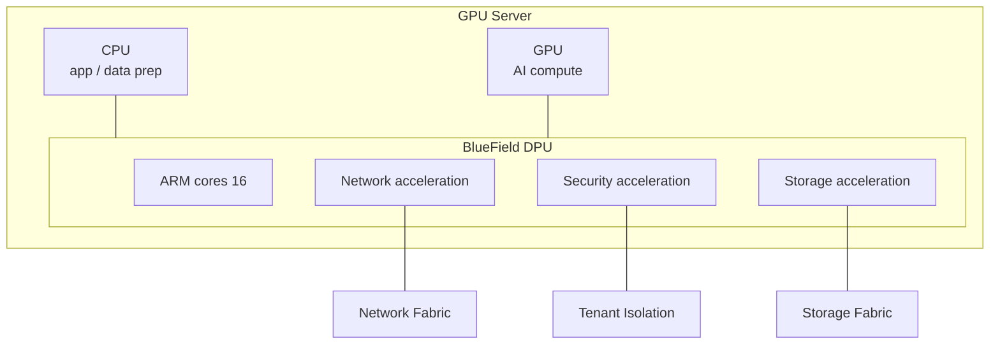

# Module 08 — DPU (Data Processing Unit) (ပြည့်စုံသော ရှင်းလင်းချက်)

> ဤ chapter ၏ ရည်ရွယ်ချက် — data center တွင် CPU သည် infrastructure အလုပ်များဖြင့် မည်သို့ ဝန်ပိနေသလဲ၊ DPU က ထိုဝန်ကို မည်သို့ လွှဲယူသလဲ၊ DOCA သည် ဘာနှင့် ဆင်တူသလဲ ဆိုသည်ကို ခွဲခြား မှတ်မိစေရန် ဖြစ်ပါသည်။

---

## 1. ပြဿနာ — CPU သည် infrastructure အလုပ်များဖြင့် ဝန်ပိနေခြင်း

ရိုးရာ server တစ်လုံးတွင် CPU core များ၏ သိသာထင်ရှားသော အစိတ်အပိုင်းတစ်ခု (လုပ်ငန်း အခြေအနေပေါ် မူတည်၍ **30% အထိ** ဟု မကြာခဏ ဖော်ပြလေ့ရှိ) သည် networking, storage, security, virtualization ကဲ့သို့သော infrastructure အလုပ်များဖြင့် ကုန်ဆုံးနေပါသည်။ AI server တစ်လုံးတွင်မူ ထို CPU စွမ်းရည်အားလုံးကို data pipeline (dataloader, preprocessing) အတွက် အသုံးပြုချင်ပါသည် — GPU များ အလုပ်မလုပ်ဘဲ စောင့်နေရမှု မဖြစ်စေချင်ပါ။

ထို့ကြောင့် ဤ ပြဿနာ ပေါ်ပေါက်လာပါသည် — **infrastructure အလုပ်များကို CPU မှ ခွဲထုတ် လုပ်ဆောင်ပေးမည့် သီးသန့် processor တစ်ခု လိုအပ်သည်**။ ထို processor သည် **DPU (Data Processing Unit)** ဖြစ်ပါသည်။ NVIDIA ၏ DPU ထုတ်ကုန် အမည်မှာ **BlueField** ဖြစ်ပါသည်။

> **ဥပမာ** — စားပွဲထိုး (CPU) သည် မီးဖိုချောင်အလုပ်ပါ လုပ်နေပါက ဧည့်ခံချိန် မလောက်တော့ပါ။ DPU သည် မီးဖိုချောင်အလုပ်ကို သီးသန့် ယူသွားပေးသကဲ့သို့ ဖြစ်ပါသည်။

---

## 2. အဓိက အယူအဆ — DPU ဆိုတာ ဘာလဲ၊ မည်သို့ အလုပ်လုပ်သလဲ

**DPU (Data Processing Unit)** သည် data center ၏ infrastructure အလုပ်များ (networking, storage, security) ကို CPU မှ ခွဲထုတ် လုပ်ဆောင်ပေးသော သီးသန့် processor ဖြစ်ပါသည်။ DPU တစ်ခုတွင် ပုံမှန်အားဖြင့် NIC (network interface) + programmable processor (ARM core များ) + hardware accelerator များ ပေါင်းစပ် ပါဝင်ပါသည်။

### လွှဲယူသော အလုပ်များ

| ကဏ္ဍ | အလုပ် |
|---|---|
| **Networking** | virtual switch, routing, RDMA, load balancing, traffic shaping |
| **Storage** | NVMe-oF (NVMe over Fabric), storage virtualization, compression |
| **Security** | encryption/decryption (IPsec, TLS), firewall, zero-trust isolation |
| **Multi-tenancy** | VM/container ချင်း hardware-level ကာကွယ်ခြင်း (cloud provider အတွက် အရေးကြီး) |
| **Infrastructure mgmt** | monitoring, telemetry |

DPU သည် ဤအလုပ်များကို ကိုယ်ပိုင် ARM core နှင့် accelerator များပေါ်တွင် လုပ်ဆောင်သောကြောင့် host CPU သည် application နှင့် AI workload အတွက် လုံးဝ လွတ်လပ်သွားပါသည်။

---

## 3. နှိုင်းယှဉ်ခြင်း — Processor ၄ မျိုး၊ NIC မှ DPU သို့ ဆင့်တက်ပုံ၊ CUDA vs DOCA

### Processor ၄ မျိုး ခွဲခြားချက်

| Processor | ရည်ရွယ်ချက် |
|---|---|
| **CPU** | general logic, OS, sequential task |
| **GPU** | AI/compute (matrix operation) |
| **DPU** | infrastructure (network/storage/security) |
| SmartNIC | NIC + programmable (DPU ၏ ရိုးရှင်းသော ဗားရှင်း) |

### NIC → SmartNIC → DPU ဆင့်တက် ပုံစံ

| Device | လုပ်ဆောင်နိုင်မှု |
|---|---|
| NIC | network traffic သာ (kernel offload အနည်းငယ်) |
| SmartNIC | NIC + programmable FPGA/ASIC — အချို့ workload offload |
| **DPU** | NIC + ARM cores + accelerators — storage, security, virtualization အပြည့် offload |

### BlueField မျိုးဆက်များနှင့် DOCA

| မျိုးဆက် | အချိန် | Network |
|---|---|---|
| BlueField-2 | 2020 | 200Gb/s |
| BlueField-3 | 2023 | 400Gb/s (ARM core 16 ခု) |
| BlueField-4 | နောက်ပိုင်း | 800Gb/s class |

- **DOCA** — DPU အတွက် software platform (SDK, framework, security service များ)။ DPU ပေါ်တွင် application ရေးသားခြင်း၊ infrastructure service များ စီမံခြင်းအတွက် ဖြစ်ပါသည်။

⚠️ **CUDA = GPU အတွက် platform** / **DOCA = DPU အတွက် platform** — ဤ ၂ ခုကို ချိတ်ဆက် မှတ်ထားပါက မမေ့နိုင်တော့ပါ။

### အကျိုးကျေးဇူးများ (စာမေးပွဲ အဖြေ)

1. **CPU လွတ်လပ်လာခြင်း** — app/AI အတွက် core များ ပြန်လည် ပေးအပ် → performance တိုက်ရိုက် တိုးတက်
2. **Performance တည်ငြိမ်ခြင်း** — infrastructure traffic တိုးလာလည်း application မထိခိုက်
3. **Isolation / zero-trust** — tenant ချင်း hardware-level ခွဲခြား → cloud security ပိုမို ကောင်းမွန်
4. **စွမ်းအင် ထိရောက်မှု** — task-specific silicon ဖြစ်သောကြောင့် CPU ထက် ပိုမို ထိရောက်
5. **Consolidation** — NIC + storage controller + security appliance ကို chip တစ်ခုတည်းတွင် ပေါင်းစပ်

---

## 4. လက်တွေ့ အသုံးချမှု — မည်သည့်နေရာတွင် အများဆုံး တွေ့ရသလဲ

- **Cloud provider** — multi-tenancy isolation အတွက် (tenant ချင်း hardware-level ခွဲခြားမှု)
- **DGX SuperPOD** — node တိုင်းတွင် BlueField ပါဝင် (networking + management)
- **Enterprise AI cluster** — storage fabric, security

### AI Cluster တွင် တွေ့ရပုံ

1. **Backend fabric** (InfiniBand) traffic စီမံခြင်း
2. **Storage fabric** (NVMe-oF) စီမံခြင်း
3. **Management network** ခွဲခြား ထိန်းချုပ်ခြင်း (job traffic နှင့် မရောနှော)
4. **Tenant isolation** — team/project အလိုက် ခွဲဝေချိန် hardware-level ကာကွယ်မှု

ဤသို့ဖြင့် GPU server ၏ CPU သည် data preprocessing (dataloader) အတွက် အပြည့်အဝ ရရှိလာပြီး GPU utilization တိုက်ရိုက် တိုးတက်ပါသည်။

### လုပ်ငန်းခွင် scenario များ

**"Cloud provider တစ်ခုက tenant များအကြား security isolation လိုအပ်သည်"** → DPU ဖြင့် zero-trust architecture — encryption/firewall ကို hardware တွင် offload — software firewall ထက် ပိုမို လုံခြုံပြီး မြန်ဆန်ပါသည်။

**"GPU server CPU usage 70% ကျော်ပြီး GPU util 30%"** → storage/network အလုပ်များ CPU ဝန်တင်နေခြင်း — DPU ထည့်သွင်းခြင်း (သို့) GPUDirect Storage ဖြင့် ဖြေရှင်းနိုင်ပါသည်။

> **မှတ်ချက်** — DPU ကို တပ်ဆင်ခြင်းနှင့် DOCA service များ ဖွင့်ခြင်းသည် hardware generation နှင့် DOCA version ပေါ် မူတည်ပါသည်။ စာမေးပွဲတွင် command syntax ထက် အခန်းကဏ္ဍ (role) နှင့် အကျိုးကျေးဇူးကို သိရန် ပိုမို အရေးကြီးပါသည်။ လက်တွေ့ command များကို DOCA SDK documentation တွင် ကြည့်ရှုပါ။

---

## 5. လုပ်ငန်းခွင် သတိပြုရန် အချက်များနှင့် exam trap များ

1. **DPU = infrastructure processing (AI compute မဟုတ်)** — "DPU က AI model တွက်ပေးသလား" မေးပါက **မဟုတ်ပါ** — AI compute သည် GPU ၏ အလုပ် ဖြစ်ပါသည်။
2. **DOCA = DPU software platform (CUDA နှင့် မရှုပ်ပါနှင့်)**
3. **အကျိုးကျေးဇူး = CPU offload + isolation + security + efficiency**
4. **BlueField = NVIDIA DPU အမည်**
5. **Multi-tenancy/zero-trust = DPU ၏ ထူးခြားသော ရောင်းချမှု အချက်**
6. **SmartNIC နှင့် DPU မရှုပ်ပါနှင့်** — SmartNIC သည် programmable NIC ဖြစ်ပြီး DPU သည် ARM core နှင့် accelerator အပြည့် ပါဝင်သော အဆင့်မြင့် device ဖြစ်ပါသည်။

---

## 6. ကိုယ်တိုင် စစ်ဆေးရန် မေးခွန်းများ (Self-check)

1. DPU က လွှဲယူသော အလုပ် ၃ မျိုး ဖော်ပြပါ။
2. DPU ၏ CPU အတွက် အကျိုးကျေးဇူးကို ရှင်းပြပါ။
3. DOCA သည် မည်သည့် hardware အတွက် software platform လဲ။
4. NIC၊ SmartNIC၊ DPU တို့၏ ကွာခြားချက်ကို တစ်ကြောင်းဖြင့် ဖော်ပြပါ။
5. "DPU က AI training ကို အရှိန်မြှင့်ပေးသည်" ဆိုသော စကား မှန်/မမှန် ရှင်းပြပါ။

**အဖြေများ** —
1. networking, storage, security (multi-tenancy/management ပါ ပါဝင်နိုင်)
2. CPU core များ လွတ်လပ်လာပြီး app/data pipeline performance တိုးတက်
3. DPU (BlueField) — CUDA က GPU အတွက် platform ဖြစ်သည်
4. NIC = network traffic သာ၊ SmartNIC = NIC + programmable အချို့ offload၊ DPU = ARM cores + accelerators ဖြင့် infrastructure အပြည့် offload
5. မမှန်ပါ — DPU သည် infrastructure ကို offload ခြင်းဖြင့် CPU လွတ်လပ်စေပြီး GPU utilization မြင့်စေရုံသာ ဖြစ်သည်။ AI compute ကို GPU က လုပ်ဆောင်ခြင်း ဖြစ်ပါသည်။

---

## 7. Official References

- NVIDIA BlueField DPU: https://www.nvidia.com/en-us/networking/bluefield-dpu/
- DOCA SDK: https://developer.nvidia.com/networking/doca
- Introduction to NVIDIA Networking and DPUs: https://developer.nvidia.com/blog/introduction-to-nvidia-networking-and-dpus/

---

## Technical review notes

- "CPU core 30% အထိ ကုန်ဆုံး" ဆိုသော ပမာဏသည် workload ပေါ် မူတည်သော လုပ်ငန်းခွင် ခန့်မှန်းချက် ဖြစ်ပြီး universal ဂဏန်း မဟုတ်ပါ — needs verification (workload-dependent claim)။
- BlueField မျိုးဆက် ဇယား (နှစ်၊ bandwidth နှုန်း၊ ARM core အရေအတွက်) သည် မူရင်း အချက်အလက်အတိုင်း ထားရှိပါသည် — အထူးသဖြင့် BlueField-4 ၏ "800Gb/s class" နှင့် ထုတ်ဝေချိန် ကို NVIDIA ၏ တရားဝင် မိတ်ဆက်မှုနှင့် ပြန်လည် စစ်ဆေးရန် လိုအပ်ပါသည် — needs verification။
- Mermaid diagram တွင် subgraph ကို `DPU[BlueField DPU]` အဖြစ် ပြင်ဆင် ရေးသားထားပါသည် (မူရင်းတွင် node reference ကို တိကျစွာ ညွှန်းရန် id လိုအပ်သောကြောင့် ဖြစ်ပါသည်) — technical meaning မပြောင်းပါ။
- DPU တပ်ဆင်မှု/DOCA command များကို ထည့်သွင်းခြင်း မပြုပါ — version-dependent ဖြစ်ပြီး တရားဝင် documentation ဖြင့်သာ အတည်ပြုနိုင်သောကြောင့် ဖြစ်ပါသည်။
