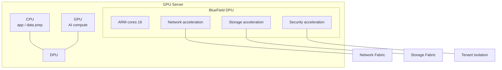

# Module 08 — DPU (Data Processing Unit) (ပြည့်စုံသော ရှင်းလင်းချက်)

> ဤ module ၏ ရည်ရွယ်ချက် — DPU ဆိုတာ ဘာလဲ၊ CPU ကို မည်သို့ offload လုပ်ပေးသလဲ၊ DOCA သည် ဘာနှင့် ဆင်တူသလဲ ဆိုသည်ကို ရှင်းလင်းစွာ ခွဲခြား မှတ်မိစေရန် ဖြစ်ပါသည်။

---

## 1. DPU ဆိုတာ ဘာလဲ

**DPU (Data Processing Unit)** သည် data center ၏ infrastructure အလုပ်များ (networking, storage, security) ကို CPU မှ ခွဲထုတ် လုပ်ဆောင်ပေးသော သီးသန့် processor ဖြစ်ပါသည်။ NVIDIA ၏ ထုတ်ကုန် အမည်မှာ **BlueField** ဖြစ်ပါသည်။

### ဘာကြောင့် လိုအပ်ရသလဲ

ရိုးရာ server တွင် CPU core များ၏ **30% အထိ**သည် networking, storage, security, virtualization အလုပ်များဖြင့် ကုန်ဆုံးနေပါသည်။ AI server တွင် ထို CPU စွမ်းရည်အားလုံးကို data pipeline အတွက် ပြန်လည် အသုံးပြုချင်ပါသည် — DPU က ထိုဝန်ကို ယူပေးလိုက်ခြင်း ဖြစ်ပါသည်။

> **လူဥပမာ** — စားပွဲထိုး (CPU) သည် မီးဖိုချောင်အလုပ်ပါ လုပ်နေပါက ဧည့်ခံချိန် မလောက်တော့ပါ။ DPU သည် မီးဖိုချောင်အလုပ်ကို သီးသန့် ယူသွားပေးသကဲ့သို့ ဖြစ်ပါသည်။

---

## 2. DPU Architecture — မည်သို့ အလုပ်လုပ်သလဲ

### လွှဲယူသော အလုပ်များ

| ကဏ္ဍ | အလုပ် |
|---|---|
| **Networking** | virtual switch, routing, RDMA, load balancing, traffic shaping |
| **Storage** | NVMe-oF (NVMe over Fabric), storage virtualization, compression |
| **Security** | encryption/decryption (IPsec, TLS), firewall, zero-trust isolation |
| **Multi-tenancy** | VM/container ချင်း hardware-level ကာကွယ်ခြင်း (cloud provider အတွက် အရေးကြီး) |
| **Infrastructure mgmt** | monitoring, telemetry |

---

## 3. အကျိုးကျေးဇူးများ (စာမေးပွဲ အဖြေ)

1. **CPU လွတ်လပ်လာခြင်း** — app/AI အတွက် core များ ပြန်လည် ပေးအပ် → performance တိုက်ရိုက် တိုးတက်
2. **Performance တည်ငြိမ်ခြင်း** — infrastructure traffic တိုးလာလည်း application မထိခိုက်
3. **Isolation / zero-trust** — tenant ချင်း hardware-level ခွဲခြား → cloud security ပိုမို ကောင်းမွန်
4. **စွမ်းအင် ထိရောက်မှု** — task-specific silicon ဖြစ်သောကြောင့် CPU ထက် ပိုမို ထိရောက်
5. **Consolidation** — NIC + storage controller + security appliance ကို chip တစ်ခုတည်းတွင် ပေါင်းစပ်

---

## 4. BlueField မျိုးဆက်များနှင့် DOCA

| မျိုးဆက် | အချိန် | Network |
|---|---|---|
| BlueField-2 | 2020 | 200Gb/s |
| BlueField-3 | 2023 | 400Gb/s (ARM core 16 ခု) |
| BlueField-4 | နောက်ပိုင်း | 800Gb/s class |

- **DOCA** — DPU အတွက် software platform (SDK, framework, security service များ)

⚠️ **CUDA = GPU အတွက် platform** / **DOCA = DPU အတွက် platform** — ဤ ၂ ခုကို ချိတ်ဆက် မှတ်ထားပါက မမေ့နိုင်တော့ပါ။

---

## 5. Processor ၄ မျိုး ခွဲခြားချက်

| Processor | ရည်ရွယ်ချက် |
|---|---|
| **CPU** | general logic, OS, sequential task |
| **GPU** | AI/compute (matrix operation) |
| **DPU** | infrastructure (network/storage/security) |
| SmartNIC | NIC + programmable (DPU ၏ ရိုးရှင်းသော ဗားရှင်း) |

### NIC → SmartNIC → DPU ဆင့်တက် ပုံစံ

| Device | လုပ်ဆောင်နိုင်မှု |
|---|---|
| NIC | network traffic သာ (kernel offload အနည်းငယ်) |
| SmartNIC | NIC + programmable FPGA/ASIC — အချို့ workload offload |
| **DPU** | NIC + ARM cores + accelerators — storage, security, virtualization အပြည့် offload |

⚠️ Exam trap — "DPU က AI model တွက်ပေးသလား" → **မဟုတ်ပါ** — infrastructure အလုပ်သာ ဖြစ်ပြီး AI compute သည် GPU ၏ အလုပ် ဖြစ်ပါသည်။

---

## 6. မည်သည့်နေရာတွင် အများဆုံး တွေ့ရသလဲ

- **Cloud provider** — multi-tenancy isolation အတွက်
- **DGX SuperPOD** — node တိုင်းတွင် BlueField ပါဝင် (networking + management)
- **Enterprise AI cluster** — storage fabric, security

### AI Cluster တွင် တွေ့ရပုံ

1. **Backend fabric** (InfiniBand) traffic စီမံခြင်း
2. **Storage fabric** (NVMe-oF) စီမံခြင်း
3. **Management network** ခွဲခြား ထိန်းချုပ်ခြင်း (job traffic နှင့် မရောနှော)
4. **Tenant isolation** — team/project အလိုက် ခွဲဝေချိန် hardware-level ကာကွယ်မှု

ဤသို့ဖြင့် GPU server ၏ CPU သည် data preprocessing (dataloader) အတွက် အပြည့်အဝ ရရှိလာပြီး GPU utilization တိုက်ရိုက် တိုးတက်ပါသည်။

---

## 7. Scenario

**"Cloud provider တစ်ခုက tenant များအကြား security isolation လိုအပ်သည်"** → DPU ဖြင့် zero-trust architecture — encryption/firewall ကို hardware တွင် offload — software firewall ထက် ပိုမို လုံခြုံပြီး မြန်ဆန်ပါသည်။

**"GPU server CPU usage 70% ကျော်ပြီး GPU util 30%"** → storage/network အလုပ်များ CPU ဝန်တင်နေခြင်း — DPU ထည့်သွင်းခြင်း (သို့) GPUDirect Storage ဖြင့် ဖြေရှင်းနိုင်ပါသည်။

---

## 8. အဓိက မှားယွင်းနိုင်သော အချက်များ

1. DPU = infrastructure processing (AI compute မဟုတ်)
2. DOCA = DPU software platform (CUDA နှင့် မရှုပ်ပါနှင့်)
3. အကျိုးကျေးဇူး = CPU offload + isolation + security + efficiency
4. BlueField = NVIDIA DPU အမည်
5. Multi-tenancy/zero-trust = DPU ၏ ထူးခြားသော ရောင်းချမှု အချက်

---

## 9. Mini-Quiz

1. DPU က လွှဲယူသော အလုပ် ၃ မျိုး ဖော်ပြပါ။
2. DPU ၏ CPU အတွက် အကျိုးကျေးဇူးကို ရှင်းပြပါ။
3. DOCA သည် မည်သည့် hardware အတွက် software platform လဲ။

**အဖြေများ** — 1) networking, storage, security · 2) CPU core များ လွတ်လပ်လာပြီး app performance တိုးတက် · 3) DPU (BlueField) — CUDA က GPU အတွက်

---

## 10. Official References

- NVIDIA BlueField DPU: https://www.nvidia.com/en-us/networking/bluefield-dpu/
- DOCA SDK: https://developer.nvidia.com/networking/doca
- Introduction to NVIDIA Networking and DPUs: https://developer.nvidia.com/blog/introduction-to-nvidia-networking-and-dpus/
