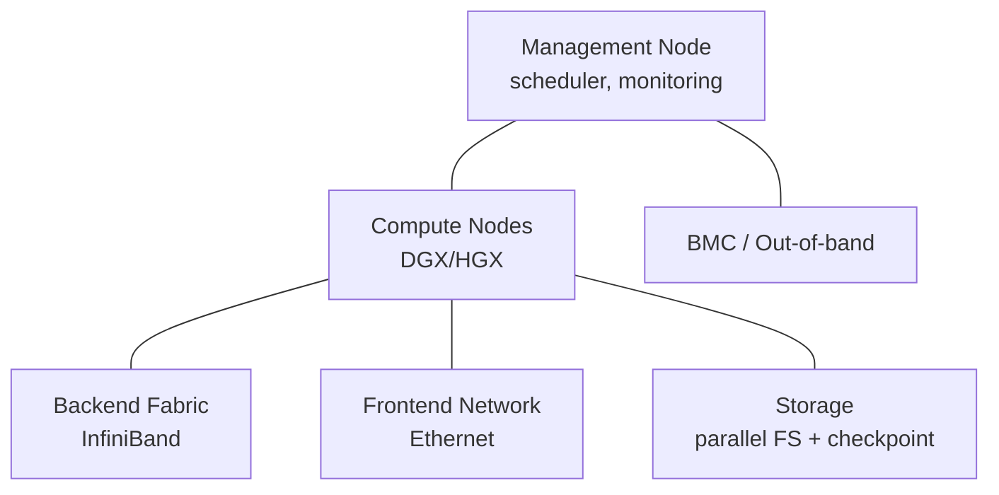
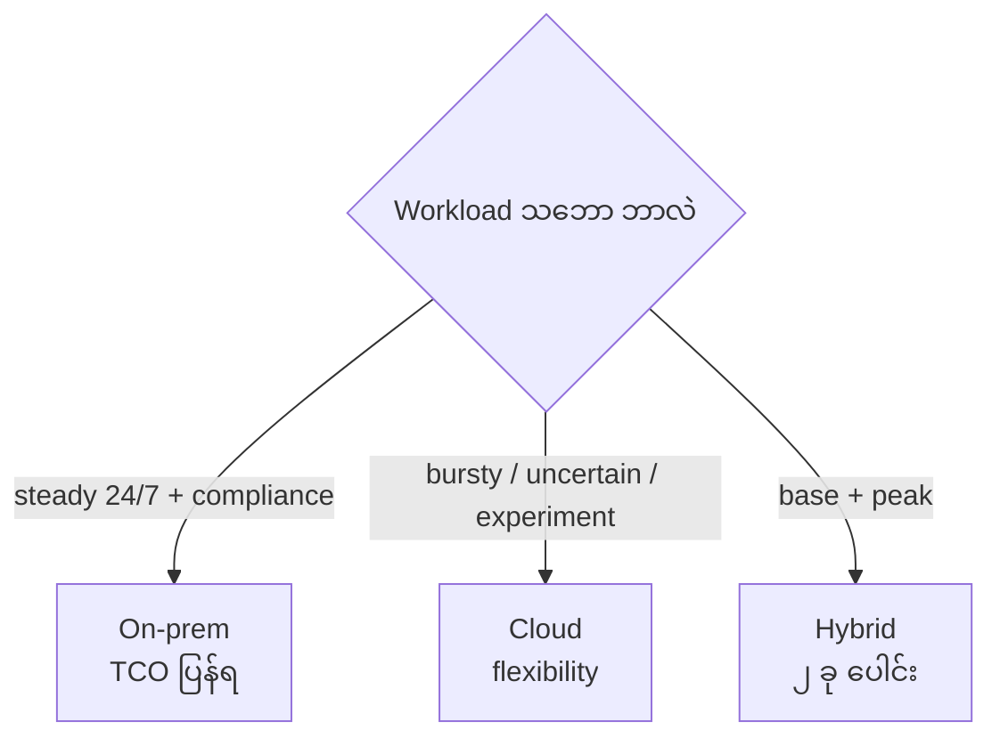

# Module 09 — Cluster Components & On-prem vs Cloud (ပြည့်စုံသော ရှင်းလင်းချက်)

> ဤ module ၏ ရည်ရွယ်ချက် — AI cluster တစ်ခုတွင် ဘာတွေ ပါဝင်သလဲ၊ on-prem နှင့် cloud မည်သို့ ရွေးချယ်မလဲ ဆိုသည်ကို TCO အမြင်ဖြင့် ဆုံးဖြတ်နိုင်စေရန် ဖြစ်ပါသည်။

---

## 1. Accelerated Cluster ၏ Component များ (Objective 2.5)

AI cluster တစ်ခုသည် GPU server များ စုစည်းရုံ မဟုတ်ဘဲ — စနစ်တစ်ခုလုံး ပါဝင်ပါသည်။

```
┌────────────────────────────────────────────────────┐
│  Management layer — scheduler, monitoring, BMC     │
├────────────────────────────────────────────────────┤
│  Compute nodes — DGX/HGX GPU servers               │
├────────────────────────────────────────────────────┤
│  Network — backend fabric (IB) + frontend +        │
│            management network                      │
├────────────────────────────────────────────────────┤
│  Storage — local NVMe + parallel file system       │
├────────────────────────────────────────────────────┤
│  Facility — power, cooling, rack, cabling          │
└────────────────────────────────────────────────────┘
```



1. **Compute node** — GPU server (DGX သို့မဟုတ် HGX-based) — CPU, GPU, NVMe, NIC
2. **Network fabric** — backend (training traffic)၊ frontend (user access)၊ management (BMC)
3. **Storage** — parallel file system (WEKA, Lustre, GPUDirect Storage) + checkpoint + dataset cache
4. **Management node** — provisioning, scheduler (Slurm/Kubernetes), monitoring (DCGM)
5. **Facility** — power/cooling/rack

**စဉ်းစားစရာ အချက်များ** —
- **Capacity planning** — မည်မျှ GPU လိုအပ်မလဲ၊ ကြီးထွားမှု လမ်းကြောင်း
- **High availability** — node ကျပါက အလုပ် ဆက်လုပ်နိုင်မှု
- **Multi-tenancy** — team/workload အမျိုးမျိုး ခွဲဝေ အသုံးပြုမှု
- **Data pipeline** — storage က GPU ကို မမီပါက GPU အားလုံး စောင့်ဆိုင်း

⚠️ Storage သည် network ကဲ့သို့ပင် အရေးကြီးပါသည် — "GPU utilization နိမ့်" scenario များတွင် network/storage သည် အကြောင်းရင်း ဖြစ်နိုင်ပါသည်။

---

## 2. On-prem vs Cloud (Objective 2.4) ⭐

| အချက် | **On-prem** | **Cloud** |
|---|---|---|
| ငွေကြေး သဘော | CapEx (ကြိုတင် ဝယ်ယူ) | OpEx (သုံးသလောက် ပေး) |
| အမြန်နှုန်း | ဝယ်/တပ်ဆင် — လ/နှစ် ကြာ | မိနစ်/နာရီ အတွင်း provision |
| Control | အပြည့်အဝ | provider ကန့်သတ် (quota) |
| Data | data sovereignty ထိန်းချုပ်နိုင် | ဒေတာ ပြင်ပ ရောက်ရှိနိုင် |
| Scaling | power/cooling ပမာဏပေါ် မူတည် | elastic — ချက်ချင်း တိုး/လျှော့ |
| Long-run cost | steady workload ပိုသက်သာ | 24/7 ဆိုပါက ကုန်ကျ ကြီးနိုင် |
| တာဝန် | facility, staffing, maintenance | provider တာဝန် |
| Supply | GPU lead time ကြာ | availability zone ပေါ် မူတည် |



### မည်သည့်အခါ မည်သည့်အရာ ရွေးချယ်မလဲ

- **On-prem သင့်တော်** — 24/7 steady (pretraining ကြီးမား)၊ data မထွက်ချင်၊ compliance တင်းကျပ်၊ 3+ နှစ် အသုံးပြုမည်
- **Cloud သင့်တော်** — bursty/မသေချာ (experiment)၊ အမြန်ဆုံး စတင်ချင်၊ CapEx မရှိ
- **Hybrid** — steady base on-prem + peak overflow cloud

### Cloud ၏ ပြဿနာများ

1. **Egress cost** — data ပြင်ပ ထုတ်ပါက ငွေကြေး ကျခံရ
2. **Data gravity** — dataset ကြီးမားပါက ရွှေ့ပြောင်းရ ခက်ခဲ/ကုန်ကျမှု ကြီး
3. **Quota/limit** — GPU အရေအတွက် တောင်းဆိုမှု ငြင်းပယ်ခံရနိုင်
4. **Long-run cost** — 24/7 ဆိုပါက ၃ နှစ်အတွက် ကိုယ်ပိုင် ဝယ်ယူခြင်းက ပိုသက်သာနိုင်
5. **Performance variability** — shared tenancy ကြောင့် မတည်ငြိမ်

---

## 3. TCO (Total Cost of Ownership)

```
TCO = hardware + power + cooling + staff + maintenance + space + network
```

GPU ဈေးနှုန်း တစ်ခုတည်း မဟုတ်ပါ။

### လက်တွေ့ တွက်ချက်မှု ဥပမာ

**မေးခွန်း** — 8×H100 node ၄ လုံး (GPU 32 လုံး) ကို ၃ နှစ် အသုံးပြုမည်။ ဝယ်မလား cloud လား။

- On-prem: hardware (node 4 + fabric + storage + rack) + facility (power/cooling ~150kW) + staff + maintenance — ၃ နှစ်ဖြင့် ခွဲဝေတွက်
- Cloud: GPU-hour ဈေး × 24 × 365 × 3 + egress + storage
- ၃ နှစ် 24/7 ဆိုပါက အများအားဖြင့် on-prem က ပိုမို သက်သာ (TCO ပြန်ရ)
- workload မသေချာ / experiment ဆိုပါက cloud က ပိုမို လုံခြုံ

---

## 4. Hybrid Architecture

```
On-prem: steady training base + sensitive data
   ↕ (VPN / interconnect)
Cloud: burst capacity + experiment + global serving
```

**မှတ်ရနည်း** — "steady 24/7 = on-prem (TCO)၊ bursty/uncertain = cloud (flexibility)"။

---

## 5. Reference Architecture

- **BasePOD/SuperPOD** validated design အတိုင်း ဆောက်လုပ်ပါက ပြဿနာ နည်းပြီး ခန့်မှန်းချက် သေချာ
- **Custom design** — ပိုမို လွတ်လပ်သော်လည်း integration risk ကိုယ်တိုင် ယူရ

---

## 6. Scenario ဖြေဆိုပုံ

**"Startup တစ်ခုက LLM experiment လုပ်ချင် — budget ကန့်သတ်"** → Cloud — CapEx မလို၊ GPU ချက်ချင်း ရ၊ ရပ်ချင်ပါက ရပ်နိုင်။

**"ဘဏ်တစ်ခုက fraud detection ကို 24/7 run မည် — data မထွက်ရ"** → On-prem — compliance, data sovereignty, TCO။

**"Retail — holiday season တွင် inference demand ၃ ဆ တက်မည်"** → Hybrid — base on-prem၊ peak cloud burst။

---

## 7. အဓိက မှားယွင်းနိုင်သော အချက်များ

1. On-prem = CapEx / Cloud = OpEx
2. Cloud ၏ ပြဿနာ — egress, data gravity, quota
3. Cluster = compute + network + storage + management + facility
4. Training cluster တွင် storage I/O က ကြိုးကြာစေနိုင်
5. steady = on-prem၊ bursty = cloud

---

## 8. Mini-Quiz

1. Accelerated cluster ၏ component ၅ ခု စာရင်း ပြုစုပါ။
2. 24/7 LLM training ၂ နှစ် အတွက် မည်သည့်အရာ ပိုသင့်တော်သလဲ။
3. Cloud တွင် dataset 100TB ပြောင်းလိုပါက ပြဿနာ ၂ ခု ဖော်ပြပါ။

**အဖြေများ** — 1) compute, network (3 မျိုး), storage, management, facility · 2) **On-prem** · 3) egress cost + data gravity

---

## 9. Official References

- NVIDIA DGX SuperPOD: https://www.nvidia.com/en-us/data-center/dgx-superpod/
- NVIDIA BasePOD: https://www.nvidia.com/en-us/data-center/data-center-reference-architecture/
- NVIDIA DGX Cloud: https://www.nvidia.com/en-us/data-center/dgx-cloud/
- Cloud vs On-prem TCO: https://www.nvidia.com/en-us/data-center/resources/
