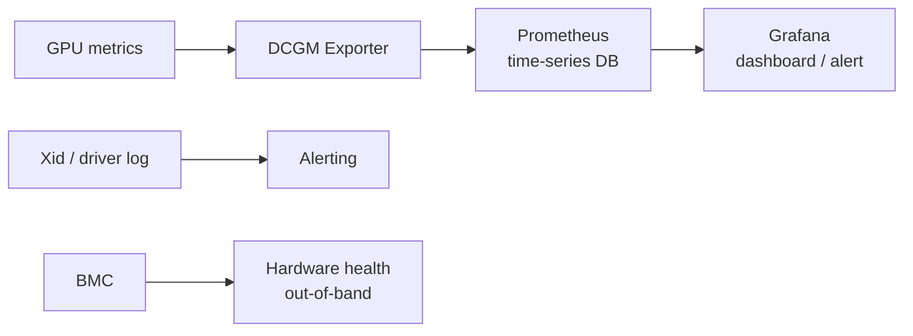
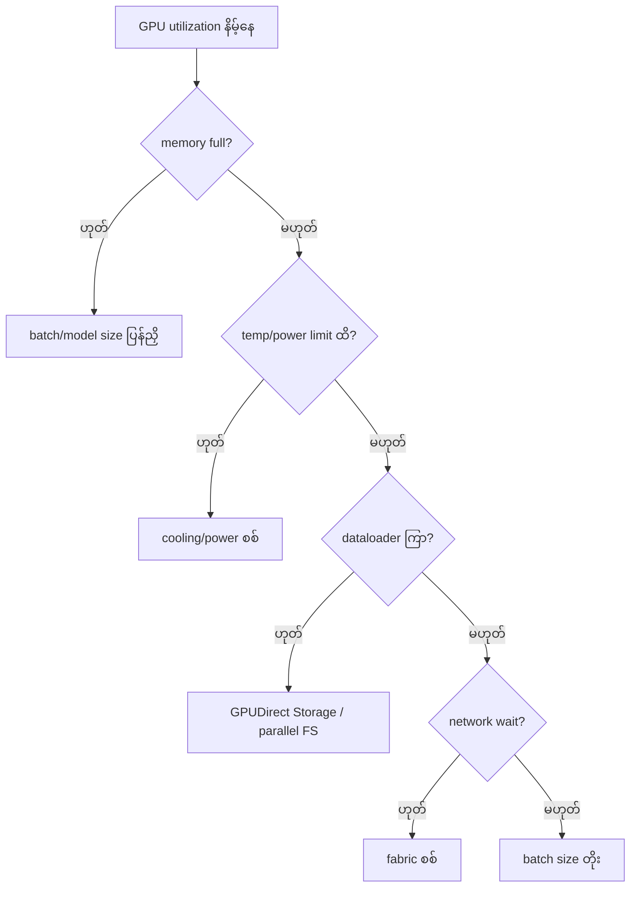

# Module 10 — AI DC Management & Monitoring (ပြည့်စုံသော ရှင်းလင်းချက်)

> ဤ module ၏ ရည်ရွယ်ချက် — GPU metrics များ ဘာတွေ ကြည့်ရမလဲ၊ nvidia-smi နှင့် DCGM ကွာခြားချက်၊ GPU utilization နိမ့်ရခြင်း အကြောင်းရင်းများကို workflow ဖြင့် စစ်ဆေးတတ်စေရန် ဖြစ်ပါသည်။

---

## 1. GPU Monitoring Metrics (Objective 3.3)

| Metric | အဓိပ္ပာယ် | စိုးရိမ်ရမည့် အခြေအနေ |
|---|---|---|
| **GPU Utilization** | compute unit အလုပ်လုပ်ချိန် % | နည်းနေပါက bottleneck ရှာဖွေ |
| **Memory usage** | VRAM သုံးစွဲမှု | ပြည့်နီးပါက OOM risk |
| **Memory bandwidth utilization** | data ရွှေ့ပြောင်းနှုန်း အသုံးပြုမှု | decode workload တွင် အရေးကြီး |
| **Temperature** | GPU အပူချိန် | target ထက် ကျော်လျှင် throttle |
| **Power draw / limit** | ပါဝါ စားသုံးမှု | limit တွင် ထိလျှင် clock ကျ |
| **SM clock** | တွက်ချက်နှုန်း | throttle ဖြစ်ပါက max အောက် ကျ |
| **ECC errors** | memory error correction | error တက်ပါက hardware ပြဿနာ |
| **PCIe/NVLink throughput** | data transfer နှုန်း | နှေးပါက data pipeline ပြဿနာ |
| **Xid errors** | NVIDIA driver error code | တစ်ခုခု ပေါ်ပါက workflow အတိုင်း |

⚠️ **Memory သုံးစွဲထားခြင်း ≠ အလုပ်လုပ်နေခြင်း** — model ကို memory ထဲ ထည့်ထားပြီး request မလာသေးပါက utilization 0% ဖြစ်နေနိုင်ပါသည်။

⚠️ **Thermal throttling** — အပူချိန် တက်လာပါက GPU က clock speed ကို အလိုအလျောက် လျှော့ချပြီး performance တိတ်တဆိတ် ကျဆင်းသွားပါသည်။

---

## 2. Tools — nvidia-smi vs DCGM ⭐ (Objective 3.1)

| အချက် | **nvidia-smi** | **DCGM** |
|---|---|---|
| Scope | node တစ်ခုချင်း (CLI) | cluster အဆင့် (data center) |
| လုပ်ဆောင်ချက် | real-time ကြည့်ရှု, query, dmon | telemetry, health check, policy, diagnostics |
| အသုံးပြုရာ | စက်တစ်လုံး စစ်ဆေး | GPU ရာ/ထောင်ချီ စောင့်ကြည့် |

**DCGM (Data Center GPU Manager)** — NVIDIA ၏ cluster-wide GPU management library + tool —
- `dcgmi` — CLI (health, policy, stats)
- **DCGM Exporter** → **Prometheus** → **Grafana** — ဤ pipeline ကို စာမေးပွဲတွင် အမြဲ မေးလေ့ရှိပါသည်
- Health check (diagnostic)၊ policy enforcement (power/clock limit)၊ failure detection

**BMC (Baseboard Management Controller)** — server ၏ out-of-band management chip (power, console, hardware health)

---

## 3. Monitoring Pipeline (Production ပုံစံ)



**Threshold သတ်မှတ်ခြင်း ဥပမာ** —
- GPU temp > 85°C — warning
- ECC uncorrectable error > 0 — critical
- GPU memory usage > 95% — warning
- utilization < 20% (15 min) — investigate
- Xid error detected — page on-call

---

## 4. "GPU Utilization ဘာကြောင့် နည်းနေသလဲ" — 6 Reasons ⭐

1. **Data loading မမီခြင်း** — storage/dataloader နှေးပြီး GPU စောင့်ဆိုင်း
2. **CPU preprocessing** — CPU က data ပြင်ဆင်နေစဉ် GPU ငြိမ်သက်နေ
3. **Network bottleneck** — distributed job တွင် all-reduce စောင့်ဆိုင်း
4. **Small batch size** — GPU ပြည့်အောင် အလုပ်မပေးနိုင်
5. **Checkpoint/serialization** — သိမ်းဆည်းနေစဉ် အလုပ် ရပ်
6. **Thermal/power throttling** — clock ကျနေစဉ်



**စဉ်းစားပုံ** — GPU slow ဆိုပါက GPU ကို အပြစ်မတင်ဘဲ ပတ်ဝန်းကျင် (data, CPU, network, storage, power) ကို တစ်ခုချင်း ဖြတ်ပစ် စစ်ဆေးပါ။

---

## 5. Xid Errors ဘာလဲ

NVIDIA GPU သည် hardware/driver ပြဿနာများကို **Xid code** ဖြင့် သတင်းပို့ပါသည် — Linux `dmesg` / driver log တွင် တွေ့ရှိနိုင်ပါသည်။

- ဥပမာ — Xid 63 (ECC retirement)၊ Xid 79 (GPU ပျောက်ကွယ်ခြင်း)၊ Xid 48 (double-bit ECC)
- မည်သည့်နေရာတွင် မြင်ရသလဲ — Linux `dmesg`၊ BMC log၊ DCGM health check
- Node မကြာခဏ ကျဆင်းပါက — dmesg/Xid အရင် စစ် → DCGM health → BMC log

---

## 6. လက်တွေ့ စစ်ဆေးသည့် command များ

```bash
# GPU status (node တစ်ခုအတွက်)
nvidia-smi
nvidia-smi --query-gpu=name,temperature.gpu,utilization.gpu,memory.used,memory.free --format=csv

# real-time monitoring
nvidia-smi dmon        # utilization, memory, power, temperature stream
nvidia-smi topo -m     # GPU/NIC topology (network ပြဿနာ ရှာရာတွင် အသုံးဝင်)

# DCGM (cluster အတွက်)
dcgmi discovery -l          # GPU စာရင်း
dcgmi health -g 0 -j        # health check
dcgmi stats -e 1004 -g 0    # utilization stats
```

---

## 7. Scenario — GPU Utilization Low စစ်ဆေးမှု အဆင့်ဆင့်

**"Training job တွင် GPU util 25% သာ ရှိနေသည်"**
1. `nvidia-smi dmon` — memory bandwidth / SM clock — throttle ဖြစ်/မဖြစ်
2. Dataloader profiling — CPU preprocessing ကြာချိန်
3. `nvidia-smi topo -m` — GPU/NIC ချိတ်ဆက်မှု
4. Network — all-reduce ကြာချိန် (NCCL test)
5. Checkpoint write ကြာချိန်
6. Batch size တိုး၍ ကြည့်

တစ်ဆင့်ချင်း ဖြတ်ပစ်စစ်ဆေးခြင်းကသာ အဖြေ မှန်ကန်စွာ ရရှိစေပါသည်။

---

## 8. အဓိက မှားယွင်းနိုင်သော အချက်များ

1. nvidia-smi = single node / DCGM = cluster
2. DCGM Exporter → Prometheus → Grafana အစဉ် မမှားပါစေနှင့်
3. "GPU util low" → 6 reasons မှ စဉ်းစား
4. Xid = GPU error code (dmesg)
5. BMC = out-of-band server management
6. Thermal throttling = performance ကျဆင်းခြင်း ၏ အကြောင်းရင်း

---

## 9. Mini-Quiz

1. GPU 100 လုံးပါ cluster ကို စောင့်ကြည့်ရန် မည်သည့် tool သုံးမလဲ။
2. DCGM metrics visualization pipeline ၃ ဆင့် ရေးပါ။
3. GPU utilization 30% သာ ရှိနေပါက စစ်ဆေးစရာ ၃ ခု ဖော်ပြပါ။

**အဖြေများ** — 1) **DCGM** · 2) DCGM Exporter → Prometheus → Grafana · 3) data loading / CPU prep / network

---

## 10. Official References

- NVIDIA DCGM: https://developer.nvidia.com/dcgm
- nvidia-smi docs: https://docs.nvidia.com/datacenter/tesla/nvidia-smi/
- Xid Error Codes: https://docs.nvidia.com/datacenter/tesla/xid-errors/
- Run:ai — 6 Reasons for Low GPU Utilization: https://www.run.ai/guides/gpu-fine-tuning/low-gpu-utilization
