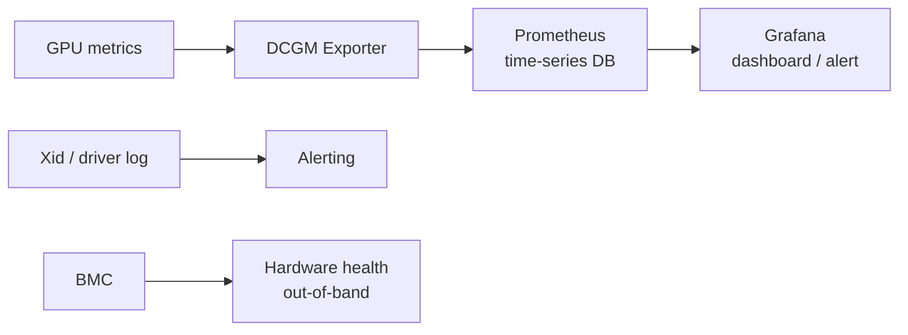
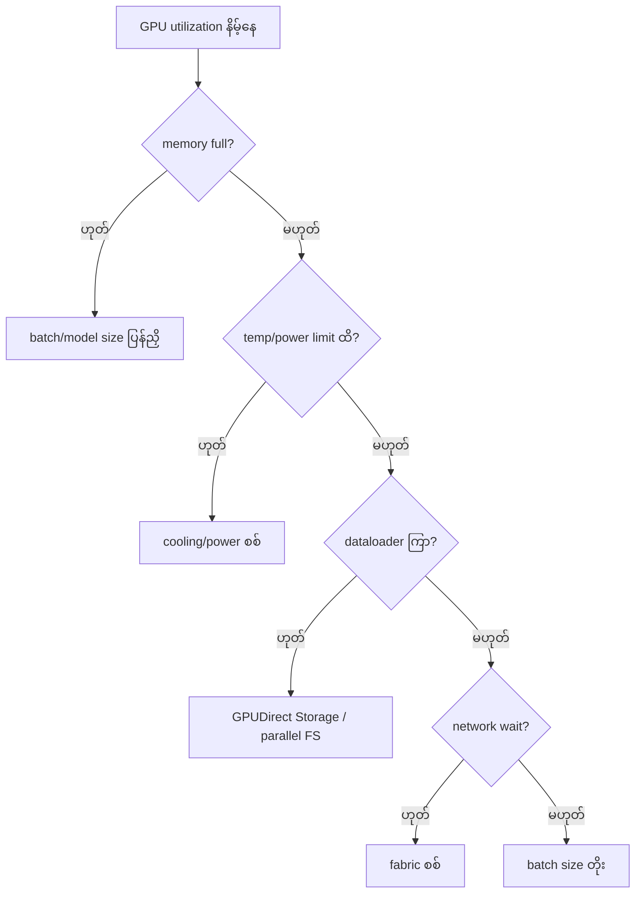

# Module 10 — AI DC Management & Monitoring (ပြည့်စုံသော ရှင်းလင်းချက်)

> ဤ chapter ၏ ရည်ရွယ်ချက် — GPU metrics များ ဘာတွေ ကြည့်ရမလဲ၊ nvidia-smi နှင့် DCGM ကွာခြားချက်၊ GPU utilization နိမ့်ရခြင်း အကြောင်းရင်းများကို workflow ဖြင့် စစ်ဆေးတတ်စေရန် ဖြစ်ပါသည်။

---

## 1. ပြဿနာ — "GPU ကောင်းကောင်း အလုပ်လုပ်နေပါသလား" ကို မည်သို့ သိမလဲ

AI data center တစ်ခုတွင် GPU ရာ/ထောင်ချီ ရှိပြီး တစ်လုံးချင်းစီကို ကိုယ်တိုင် သွားကြည့်၍ မရနိုင်ပါ။ အောက်ပါ မေးခွန်းများကို ဖြေနိုင်မှသာ လုပ်ငန်း လည်ပတ်မှု ကောင်းမွန်ပါမည် —

- GPU များ အပူချိန် များနေပါသလား၊ power limit ထိနေပါသလား
- GPU memory ပြည့်နေပြီး OOM ဖြစ်မည့် အန္တရာယ် ရှိပါသလား
- GPU utilization ဘာကြောင့် နည်းနေသလဲ
- hardware/driver ပြဿနာ (Xid error, ECC error) တစ်ခုခု ပေါ်နေပါသလား

ဤမေးခွန်းများကို **metric များ ဖတ်တတ်ခြင်း**၊ **tool များ မှန်ကန်စွာ ရွေးချယ်ခြင်း** (nvidia-smi vs DCGM)၊ **monitoring pipeline** ဖြင့် ဖြေရှင်းရပါမည်။

---

## 2. အဓိက အယူအဆ — GPU Monitoring Metrics (Objective 3.3)

| Metric | အဓိပ္ပာယ် | စိုးရိမ်ရမည့် အခြေအနေ |
|---|---|---|
| **GPU Utilization** | compute unit အလုပ်လုပ်ချိန် % | နည်းနေပါက bottleneck ရှာဖွေ |
| **Memory usage** | VRAM သုံးစွဲမှု | ပြည့်နီးပါက OOM risk |
| **Memory bandwidth utilization** | data ရွှေ့ပြောင်းနှုန်း အသုံးပြုမှု | decode workload တွင် အရေးကြီး |
| **Temperature** | GPU အပူချိန် | target ထက် ကျော်လျှင် throttle |
| **Power draw / limit** | ပါဝါ စားသုံးမှု | limit တွင် ထိလျှင် clock ကျ |
| **SM clock** | တွက်ချက်နှုန်း | throttle ဖြစ်ပါက max အောက် ကျ |
| **ECC errors** | memory error correction | error တက်ပါက hardware ပြဿနာ |
| **PCIe/NVLink throughput** | data transfer နှုန်း | နှေးပါက data pipeline ပြဿနာ |
| **Xid errors** | NVIDIA driver error code | တစ်ခုခု ပေါ်ပါက workflow အတိုင်း |

⚠️ **Memory သုံးစွဲထားခြင်း ≠ အလုပ်လုပ်နေခြင်း** — model ကို memory ထဲ ထည့်ထားပြီး request မလာသေးပါက utilization 0% ဖြစ်နေနိုင်ပါသည်။

⚠️ **Thermal throttling** — အပူချိန် တက်လာပါက GPU က clock speed ကို အလိုအလျောက် လျှော့ချပြီး performance တိတ်တဆိတ် ကျဆင်းသွားပါသည်။

---

## 3. နှိုင်းယှဉ်ခြင်း — nvidia-smi vs DCGM ⭐ (Objective 3.1)

| အချက် | **nvidia-smi** | **DCGM** |
|---|---|---|
| Scope | node တစ်ခုချင်း (CLI) | cluster အဆင့် (data center) |
| လုပ်ဆောင်ချက် | real-time ကြည့်ရှု, query, dmon | telemetry, health check, policy, diagnostics |
| အသုံးပြုရာ | စက်တစ်လုံး စစ်ဆေး | GPU ရာ/ထောင်ချီ စောင့်ကြည့် |

**DCGM (Data Center GPU Manager)** — NVIDIA ၏ cluster-wide GPU management library + tool —
- `dcgmi` — CLI (health, policy, stats)
- **DCGM Exporter** → **Prometheus** → **Grafana** — ဤ pipeline ကို စာမေးပွဲတွင် အမြဲ မေးလေ့ရှိပါသည်
- Health check (diagnostic)၊ policy enforcement (power/clock limit)၊ failure detection

**BMC (Baseboard Management Controller)** — server ၏ out-of-band management chip (power, console, hardware health)။ OS မကျနေစဉ်ပင် ဝင်ရောက် စီမံနိုင်သောကြောင့် node ပျက်နေပါက BMC console/log ကို ကြည့်ရပါမည်။

### Monitoring Pipeline (Production ပုံစံ)



**Threshold သတ်မှတ်ခြင်း ဥပမာ (illustrative — စနစ်အလိုက် ပြင်ဆင်ရန်)** —
- GPU temp > 85°C — warning
- ECC uncorrectable error > 0 — critical
- GPU memory usage > 95% — warning
- utilization < 20% (15 min) — investigate
- Xid error detected — page on-call

---

## 4. လက်တွေ့ စစ်ဆေးသည့် command များ

```bash
# GPU status (node တစ်ခုအတွက်)
nvidia-smi
nvidia-smi --query-gpu=name,temperature.gpu,utilization.gpu,memory.used,memory.free --format=csv

# real-time monitoring
nvidia-smi dmon        # utilization, memory, power, temperature stream
nvidia-smi topo -m     # GPU/NIC topology (network ပြဿနာ ရှာရာတွင် အသုံးဝင်)

# DCGM (cluster အတွက်)
dcgmi discovery -l          # GPU စာရင်း
dcgmi health -g 0 -j        # health check
dcgmi stats -e 1004 -g 0    # utilization stats
```

- `nvidia-smi` — ထို node ၏ GPU အခြေအနေ အကျဉ်းချုပ် ပြသသည်
- `nvidia-smi --query-gpu=... --format=csv` — လိုချင်သော field များကို CSV အဖြစ် ရယူသည် (script/alert တွင် အသုံးဝင်)
- `nvidia-smi dmon` — utilization, memory, power, temperature ကို စဉ်ဆက်မပြတ် stream ပြသသည်
- `nvidia-smi topo -m` — GPU နှင့် NIC ချိတ်ဆက်မှု topology ပြသည် (distributed job network ပြဿနာ ရှာရာတွင် အသုံးဝင်)
- `dcgmi discovery -l` — cluster node ပေါ်ရှိ GPU များ စာရင်း ပြသသည်
- `dcgmi health -g 0` — GPU 0 ၏ health watch အခြေအနေ စစ်ဆေးသည်
- `dcgmi stats -e 1004 -g 0` — field 1004 (GPU utilization) ၏ stats ကြည့်သည်

> **မှတ်ချက်** — ဤ command များသည် လက်တွေ့ စစ်ဆေးမှု နမူနာ ဖြစ်ပြီး option/flag အသေးစိတ်သည် tool version ပေါ် မူတည်နိုင်ပါသည်။ တိကျသော syntax ကို NVIDIA documentation တွင် အတည်ပြုပါ။

---

## 5. "GPU Utilization ဘာကြောင့် နည်းနေသလဲ" — 6 Reasons ⭐

1. **Data loading မမီခြင်း** — storage/dataloader နှေးပြီး GPU စောင့်ဆိုင်း
2. **CPU preprocessing** — CPU က data ပြင်ဆင်နေစဉ် GPU ငြိမ်သက်နေ
3. **Network bottleneck** — distributed job တွင် all-reduce စောင့်ဆိုင်း
4. **Small batch size** — GPU ပြည့်အောင် အလုပ်မပေးနိုင်
5. **Checkpoint/serialization** — သိမ်းဆည်းနေစဉ် အလုပ် ရပ်
6. **Thermal/power throttling** — clock ကျနေစဉ်



**စဉ်းစားပုံ** — GPU slow ဆိုပါက GPU ကို အပြစ်မတင်ဘဲ ပတ်ဝန်းကျင် (data, CPU, network, storage, power) ကို တစ်ခုချင်း ဖြတ်ပစ် စစ်ဆေးပါ။

### Scenario — GPU Utilization Low စစ်ဆေးမှု အဆင့်ဆင့်

**"Training job တွင် GPU util 25% သာ ရှိနေသည်"**
1. `nvidia-smi dmon` — memory bandwidth / SM clock — throttle ဖြစ်/မဖြစ်
2. Dataloader profiling — CPU preprocessing ကြာချိန်
3. `nvidia-smi topo -m` — GPU/NIC ချိတ်ဆက်မှု
4. Network — all-reduce ကြာချိန် (NCCL test)
5. Checkpoint write ကြာချိန်
6. Batch size တိုး၍ ကြည့်

တစ်ဆင့်ချင်း ဖြတ်ပစ်စစ်ဆေးခြင်းကသာ အဖြေ မှန်ကန်စွာ ရရှိစေပါသည်။

---

## 6. Xid Errors ဘာလဲ

NVIDIA GPU သည် hardware/driver ပြဿနာများကို **Xid code** ဖြင့် သတင်းပို့ပါသည် — Linux `dmesg` / driver log တွင် တွေ့ရှိနိုင်ပါသည်။

- ဥပမာ — Xid 63 (ECC page retirement)၊ Xid 79 (GPU has fallen off the bus)၊ Xid 48 (double-bit ECC error)
- မည်သည့်နေရာတွင် မြင်ရသလဲ — Linux `dmesg`၊ BMC log၊ DCGM health check
- Node မကြာခဏ ကျဆင်းပါက — dmesg/Xid အရင် စစ် → DCGM health → BMC log

> Xid code အဓိပ္ပာယ် အပြည့်အစုံကို NVIDIA ၏ Xid errors documentation တွင် ကြည့်ရှုပါ — code တစ်ခုချင်းစီ၏ အဓိပ္ပာယ်သည် GPU generation နှင့် driver version ပေါ် မူတည် ကွဲပြားနိုင်ပါသည်။

---

## 7. လုပ်ငန်းခွင် သတိပြုရန် အချက်များနှင့် exam trap များ

1. **nvidia-smi = single node / DCGM = cluster** — scope ကွာခြားချက်
2. **DCGM Exporter → Prometheus → Grafana အစဉ် မမှားပါစေနှင့်**
3. **"GPU util low"** → 6 reasons မှ စဉ်းစား
4. **Xid = GPU error code (dmesg)**
5. **BMC = out-of-band server management**
6. **Thermal throttling = performance ကျဆင်းခြင်း ၏ အကြောင်းရင်း**
7. **Memory used မြင့်ခြင်း = အလုပ်များခြင်း မဟုတ်** — utilization နှင့် memory usage ကို သီးခြား ကြည့်ပါ

---

## 8. ကိုယ်တိုင် စစ်ဆေးရန် မေးခွန်းများ (Self-check)

1. GPU 100 လုံးပါ cluster ကို စောင့်ကြည့်ရန် မည်သည့် tool သုံးမလဲ။
2. DCGM metrics visualization pipeline ၃ ဆင့် ရေးပါ။
3. GPU utilization 30% သာ ရှိနေပါက စစ်ဆေးစရာ ၃ ခု ဖော်ပြပါ။
4. Xid error ဆိုတာ ဘာလဲ၊ မည်သည့်နေရာတွင် တွေ့ရသလဲ။
5. GPU memory ပြည့်နေပြီး utilization 0% ဖြစ်နေပါက ဘာကို ဆိုလိုသလဲ။

**အဖြေများ** —
1. **DCGM** (cluster-wide GPU management)
2. DCGM Exporter → Prometheus → Grafana
3. data loading / CPU prep / network (batch size, checkpoint, throttle လည်း စဉ်းစားနိုင်)
4. NVIDIA GPU ၏ hardware/driver error code — Linux `dmesg`၊ BMC log၊ DCGM health check တွင် တွေ့ရ
5. Model ကို memory ထဲ ထည့်ထားပြီး အလုပ် (request/job) မလာသေးခြင်း ဖြစ်နိုင် — memory သုံးစွဲမှုသည် အလုပ်လုပ်နေမှု မဟုတ်ပါ

---

## 9. Official References

- NVIDIA DCGM: https://developer.nvidia.com/dcgm
- nvidia-smi docs: https://docs.nvidia.com/datacenter/tesla/nvidia-smi/
- Xid Error Codes: https://docs.nvidia.com/datacenter/tesla/xid-errors/
- Run:ai — 6 Reasons for Low GPU Utilization: https://www.run.ai/guides/gpu-fine-tuning/low-gpu-utilization

---

## Technical review notes

- Xid code ဥပမာ ၃ ခု (Xid 63, 79, 48) ၏ အဓိပ္ပာယ် ဖော်ပြချက်ကို မူရင်းအတိုင်း ထားရှိပြီး ပိုမို တိကျသော အဓိပ္ပာယ် (page retirement, fallen off the bus, double-bit ECC) ဖြင့် ဖြည့်စွက်ပါသည် — code အဓိပ္ပာယ်များကို NVIDIA Xid documentation ဖြင့် ပြန်လည် အတည်ပြုပါ — needs verification (driver/version-dependent)။
- `dcgmi health -g 0 -j` ၏ `-j` flag အပါအဝင် dcgmi option အသေးစိတ်သည် version ပေါ် မူတည်နိုင်ပါသည် — command များကို မူရင်း နမူနာအတိုင်း ထားရှိပြီး documentation ဖြင့် အတည်ပြုရန် လိုအပ်ပါသည် — needs verification (syntax)။
- Threshold ဥပမာများ (85°C, 95%, 20%/15min) သည် universal မဟုတ်ဘဲ စနစ်ဒီဇိုင်းနှင့် GPU model ပေါ် မူတည်၍ ပြင်ဆင်ရမည့် illustrative တန်ဖိုးများ ဖြစ်ပါသည်။
- `dcgmi stats -e 1004` ၏ field ID 1004 ကို GPU utilization metric အဖြစ် ဖော်ပြပါသည် — DCGM field ID များကို DCGM documentation ဖြင့် အတည်ပြုပါ — needs verification။
