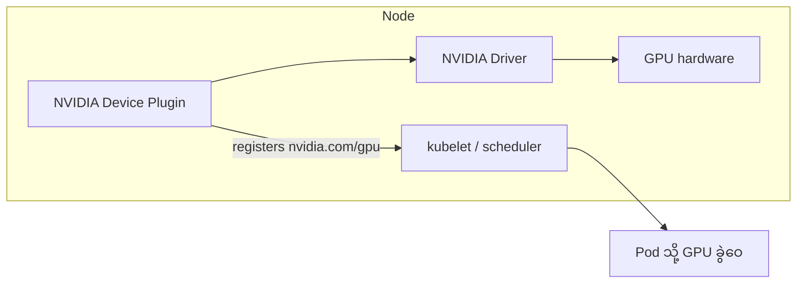

# Module 11 — Orchestration & Scheduling (ပြည့်စုံသော ရှင်းလင်းချက်)

> ဤ module ၏ ရည်ရွယ်ချက် — GPU ရာ/ထောင်ချီ ပါသော cluster တွင် job များ မည်သို့ စီမံခန့်ခွဲသလဲ၊ Kubernetes နှင့် Slurm မည်သို့ အလုပ်လုပ်သလဲ ဆိုသည်ကို နားလည်စေရန် ဖြစ်ပါသည်။

---

## 1. Orchestration ဆိုတာ ဘာလဲ (Objective 3.2)

GPU ရာ/ထောင်ချီ ပါသော cluster တွင် မည်သူက မည်သည့် GPU ကို မည်သည့်အချိန် ရသလဲ၊ job များ မည်သို့ စီမံခန့်ခွဲသလဲ — ဤကို **orchestration/scheduling** ဟု ခေါ်ပါသည်။ ကိရိယာ ၂ ခု အဓိက — **Kubernetes** နှင့် **Slurm**။

---

## 2. Kubernetes + GPU

### GPU Resource Model

- Kubernetes သည် GPU ကို extended resource (`nvidia.com/gpu`) အဖြစ် မြင်ပါသည်
- Pod spec တွင် `resources.limits: {"nvidia.com/gpu": 2}` ထည့်ပါက scheduler က GPU ၂ လုံး ခွဲဝေပေးပါသည်
- GPU မလွှဲပြောင်းနိုင် — pod တစ်ခုတည်းသို့သာ (MIG/time-slicing ဖြင့်သာ မျှဝေ)

### Device Plugin Architecture

Kubernetes သည် GPU driver ကို ကိုယ်တိုင် မသိပါ — **NVIDIA Device Plugin** (daemon) က node ၏ GPU များကို resource အဖြစ် kubelet ဆီ တင်ပြပေးပါသည်။



### GPU Operator ⭐


*ပုံ — NVIDIA GPU Operator architecture (ရင်းမြစ်: NVIDIA Developer Blog)*

| Component | အလုပ် |
|---|---|
| NVIDIA driver | GPU driver |
| Container Toolkit | container မှ GPU access |
| Device Plugin | GPU resource registration |
| DCGM Exporter | metrics ထုတ်ပေး |
| Node Validator | node ကျန်းမာရေး စစ်ဆေး |

⚠️ ဤ component စာရင်းကို စာမေးပွဲတွင် မကြာခဏ မေးပါသည်။ **Network Operator** ကဲ့သို့ သီးခြား operator လည်း ရှိပြီး — device plugin (compute) နှင့် network operator (fabric) ကို မရှုပ်ပါစေနှင့်။


*ပုံ — GPU Operator state machine (ရင်းမြစ်: NVIDIA Developer Blog)*

### K8s Workload Types

- **Deployment/Service** — inference (24/7 replica)
- **Job/CronJob** — training/batch (ပြီးလျှင် ရပ်)
- **Leader/follower pattern** — multi-node training (master + worker)
- **Resource quota** — team အလိုက် GPU ခွဲဝေ

---

## 3. Slurm

HPC/research လောကတွင် စံချိန်တင် အသုံးများသော batch scheduler ဖြစ်ပါသည်။

- **Partition** — node အုပ်စု (K8s namespace ကဲ့သို့)
- `sbatch` — job တင်ခြင်း၊ `squeue` — အခြေအနေ ကြည့်ခြင်း၊ `sacct` — မှတ်တမ်း
- **Gang scheduling** ⭐ — job ၏ node အားလုံး တစ်ပြိုင်နက် ရရှိမှသာ စတင်ခြင်း — မဟုတ်ပါက node တချို့သာ ရပြီး ကျန် node များ စောင့်ဆိုင်း (fragmentation)

```
Gang scheduling မပါ:  [GPU 4 ရ] [GPU 4 စောင့်] → node တချို့ အလွတ်ထိုင်
Gang scheduling ပါ:   အားလုံး ရမှ စ → အားလုံး အလုပ်လုပ်
```

---

## 4. Commercial Platforms

- **Run:ai** — Kubernetes ပေါ် GPU scheduling/monitoring/quotas/preemption
- **NVIDIA Base Command** — cluster OS / cloud platform

---

## 5. Scheduling သဘောတရား ၆ ခု

1. **Queue** — job များ စောင့်ဆိုင်းစာရင်း
2. **Priority** — ဦးစားပေး (preemption ဖြင့် ဖြတ်ယူနိုင်)
3. **Fair share** — အဖွဲ့အလိုက် မျှတစွာ ခွဲဝေ
4. **Quota** — သတ်မှတ် ပမာဏ ကန့်သတ်
5. **Gang scheduling** — node အားလုံး တစ်ပြိုင်နက်
6. **Preemption** — ဦးစားနည်း job ရပ်ပြီး ပိုအရေးကြီး job ထည့်ခြင်း

---

## 6. K8s vs Slurm

| အချက် | Kubernetes | Slurm |
|---|---|---|
| အဓိက အသုံးပြုရာ | inference, microservice | HPC training, research |
| Job သဘော | long-running service | batch, checkpoint |
| Ecosystem | container, cloud-native | HPC tools (MPI) |
| ပေါင်းစပ်မှု | Run:ai ကဲ့သို့ GPU layer | native gang scheduling |

လက်တွေ့တွင် ၂ ခု တွဲသုံးခြင်းလည်း ရှိပါသည် (Slurm ဖြင့် training + K8s ဖြင့် serving)။

---

## 7. Job အသွင်အပြောင်း

- **Training** — long-running, gang-scheduled, checkpoint → batch job
- **Inference** — always-on, scale replicas → deployment/service
- **Batch inference** — queue ထဲ ထည့်ပြီး ပြီးသည်အထိ လုပ်ဆောင် → job

---

## 8. GPU Scheduling ပြဿနာ လက်တွေ့ ဥပမာများ

- **Fragmentation** — GPU 8 လုံးပါ node တွင် job များက GPU 2 စီ ယူထားပြီး GPU 16 လုံး job စောင့်နေရ — gang scheduling + backfill
- **Priority inversion** — အရေးငယ် job က GPU များ သိမ်းပိုက်ထား — priority + preemption
- **Quota enforcement** — team တစ်ခုက GPU အားလုံး ယူထား — fair share + quota

---

## 9. Container — NGC

Training/inference container များကို **NGC catalog** မှ ဆွဲယူ အသုံးပြုပါသည် — CUDA + framework + optimization ပါပြီးသား။

---

## 10. အဓိက မှားယွင်းနိုင်သော အချက်များ

1. K8s ကိုယ်တိုင်က GPU မသိ — **Device Plugin** က တင်ပြပေး
2. GPU Operator components — driver, toolkit, device plugin, DCGM exporter, validator
3. Gang scheduling = Slurm ၏ အဓိက feature
4. Run:ai = K8s ပေါ် GPU platform
5. Training = batch job / Inference = deployment
6. Network Operator ≠ Device Plugin

---

## 11. Mini-Quiz

1. Kubernetes က GPU ကို မည်သို့ သိရှိအောင် ပြုလုပ်သလဲ။
2. GPU Operator ၏ component ၄ ခု ဖော်ပြပါ။
3. Gang scheduling ဆိုတာ ဘာလဲ။

**အဖြေများ** — 1) NVIDIA Device Plugin (extended resource `nvidia.com/gpu`) · 2) driver, container toolkit, device plugin, DCGM exporter, node validator · 3) job ၏ node အားလုံး တစ်ပြိုင်နက် ရမှ စတင်ခြင်း

---

## 12. Official References

- NVIDIA GPU Operator: https://docs.nvidia.com/datacenter/cloud-native/gpu-operator/latest/
- NVIDIA Device Plugin for Kubernetes: https://github.com/NVIDIA/k8s-device-plugin
- Slurm: https://slurm.schedmd.com/documentation.html
- Kubernetes: https://kubernetes.io/docs/
