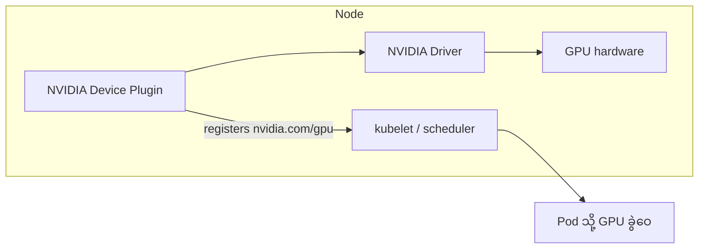
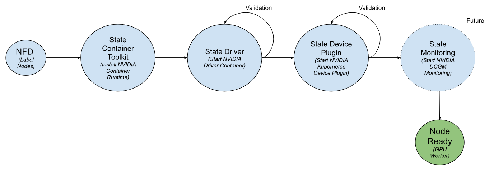

# Module 11 — Orchestration & Scheduling (ပြည့်စုံသော ရှင်းလင်းချက်)

> ဤ module ၏ ရည်ရွယ်ချက် — GPU ရာ/ထောင်ချီ ပါသော cluster တွင် job များ မည်သို့ စီမံခန့်ခွဲသလဲ၊ Kubernetes နှင့် Slurm မည်သို့ အလုပ်လုပ်သလဲ ဆိုသည်ကို နားလည်စေရန် ဖြစ်ပါသည်။

---

## 1. ပြဿနာ — GPU အများအပြားကို တစ်ပြိုင်နက် ဘယ်သူ စီမံမလဲ

GPU တစ်လုံးတည်း ရှိသော စက်တွင် script တစ်ခု တိုက်ရိုက် run ရုံနှင့် ပြီးပါသည်။ သို့သော် GPU ရာချီ၊ ထောင်ချီ ပါသော cluster တွင် ပြဿနာများ စတင်ပါသည် —

- user ၅၀ ထဲမှ **မည်သူက မည်သည့် GPU ကို မည်သည့်အချိန် ရမလဲ**
- တစ်ဦးက GPU အားလုံး ယူထားပါက ကျန်သူများ ဘယ်လို စောင့်ရမလဲ
- training job က node ၈ လုံး တစ်ပြိုင်နက် လိုသည် — node ၄ လုံးသာ ရပါက ဘယ်လို လုပ်မလဲ
- inference service က ၂၄/၇ အမြဲ run နေရမည် — batch job နှင့် ဘယ်လို ခွဲဝေမလဲ

ဤပြဿနာများကို ဖြေရှင်းပေးသည့် အလွှာကို **orchestration/scheduling** ဟု ခေါ်ပါသည်။ ကိရိယာ ၂ ခု အဓိက ရှိပါသည် — **Kubernetes** (cloud-native/inference ဘက်) နှင့် **Slurm** (HPC/research ဘက်)။ စာမေးပွဲတွင် ဤ ၂ ခု၏ ကွဲပြားမှုနှင့် GPU Operator component များကို မကြာခဏ မေးလေ့ ရှိပါသည် (Objective 3.2)။

---

## 2. Core Concept — Kubernetes + GPU

### GPU Resource Model

- Kubernetes သည် GPU ကို built-in resource အဖြစ် မသိပါ — **extended resource** (`nvidia.com/gpu`) အဖြစ်သာ မြင်ပါသည်
- Pod spec တွင် `resources.limits: {"nvidia.com/gpu": 2}` ထည့်ပါက scheduler က GPU ၂ လုံး ခွဲဝေပေးပါသည်
- GPU သည် **မလွှဲပြောင်းနိုင်သော (non-shareable) resource** — pod တစ်ခုတည်းသို့သာ ပေးနိုင်ပြီး အမှန်တကယ် မျှဝေချင်ပါက MIG သို့မဟုတ် time-slicing ဖြင့်သာ မျှဝေနိုင်ပါသည်

### Device Plugin Architecture

Kubernetes သည် GPU driver ကို ကိုယ်တိုင် မသိပါ — **NVIDIA Device Plugin** (daemon) က node ၏ GPU များကို resource အဖြစ် kubelet ဆီ တင်ပြပေးပါသည်။



### GPU Operator ⭐


*ပုံ — NVIDIA GPU Operator architecture (ရင်းမြစ်: NVIDIA Developer Blog)*

| Component | အလုပ် |
|---|---|
| NVIDIA driver | GPU driver |
| Container Toolkit | container မှ GPU access |
| Device Plugin | GPU resource registration |
| DCGM Exporter | metrics ထုတ်ပေး |
| Node Validator | node ကျန်းမာရေး စစ်ဆေး |

⚠️ ဤ component စာရင်းကို စာမေးပွဲတွင် မကြာခဏ မေးပါသည်။ **Network Operator** ကဲ့သို့ သီးခြား operator လည်း ရှိပြီး — device plugin (compute) နှင့် network operator (fabric) ကို မရှုပ်ပါစေနှင့်။


*ပုံ — GPU Operator state machine (ရင်းမြစ်: NVIDIA Developer Blog)*

### K8s Workload Types

- **Deployment/Service** — inference (24/7 replica)
- **Job/CronJob** — training/batch (ပြီးလျှင် ရပ်)
- **Leader/follower pattern** — multi-node training (master + worker)
- **Resource quota** — team အလိုက် GPU ခွဲဝေ

---

## 3. Core Concept — Slurm

HPC/research လောကတွင် စံချိန်တင် အသုံးများသော batch scheduler ဖြစ်ပါသည်။

- **Partition** — node အုပ်စု (K8s namespace ကဲ့သို့)
- `sbatch` — job တင်ခြင်း၊ `squeue` — အခြေအနေ ကြည့်ခြင်း၊ `sacct` — မှတ်တမ်း
- **Gang scheduling** ⭐ — job ၏ node အားလုံး တစ်ပြိုင်နက် ရရှိမှသာ စတင်ခြင်း — မဟုတ်ပါက node တချို့သာ ရပြီး ကျန် node များ စောင့်ဆိုင်း (fragmentation)

```
Gang scheduling မပါ:  [GPU 4 ရ] [GPU 4 စောင့်] → node တချို့ အလွတ်ထိုင်
Gang scheduling ပါ:   အားလုံး ရမှ စ → အားလုံး အလုပ်လုပ်
```

---

## 4. Scheduling သဘောတရား ၆ ခု နှင့် Commercial Platforms

### Scheduling concepts ၆ ခု

1. **Queue** — job များ စောင့်ဆိုင်းစာရင်း
2. **Priority** — ဦးစားပေး (preemption ဖြင့် ဖြတ်ယူနိုင်)
3. **Fair share** — အဖွဲ့အလိုက် မျှတစွာ ခွဲဝေ
4. **Quota** — သတ်မှတ် ပမာဏ ကန့်သတ်
5. **Gang scheduling** — node အားလုံး တစ်ပြိုင်နက်
6. **Preemption** — ဦးစားနည်း job ရပ်ပြီး ပိုအရေးကြီး job ထည့်ခြင်း

### Commercial Platforms

- **Run:ai** — Kubernetes ပေါ် GPU scheduling/monitoring/quotas/preemption
- **NVIDIA Base Command** — cluster OS / cloud platform

---

## 5. နှိုင်းယှဉ်ချက် — K8s vs Slurm နှင့် Job အသွင်အပြောင်း

| အချက် | Kubernetes | Slurm |
|---|---|---|
| အဓိက အသုံးပြုရာ | inference, microservice | HPC training, research |
| Job သဘော | long-running service | batch, checkpoint |
| Ecosystem | container, cloud-native | HPC tools (MPI) |
| ပေါင်းစပ်မှု | Run:ai ကဲ့သို့ GPU layer | native gang scheduling |

လက်တွေ့တွင် ၂ ခု တွဲသုံးခြင်းလည်း ရှိပါသည် (Slurm ဖြင့် training + K8s ဖြင့် serving)။

| Job အသွင် | သင့်လျော်သော mapping |
|---|---|
| **Training** | long-running, gang-scheduled, checkpoint → batch job |
| **Inference** | always-on, scale replicas → deployment/service |
| **Batch inference** | queue ထဲ ထည့်ပြီး ပြီးသည်အထိ လုပ်ဆောင် → job |

---

## 6. လက်တွေ့ Configuration (illustrative example များ)

ဥပမာ command များသည် အခြေခံ ပုံစံများသာ ဖြစ်ပြီး version/environment ပေါ် မူတည်၍ အသေးစိတ် ပြောင်းလဲနိုင်ပါသည်။

### Kubernetes — GPU တောင်းဆိုသော pod

```yaml
# Pod spec အစိတ်အပိုင်း — GPU 2 လုံး တောင်းဆိုခြင်း
resources:
  limits:
    nvidia.com/gpu: 2   # extended resource အဖြစ် GPU 2 လုံး ခွဲဝေခိုင်းခြင်း
```

```bash
kubectl describe node <node-name>   # node ၏ GPU resource များ စစ်ဆေးခြင်း
kubectl get pods -o wide            # pod များ မည်သည့် node ပေါ် ရောက်နေသည် ကြည့်ခြင်း
```

### Slurm — batch job တင်ခြင်း

```bash
# job script (ဥပမာ) — GPU 4 လုံး၊ node 2 လုံး တောင်းဆိုခြင်း
#SBATCH --gres=gpu:4        # node တစ်ခုချင်းစီအတွက် GPU 4 လုံး တောင်းဆိုခြင်း
#SBATCH --nodes=2           # node 2 လုံး တောင်းဆိုခြင်း
#SBATCH --job-name=train-job

sbatch train.sh   # job ကို queue ထဲ တင်ခြင်း
squeue -u $USER   # မိမိ job ၏ အခြေအနေ (PEND/RUNNING) ကြည့်ခြင်း
sacct             # ပြီးဆုံးသွားသော job များ၏ မှတ်တမ်းနှင့် runtime ကြည့်ခြင်း
```

---

## 7. လည်ပတ်မှု ပြဿနာများနှင့် စာမေးပွဲ Trap များ

### GPU Scheduling ပြဿနာ လက်တွေ့ ဥပမာများ

- **Fragmentation** — GPU 8 လုံးပါ node တွင် job များက GPU 2 စီ ယူထားပြီး GPU 16 လုံး job စောင့်နေရ — gang scheduling + backfill (စောင့်နေသော job ကြီးအား မဖြတ်ဘဲ အချိန်တို job ငယ်များ ထည့်ခြင်း)
- **Priority inversion** — အရေးငယ် job က GPU များ သိမ်းပိုက်ထား — priority + preemption
- **Quota enforcement** — team တစ်ခုက GPU အားလုံး ယူထား — fair share + quota

### Container — NGC

Training/inference container များကို **NGC catalog** မှ ဆွဲယူ အသုံးပြုပါသည် — CUDA + framework + optimization ပါပြီးသား။

### အဓိက မှားယွင်းနိုင်သော အချက်များ (Exam traps)

1. K8s ကိုယ်တိုင်က GPU မသိ — **Device Plugin** က တင်ပြပေး
2. GPU Operator components — driver, toolkit, device plugin, DCGM exporter, validator
3. Gang scheduling = Slurm ၏ အဓိက feature
4. Run:ai = K8s ပေါ် GPU platform
5. Training = batch job / Inference = deployment
6. Network Operator ≠ Device Plugin

---

## 8. Self-check

1. Kubernetes က GPU ကို မည်သို့ သိရှိအောင် ပြုလုပ်သလဲ။
2. GPU Operator ၏ component ၄ ခု ဖော်ပြပါ။
3. Gang scheduling ဆိုတာ ဘာလဲ၊ ဘာကြောင့် လိုအပ်သလဲ။
4. Inference service တစ်ခုကို Kubernetes ပေါ်တွင် မည်သည့် workload type ဖြင့် run သင့်သလဲ။
5. Fragmentation ပြဿနာကို ဖြေရှင်းရာတွင် မည်သည့် technique ၂ ခု အသုံးပြုနိုင်သလဲ။

**အဖြေများ**

1. NVIDIA Device Plugin က node ၏ GPU များကို extended resource `nvidia.com/gpu` အဖြစ် kubelet ဆီ တင်ပြပေးခြင်းဖြင့်
2. driver, container toolkit, device plugin, DCGM exporter, node validator
3. job ၏ node အားလုံး တစ်ပြိုင်နက် ရမှ စတင်ခြင်း — node တချို့သာ ရပြီး ကျန် node များ စောင့်ဆိုင်းနေခြင်း (fragmentation) ကို ရှောင်ရှားရန်
4. Deployment/Service (24/7 replica)
5. Gang scheduling + backfill

---

## 9. Official References

- NVIDIA GPU Operator: https://docs.nvidia.com/datacenter/cloud-native/gpu-operator/latest/
- NVIDIA Device Plugin for Kubernetes: https://github.com/NVIDIA/k8s-device-plugin
- Slurm: https://slurm.schedmd.com/documentation.html
- Kubernetes: https://kubernetes.io/docs/

---

## Technical review notes

- Section 6 ၏ command များသည် illustrative example များသာ ဖြစ်ပြီး output မပါဝင်ပါ — flag/option များသည် Slurm version နှင့် cluster config ပေါ် မူတည်၍ ပြောင်းလဲနိုင်သည် (needs verification)။
- GPU Operator ၏ component အမည်များ (Node Validator အပါအဝင်) သည် GPU Operator version အလိုက် အနည်းငယ် ကွဲပြားနိုင်သည် — စာမေးပွဲအတွက် မူလ စာရင်းအတိုင်း မှတ်သားပါ (needs verification)။
- Run:ai ကို ယခုအခါ NVIDIA Run:ai ဟု ခေါ်ဆိုလေ့ရှိပြီး လက်ရှိ feature စာရင်းသည် ထုတ်ကုန် version ပေါ် မူတည်ပါသည် (needs verification)။
